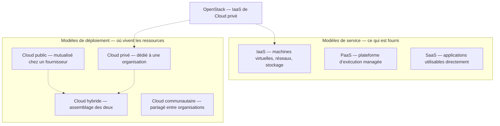
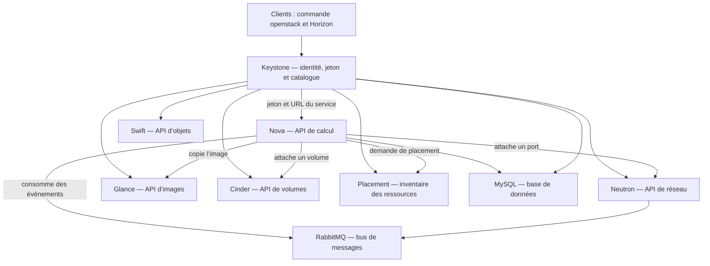
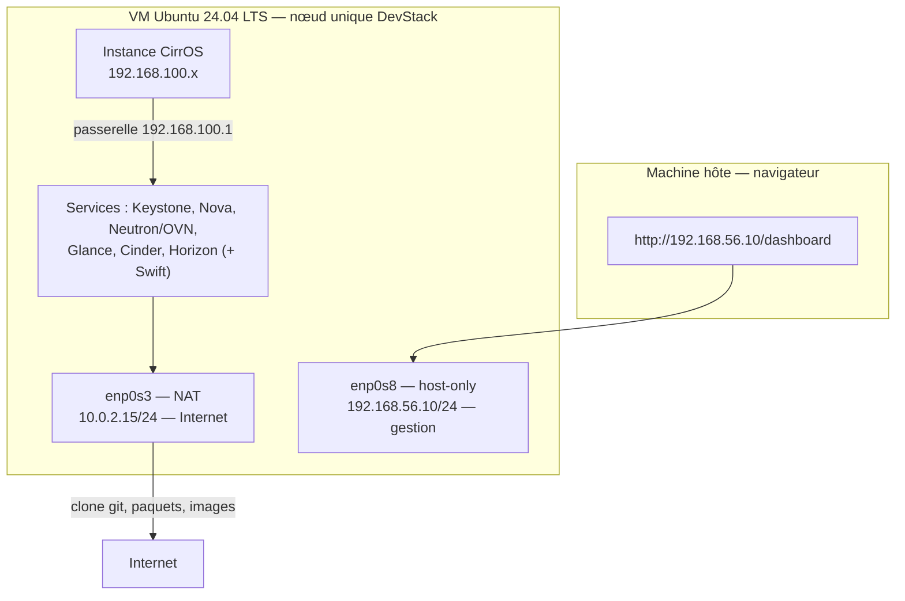
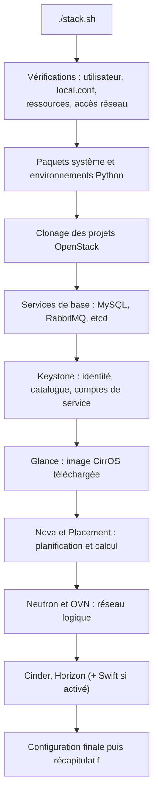
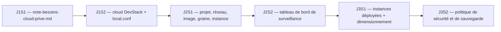

# Configuration d’un cloud d’entreprise avec OpenStack — JOUR 1

## Concepts fondamentaux du Cloud privé, présentation d’OpenStack et installation de base (26/10/2026)

## 0. PRÉAMBULE — Créer sa VM sous Windows + VirtualBox

**Scénario unique pour ce support : l’apprenant crée intégralement sa VM de A à Z.** Créer vous-même la machine virtuelle `lab-openstack` sous Windows avec Oracle VirtualBox 7.x, installer Ubuntu Server 24.04.5 LTS, configurer le réseau **NAT + Host-Only**, créer l’utilisateur `stack`, puis installer DevStack `stable/2026.1`. Tous les LAB, exercices et vérifications se font dans cette VM, de bout en bout, depuis le navigateur Windows pour accéder à Horizon. **Aucune VM n’est fournie.** Prévoir plusieurs heures pour la création et l’installation (`stack.sh` prend 30 à 90 minutes). Il est normal que l’installation se termine en fin de journée.

Ce préambule se traite en amont de S1. Chaque bloc précise s’il s’exécute sur la machine hôte (Windows + VirtualBox) ou dans la VM.

**Identifiants du laboratoire.** Une seule valeur suffit : `lab123`. Valeur utilisée dans ce laboratoire, sans rapport avec un mot de passe d’entreprise, jamais réutilisée ailleurs.

| Élément | Valeur |
|---------|--------|
| Machine virtuelle | `lab-openstack` (créée par l’apprenant) |
| Hyperviseur | Oracle VirtualBox 7.x (Windows) |
| OS invité | Ubuntu Server 24.04.5 LTS |
| Adresse de gestion | `192.168.56.10/24` (adaptateur host-only `vboxnet0`, réseau `192.168.56.0/24`) |
| Accès Internet VM | Via NIC1 NAT (apt, git, `stack.sh`) ; instances via routeur Neutron + SNAT |
| Compte de la VM | `stack` / `lab123` (jamais `root`) |
| Compte administrateur OpenStack | `admin` / `lab123` (Horizon et ligne de commande) |
| Compte de démonstration | `demo` / `lab123` (créé par DevStack) |
| Phrase secrète de chiffrement | `ENCRYPTION_PASS=lab123` (sauvegardes chiffrées des configurations, jour 3) |
| Interface Horizon | `http://192.168.56.10/dashboard` (navigateur de la machine hôte Windows) |

**Accès à Horizon (fiche rapide).** L’interface se pilote depuis le navigateur de la machine hôte Windows, sans rien installer :

1. Ouvrir le navigateur sur la machine hôte Windows.
2. Saisir `http://192.168.56.10/dashboard`.
3. Ouvrir une session avec `admin` / `lab123` (domaine `Default`, projet `admin`).
4. Vérifier : le tableau de bord s’affiche, l’onglet Projet et le menu Admin sont visibles.

| Symptôme | Vérification rapide |
|----------|---------------------|
| Page blanche | `ping 192.168.56.10` depuis l’invite de commandes Windows (réseau host-only) |
| Pas d’Internet depuis la VM | `ping 8.8.8.8` depuis la VM (vérifier NIC1 en NAT) |
| Connexion refusée | `systemctl status apache2` dans la VM |
| Mot de passe refusé | `ADMIN_PASSWORD=lab123` dans `/opt/stack/devstack/local.conf` |

> **Pourquoi ce préambule ?** — Un laboratoire échoue rarement sur OpenStack : il échoue sur l’environnement qui l’accueille (VM non créée, adaptateurs réseau manquants, virtualisation imbriquée inactive, IP mal configurée, Hyper-V/WSL2/VBS). Créer la VM soi-même dès le début permet de comprendre chaque étape et d’être autonome en cas de réinstallation. **Temps à prévoir** : 2-4 heures pour la VM + Ubuntu + réseau + DevStack. `stack.sh` prend 30-90 minutes et doit tourner sans interruption.

**Création de la VM sous Windows + VirtualBox (étapes obligatoires).**

1. **Prérequis** — VirtualBox 7.x installé (https://www.virtualbox.org), hôte avec 16 Go recommandé (8 Go possible avec une VM réduite), 80 Go d’espace disque libre sur un disque local, virtualisation matérielle activée dans le BIOS (VT-x pour Intel, AMD-V pour AMD). Télécharger l’ISO Ubuntu Server 24.04.5 LTS officielle.
2. **Créer le réseau host-only** — *Fichier → Outils → Réseau → onglet Host-only Networks → Créer*. Configurer l’interface : IPv4 `192.168.56.1`, Masque `255.255.255.0`, DHCP désactivé. Sous Windows, l’interface apparaît comme `VirtualBox Host-Only Ethernet Adapter` ; le nom logique `vboxnet0` existe surtout sous Linux.
3. **Créer la VM** — *Machine → Nouvelle* : Nom `lab-openstack`, Dossier (disque local), Type `Linux`, Version `Ubuntu (64-bit)`. Mémoire : 10-12 Go si l’hôte a 16 Go ou plus, 4-6 Go si l’hôte a 8 Go. Disque dur virtuel : VDI, Dynamiquement alloué, 80 Go (60 Go minimum).
4. **Configurer les adaptateurs réseau** — *Configuration → Réseau* :
   - Adaptateur 1 : Activé, Attaché à **NAT** (donne Internet à la VM)
   - Adaptateur 2 : Activé, Attaché à **Réseau host-only**, sélectionner le réseau créé à l’étape 2
5. **Vérifier la virtualisation imbriquée** — *Configuration → Système → Processeur* : cocher *Activer la virtualisation imbriquée (VT-x/AMD-V)*. Nombre de processeurs : 4 minimum. Si Hyper-V, WSL2 ou l’Isolation du noyau (VBS) sont actifs sous Windows 11 et que `/dev/kvm` reste absent dans la VM, les désactiver.
6. **Monter l’ISO** — *Configuration → Stockage* : ajouter `ubuntu-24.04.5-live-server-amd64.iso`.
7. **Installer Ubuntu Server** — Démarrer la VM et installer Ubuntu Server 24.04.5 LTS. Créer l’utilisateur `stack` avec le mot de passe `lab123` (le compte s’installe dans `/home/stack`). **Installer le serveur OpenSSH** (obligatoire pour la suite ; s’il n’est pas proposé, il sera ajouté à l’étape 10).
8. **Identifier les interfaces** — Dans la VM : `ip link` puis `ip -br address`. Relever le nom de l’interface NAT (souvent `enp0s3`) et celui de l’interface host-only (souvent `enp0s8`). Ne pas se fier aveuglément au nom : VirtualBox peut attribuer `enp0s9` selon l’ordre des adaptateurs.
9. **Configurer le réseau avec `netplan`** — Créer ou modifier le fichier YAML (`sudo nano /etc/netplan/50-cloud-init.yaml` ou le fichier présent), puis appliquer :

```bash
# Contenu type du fichier /etc/netplan/50-cloud-init.yaml (adapter les noms d’interfaces)
network:
  version: 2
  ethernets:
    enp0s3:                 # interface NAT : DHCP, fournit Internet
      dhcp4: true
    enp0s8:                 # interface host-only : adresse fixe de gestion
      dhcp4: false
      addresses: [192.168.56.10/24]
      # pas de routes/default : le réseau de gestion ne porte pas Internet
```

```bash
# Restreindre les droits (netplan refuse un fichier trop permissif)
sudo chmod 600 /etc/netplan/*.yaml
# Vérifier la syntaxe avant application
sudo netplan try
# Appliquer (ou valider la proposition de netplan try)
sudo netplan apply
# Contrôler le résultat
ip -br address
```

10. **Vérifier la connectivité** — Depuis Windows (invite de commandes) : `ipconfig` (l’interface host-only doit porter `192.168.56.1`), puis `ping -n 4 192.168.56.10` (`-n` sous Windows, `-c` sous Linux). Depuis la VM : `ip route | grep default` (passerelle NAT présente), `resolvectl status` (DNS), `ping -c 2 8.8.8.8`. Si `ping 8.8.8.8` échoue alors que la passerelle existe, corriger le DNS via `netplan` (`nameservers: addresses: [8.8.8.8, 1.1.1.1]`). Si SSH n’est pas actif : `sudo apt install -y openssh-server` puis `sudo systemctl enable --now ssh`.

> **Vérification Internet** : NIC1 en NAT donne un accès sortant à la VM pour `apt update`, téléchargement de DevStack et mise à jour des paquets. NIC2 en Host-Only permet l’accès depuis le navigateur Windows vers `http://192.168.56.10/dashboard`. DevStack utilisera `HOST_IP=192.168.56.10` et configurera Neutron avec un routeur pour donner Internet aux instances via SNAT.

**Vérification critique du réseau host-only (OBLIGATOIRE)**

Avant de configurer la VM, vérifier la configuration du réseau host-only sur la machine hôte.

**Sous Windows (Invite de commandes en tant qu'administrateur) :**
```cmd
ipconfig | findstr "VirtualBox"
```
L'interface `VirtualBox Host-Only Ethernet Adapter` doit apparaître avec l'IP `192.168.56.1`.

**Vérification dans VirtualBox :**
1. Ouvrir VirtualBox → Fichier → Gestionnaire de réseau hôte
2. Onglet « Réseau hôte uniquement » → sélectionner `vboxnet0` (ou équivalent)
3. **DHCP doit être DÉSACTIVÉ** (case décochée)
4. Configuration manuelle : Adresse IPv4 `192.168.56.1`, Masque de sous-réseau `255.255.255.0`

> **Important** : Si DHCP est activé, le désactiver impérativement. Un DHCP actif peut attribuer une autre adresse à l'hôte et rendre impossible l'accès à `192.168.56.10`.

**Exercice 0.1 — Création de la VM et ressources (10 min)**

```text
# Côté machine hôte (Invite de commandes Windows) : la VM est enregistrée
"C:\Program Files\Oracle\VirtualBox\VBoxManage.exe" list vms
# Si VBoxManage est dans le PATH, la commande nue suffit
# list vms : liste les VM enregistrées ; la ligne « lab-openstack » doit apparaître
```

```text
# Côté machine hôte : ressources attribuées
"C:\Program Files\Oracle\VirtualBox\VBoxManage.exe" showvminfo "lab-openstack" | findstr /C:"Memory" /C:"CPUs"
# findstr : filtre sous Windows ; vérifier 4 CPU minimum et la RAM allouée
# Les libellés exacts varient selon la version de VirtualBox : sans filtre,
#   showvminfo affiche aussi la mémoire et le nombre de processeurs
```

- [ ] VM `lab-openstack` créée et enregistrée dans VirtualBox
- [ ] RAM cohérente avec l’hôte (10-12 Go si hôte >= 16 Go, 4-6 Go si hôte 8 Go), 4 vCPU, disque 80 Go (60 Go minimum). Hyper-V/WSL2/VBS désactivés si la virtualisation imbriquée échoue.
- [ ] Adaptateurs : **NAT** (enp0s3) et **Host-Only** (nom Windows `VirtualBox Host-Only Ethernet Adapter`, logique `vboxnet0`) configurés (DHCP host-only désactivé), IP hôte `192.168.56.1/24`
- [ ] Virtualisation imbriquée activée dans les paramètres VirtualBox (VM éteinte pour modification si nécessaire). Vérifier `/dev/kvm` dans la VM.
- [ ] Interfaces vérifiées dans la VM : `ip link` et `ip -br address`. Identifier `enp0s3` (NAT/DHCP) et `enp0s8` (host-only) avant configuration.
- [ ] Réseau configuré avec `netplan` : `enp0s3` DHCP, `enp0s8` statique `192.168.56.10/24` (sans gateway). Appliquer `sudo netplan apply`, `chmod 600` sur le YAML.
- [ ] Depuis Windows : `ping -n 4 192.168.56.10` répond (utiliser `-n`, pas `-c`). `VBoxManage` utilisable avec chemin complet si absent du PATH.
- [ ] Depuis la VM : `ip route | grep default` (passerelle NAT), `resolvectl status` (DNS), `ping -c 2 8.8.8.8` répond. L’accès à Horizon sera vérifié après l’installation de DevStack (J1S2).

**Exercice 0.2 — Machine virtuelle et virtualisation imbriquée (5 min)**

```text
# Côté machine hôte (VM éteinte) : activer la virtualisation imbriquée
VBoxManage modifyvm "lab-openstack" --nested-hw-virt on
# modifyvm : modifie les paramètres de la VM
# --nested-hw-virt on : autorise VT-x/AMD-V à l'intérieur de la VM
```

```text
# Côté machine hôte : le processeur expose bien la virtualisation matérielle
powershell -Command "Get-CimInstance Win32_Processor | Select-Object -ExpandProperty VirtualizationFirmwareEnabled"
# Dans une fenêtre PowerShell : Get-CimInstance Win32_Processor | Select-Object VirtualizationFirmwareEnabled
# wmic cpu get VirtualizationFirmwareEnabled reste possible sur un Windows ancien,
#   mais wmic est obsolète depuis Windows 11 24H2
# Doit retourner True (VT-x/AMD-V activé dans le BIOS)
```

```bash
# Dans la VM : contrôle du périphérique KVM
ls -l /dev/kvm
# Le fichier /dev/kvm doit exister : les instances utiliseront KVM (rapide)

# Outil de diagnostic fourni par le paquet cpu-checker
sudo apt update && sudo apt install -y cpu-checker
kvm-ok
# kvm-ok : confirme que la virtualisation matérielle est exploitable ;
#   un refus n’arrête rien : DevStack bascule en émulation QEMU (instances lentes)
```

- [ ] `--nested-hw-virt on` appliqué sur la VM (VM éteinte)
- [ ] Virtualisation matérielle active côté hôte et `/dev/kvm` présent dans la VM
- [ ] `kvm-ok` conclut positivement (ou refus constaté et compris). Si `/dev/kvm` absent malgré VT-x/AMD-V activé, vérifier Hyper-V/WSL2/VBS (les désactiver) ou BIOS, et prévoir mode QEMU (plus lent).

**Exercice 0.3 — Réseau de gestion et accès SSH (5 min)**

```text
REM Côté machine hôte Windows : l’interface host-only est joignable
ipconfig
REM vérifier que l’interface "VirtualBox Host-Only Ethernet Adapter" porte 192.168.56.1
ping -n 4 192.168.56.10
REM -n 4 : quatre paquets puis arrêt (Windows ; -c est l’option Linux)
REM quatre réponses = adaptateur host-only configuré
REM en cas d’échec : vérifier enp0s8 dans la VM, voir « Réseau du laboratoire »
```

```bash
# Connexion à la VM avec le compte de laboratoire
ssh stack@192.168.56.10
# Premier appel : valider l’empreinte de la clé (« yes »), puis saisir le
#   mot de passe du laboratoire : lab123 (valeur utilisée dans ce laboratoire)
```

```bash
# Dans la VM (après connexion) : le service SSH est actif et persistant
systemctl is-active ssh
# doit renvoyer « active » ; unité nommée « ssh » sur Ubuntu 24.04

systemctl is-enabled ssh.socket
# doit renvoyer « enabled » : sur Ubuntu 24.04, le serveur SSH est déclenché
#   par socket (ssh.socket actif, ssh.service « disabled » mais déclenché par le
#   socket) ; la connexion fonctionnera au prochain démarrage

# Contrôle de l’identité et de l’adresse de gestion
whoami && ip -br address
# whoami : « stack » ; ip -br address : 192.168.56.10/24 doit figurer sur enp0s8
```

- [ ] `ping -n 4 192.168.56.10` reçoit quatre réponses depuis la machine hôte Windows
- [ ] `ssh stack@192.168.56.10` ouvre une session, `whoami` affiche `stack`
- [ ] `systemctl is-active ssh` renvoie `active`, `systemctl is-enabled ssh.socket` renvoie `enabled` (OpenSSH serveur installé), `192.168.56.10/24` visible sur `enp0s8`

**Exercice 0.4 — Identifiants et phrase secrète du laboratoire (5 min)**

Le tableau d’ouverture donne tous les identifiants : `stack`, `admin`, `demo` et `ENCRYPTION_PASS`, de valeur `lab123` pour chacun. Aucun autre mot de passe n’est à inventer : `local.conf` (section 6) reprend exactement ces valeurs. `ENCRYPTION_PASS` n’est pas chargée par défaut ; elle s’exporte dans la session courante chaque fois qu’un outil en demande une.

```bash
# Dans la VM : export de la phrase secrète de chiffrement
export ENCRYPTION_PASS=lab123
# export : la variable devient visible des commandes suivantes de cette session
# Une nouvelle session de terminal impose de relancer cette commande

# Contrôle de présence, sans afficher la valeur
test -n "$ENCRYPTION_PASS" && echo "ENCRYPTION_PASS chargée"
# test -n : vrai si la chaîne n’est pas vide ; la valeur elle-même n’apparaît
#   jamais dans la sortie
```

- [ ] Les quatre identifiants sont connus : `stack`/`lab123` (SSH), `admin`/`lab123` (Horizon et ligne de commande), `demo`/`lab123` (démonstration), `ENCRYPTION_PASS=lab123` (chiffrement)
- [ ] `ENCRYPTION_PASS` exportée, contrôle `test -n` concluant sans aucune valeur affichée
- [ ] Aucun identifiant hors laboratoire (compte réel, jeton, clé privée) n’a été écrit dans un fichier du dépôt ni dans un message de commit

> **Attention (identifiants hors laboratoire)** — Les quatre valeurs ci-dessus sont publiées volontairement dans ce support : elles sont propres au laboratoire. Tout autre secret — jeton d’API, mot de passe d’entreprise, clé privée — recopié dans un fichier versionné, un message de commit ou une capture reste dans l’historique après correction : il faudrait réécrire l’historique, ce que ce projet interdit. Aucun secret réel dans un commit, aucun secret réel dans un message.

Les quatre contrôles passés, le laboratoire est défini : VM `lab-openstack` joignable en `192.168.56.10` sous le compte `stack`, virtualisation imbriquée active, identifiants connus. Les sections 5 à 7 (compte `stack`, `local.conf`, relecture de l’installation DevStack) s’appuient sur cet état des lieux.

---

**Fil conducteur :** Le matin, l’analyse des besoins d’un cas d’entreprise produit une note, `note-besoins-cloud-prive.md`, qui servira de référence au dimensionnement du jour 3. L’après-midi, on poursuit avec la carte des services, puis on installe et met en service DevStack `stable/2026.1` dans la VM `lab-openstack` créée sous Windows + VirtualBox (NAT + Host-Only). On vérifie l’accès à Horizon depuis Windows et l’accès Internet de la VM. Ce cloud sert sans interruption aux jours 2 et 3.

---

## Objectifs du Jour

- Définir l’informatique en nuage et distinguer les modèles de service (IaaS, PaaS, SaaS) des modèles de déploiement (public, privé, hybride, communautaire).
- Analyser le besoin d’un Cloud privé à partir d’un cas d’entreprise et produire une note d’analyse des besoins exploitable pour le dimensionnement.
- Situer OpenStack : histoire, gouvernance, cycles de versions et positionnement face à VMware vSphere, Microsoft Hyper-V et Kubernetes.
- Décrire le rôle de chaque service OpenStack (Keystone, Nova, Neutron, Glance, Cinder, Swift, Horizon, Placement) et les interactions entre eux.
- Créer la VM `lab-openstack` sous Windows + VirtualBox (NAT + Host-Only), installer Ubuntu Server 24.04.5 LTS, configurer le réseau `netplan` et vérifier l’accès Internet.
- Créer/configurer le compte `stack` avec droits `sudo` sans mot de passe, cloner DevStack `stable/2026.1` dans `/opt/stack/devstack`.
- Installer et mettre en service DevStack via `stack.sh` (prévoir 30-90 min), vérifier le journal `/opt/stack/logs/stack.sh.log`.
- Vérifier le cloud à l’aide de la ligne de commande (jeton, catalogue, points d’accès, hyperviseur) et de l’interface Horizon depuis Windows `http://192.168.56.10/dashboard`.

---

## Planning du Jour

| Séquence | Horaires | Thème | Durée |
|----------|----------|-------|-------|
| S1 | 09h00-09h15 | Accueil, tour de table, objectifs et fil conducteur des trois jours | 15 min |
| S1 | 09h15-10h15 | Concepts fondamentaux : définition du Cloud, IaaS/PaaS/SaaS, public/privé/hybride | 1 h |
| S1 | 10h15-11h15 | Étude de cas : analyse des besoins pour un Cloud privé (lab) | 1 h |
| S1 | 11h15-12h00 | Présentation d’OpenStack, partie 1 : histoire, gouvernance, vue d’ensemble | 45 min |
| — | 12h00-13h00 | Pause déjeuner | 1 h |
| S2 | 13h00-13h45 | Carte des services : Keystone, Nova, Neutron, Glance, Cinder, Swift, Horizon, Placement | 45 min |
| S2 | 13h45-14h15 | Cas d’usage en entreprise et parcours visuel d’Horizon | 30 min |
| S2 | 14h15-14h45 | Installation et mise en service de DevStack (lab) | 30 min |
| S2 | 14h45-15h30 | Comprendre l’installation : `local.conf` et `stack.sh` (lab) | 45 min |
| S2 | 15h30-16h00 | Vérification finale et synthèse | 30 min |

---

## S1 — Concepts fondamentaux du Cloud privé et présentation d’OpenStack (09h00-12h00)

### Objectifs

- Définir l’informatique en nuage et ses cinq caractéristiques (référence NIST).
- Distinguer les modèles de service (IaaS, PaaS, SaaS) des modèles de déploiement (public, privé, hybride, communautaire).
- Appliquer la méthode d’analyse des besoins à un cas d’entreprise et livrer la note.
- Situer OpenStack : histoire, gouvernance, cycles de versions, positionnement face à VMware, Hyper-V et Kubernetes.

### Contenu Théorique

#### 1. Qu’est-ce que l’informatique en nuage ?

L’**informatique en nuage** (« cloud computing » en anglais) désigne la mise à disposition, à la demande par API, de ressources informatiques virtualisées (machines virtuelles, réseaux, stockage) par un fournisseur, avec allocation dynamique, isolation par locataire et mesure de la consommation. La définition de référence, publiée par le National Institute of Standards and Technology (NIST) dans la publication spéciale 800-145 (2011), décrit le Cloud comme un modèle permettant un accès commode, à la demande et omniprésent à un ensemble configurable de ressources informatiques partagées, qui peuvent être rapidement provisionnées puis libérées avec un effort de gestion minimal.

Techniquement, le fournisseur exploite une infrastructure physique mutualisée, expose des API de provisionnement et comptabilise la consommation de chaque locataire. L’utilisateur appelle ces API pour créer, démarrer ou libérer des ressources sans accéder au matériel ni aux composants d’orchestration. La ressource est allouée à la demande, isolée par locataire et facturée selon l’usage mesuré.

Cinq caractéristiques définissent formellement un système Cloud :

| Caractéristique | Description | Exemple dans le laboratoire |
|-----------------|-------------|------------------------------|
| **Self-service à la demande** (libre-service) | L’utilisateur provisionne lui-même les ressources, sans intervention de l’administrateur | Création d’une instance depuis Horizon ou la ligne de commande |
| **Large accès au réseau** | Accès aux ressources depuis tout point par des moyens standardisés (API) | Appels d’API REST depuis `openstack` ou `curl` |
| **Regroupement des ressources** | Les ressources physiques du fournisseur sont mutualisées et attribuées dynamiquement aux instances de plusieurs locataires (*multi-tenant*) | Les vCPU et la mémoire de l’hôte sont répartis entre les instances de plusieurs projets |
| **Rapidité d’élasticité** | Les ressources sont ajustées à la hausse ou à la baisse rapidement, proportionnellement au besoin | Ajout d’une instance en quelques minutes |
| **Service mesuré** | La consommation est comptabilisée et contrôlée automatiquement | Quotas par projet, consultation des quotas et des usages |

> **Concept clé** — Le Cloud n’est pas une technique, c’est un **modèle de service**. La virtualisation (KVM, VMware) n’est qu’une des technologies qui le rendent possible. Une machine virtuelle dans un hyperviseur isolé n’est pas un Cloud : il lui manque l’automatisation, l’interface de self-service, la facturation à l’usage et l’isolation entre locataires. On peut donc faire de la virtualisation sans Cloud, mais pas de Cloud sans automatisation.

> **Bon à savoir** — La référence NIST (SP 800-145, *The NIST Definition of Cloud Computing*, Mell et Grance, 2011) est la définition citée dans les documents d’architecture et les appels d’offres. Deux de ses termes sont des anglicismes assumés : *provisioning* (mise à disposition) et *multi-tenant* (multi-locataire, partagé entre plusieurs clients).

> **Pourquoi le « service mesuré » est-il central en entreprise ?** — Sans comptabilité de l’usage, impossible de répartir un coût de centre informatique entre directions, de détecter un abus ou de justifier un dimensionnement. C’est ce service qui rend possible la gouvernance des quotas (jour 2) et le dimensionnement (jour 3).

#### 2. Les trois modèles de service : IaaS, PaaS, SaaS

Le modèle de service décrit **la couche d’exploitation prise en charge par le fournisseur**. Plus cette couche est haute, moins l’utilisateur administre de composants, et moins il en contrôle la configuration.

- L’**infrastructure en service** (IaaS, *Infrastructure as a Service*) fournit des ressources virtualisées : machines virtuelles, réseaux, stockage. L’utilisateur installe et administre le système d’exploitation et les applications.
- La **plateforme en service** (PaaS, *Platform as a Service*) fournit en plus une plateforme d’exécution prête à l’emploi (moteur d’applications, base de données managée). L’utilisateur ne gère que son code et ses données.
- Le **logiciel en service** (SaaS, *Software as a Service*) fournit l’application elle-même, directement utilisable.

| Critère | IaaS | PaaS | SaaS |
|---------|------|------|------|
| **Ce que fournit le fournisseur** | Serveurs virtuels, réseaux, stockage | Plateforme d’exécution et outillage | L’application complète |
| **Ce que gère l’utilisateur** | Système d’exploitation, middleware, applications, données | Code applicatif et données | Rien, si ce n’est la configuration métier |
| **Ce que gère le fournisseur** | Matériel, virtualisation, réseau physique | + runtimes, base de données, échelle automatique | + maintenance de l’application |
| **Exemples** | OpenStack, VMware vSphere, offres de machines virtuelles | Hébergement d’applications managé, plateformes de déploiement | Messagerie électronique, gestion de contacts en ligne |
| **Quand le choisir** | Contrôle maximal, charges hétérogènes, contraintes de conformité | Accélération du développement | Besoin métier standard, pas de différenciation technique |

> **Pourquoi OpenStack est-il un IaaS ?** — OpenStack expose des API qui créent des machines virtuelles, des réseaux et des volumes : c’est exactement la définition d’une infrastructure en service. Toute la formation se place à ce niveau : nous administrerons l’infrastructure elle-même, donc le système d’exploitation des instances restera notre responsabilité (mise en sécurité incluse).

#### 3. Les quatre modèles de déploiement

Le modèle de déploiement décrit **où vivent les ressources et à qui elles appartiennent**. Les deux notions (service et déploiement) se croisent : on peut consommer du SaaS sur un Cloud privé, et du IaaS sur un Cloud public.

| Critère | Cloud public | Cloud privé | Cloud hybride | Cloud communautaire |
|---------|--------------|-------------|---------------|---------------------|
| **Propriété des ressources** | Fournisseur tiers (prestataire commercial) | Une organisation (ou dédiée à elle seule) | Part des deux | Plusieurs organisations partageant un même intérêt |
| **Locataires** | Nombreux, mutualisés | Uniquement l’organisation | Selon la charge | Organisations appartenant à la communauté |
| **Accès** | Internet public | Réseau d’entreprise ou lien dédié | Réseau d’entreprise + lien vers le public | Réseau de la communauté |
| **Sécurité et conformité** | Dépendantes du fournisseur (traçabilité à vérifier) | Contrôle total et maîtrise des localisations | Fractionnée entre les deux environnements | Règles communes définies par la communauté |
| **Coûts** | À l’usage, opérationnels (OPEX), sans investissement initial | Investissement initial (CAPEX) puis exploitation | Optimisation par la répartition des charges | Mutualisation des coûts |
| **Cas d’usage** | Développement, pics de charge, services non critiques | Données sensibles, applications critiques, souveraineté | Reprise d’activité, extension souple | Recherche, services publics partagés, consortiums |



**Fig 1** — Taxonomie des modèles de Cloud : les modèles de service (en haut) et les modèles de déploiement (en bas) sont deux grilles indépendantes que l’on croise pour qualifier toute offre. OpenStack se situe à l’intersection IaaS et Cloud privé.

> **Attention (hébergement)** — Un Cloud privé n’est pas nécessairement « chez soi » : il peut être hébergé chez un opérateur, à condition d’être réservé à une seule organisation. Pour des administrations soumises à des exigences de localisation, la question à poser n’est pas « où sont les machines ? », mais « qui accède aux données et sous quelle juridiction ? ». Cette précision figure dans l’analyse des besoins du lab suivant.

#### 4. Avantages et enjeux du Cloud privé

Le Cloud privé répond à un objectif précis : obtenir l’agilité d’un Cloud public sans en céder le contrôle. Chaque avantage s’accompagne d’une contrepartie à assumer, qu’il faut inscrire dans la note d’analyse des besoins.

| Avantage | Ce qu’il apporte | Enjeu et condition de réussite |
|----------|------------------|--------------------------------|
| **Souveraineté et conformité** | Localisation des données maîtrisée, périmètre d’administration défini | La responsabilité devient totale : durcissement, sauvegarde, journalisation |
| **Isolation entre locataires** | Séparation stricte des équipes, des projets et des données | L’isolation doit être conçue (projets, réseaux, quotas), elle ne naît pas d’elle-même |
| **Maîtrise des coûts** | Passage d’un investissement (CAPEX) à un coût d’exploitation (OPEX) | Le coût d’exploitation comprend les compétences : un Cloud privé se gère |
| **Personnalisation** | Choix des services, des versions et des politiques de sécurité | Maintenance, mises à jour et montée de version assurées en interne |
| **Réutilisation des ressources** | Mutualisation des serveurs physiques entre services | L’élasticité est bornée par le matériel disponible : le dimensionnement compte |
| **Interopérabilité** | API ouvertes, absence d’enfermement fournisseur | Migration et reprise d’activité à prévoir dès la conception |

> **Bonnes pratiques** — Un Cloud privé réussi commence par un périmètre restreint : un cas d’usage pilote, des équipes identifiées, des quotas initiaux conservateurs et un critère de succès mesurable (par exemple, la mise à disposition d’un environnement de test en moins d’une heure). La généralisation vient après la preuve, pas avant.

#### 5. Étude de cas : analyse des besoins pour un Cloud privé

L’étude de cas occupe le bloc de 10h15 à 11h15. Elle n’est pas une démonstration : elle produit un livrable, la **note d’analyse des besoins**, enregistrée sous le nom `note-besoins-cloud-prive.md` dans le répertoire de travail de la formation. Cette note sera relue au jour 3 pour justifier le dimensionnement de l’architecture cible ; elle constitue le premier livrable de la formation et l’entrée du calcul de dimensionnement.

**Contexte (fictif et représentatif du contexte des apprenants).** Une direction des systèmes d’information d’une administration souhaite substituer à la multiplication des machines virtuelles isolées un cloud privé unique. Elle doit y héberger : des environnements de test et de recette pour une douzaine d’équipes projet ; des services web internes accessibles depuis le réseau de l’administration ; le stockage de documents métier sensibles ; des bancs d’essai pour de nouvelles applications. Contraintes exprimées : les données ne doivent pas sortir du périmètre de l’administration, chaque direction ne doit pas voir les ressources des autres, et le coût doit rester prévisible et répartissable.

**Méthode : six questions structurantes.** Toute analyse de besoins se ramène à six questions. Chacune a une traduction technique directe dans OpenStack, que l’on rattachera dans la correction :

| N° | Question posée | Ce qu’elle conditionne dans OpenStack | Traduction journalière |
|----|----------------|----------------------------------------|------------------------|
| 1 | Qui va utiliser la plateforme et sous quelle autorité ? | Domaines, projets, utilisateurs, rôles (Keystone) | Nombre de projets, rôles par projet |
| 2 | Quelles ressources de calcul et à quelle cadence ? | Graines (flavors), quotas, planification (Nova, Placement) | Nombre et taille des machines virtuelles |
| 3 | Comment isoler les flux et les équipes ? | Réseaux, sous-réseaux, routeurs, groupes de sécurité (Neutron) | Nombre de réseaux locataires |
| 4 | Quelles données, quel niveau de sensibilité, quelle durée de rétention ? | Images (Glance), volumes (Cinder), objets (Swift) | Type de stockage et politique de sauvegarde |
| 5 | Quelle disponibilité, quelles performances, quel budget ? | Dimensionnement matériel, redondance, choix des services | Scénario matériel (jour 3) |
| 6 | Comment l’exploiter au quotidien ? | Journalisation, surveillance, mises à jour | Rôles d’exploitation, outils de surveillance (jour 2) |

> **Concept clé** — La note d’analyse des besoins est le **point d’entrée du dimensionnement**. Dimensionner avant d’avoir répondu aux six questions conduit à acheter du matériel dont personne ne se servira, ou à construire une plateforme qui refusera la première demande réelle. D’où la production de ce livrable avant même l’installation d’OpenStack.

Enchaînement des livrables : la note (jour 1) éclaire le dimensionnement (jour 3) ; le cloud installé (jour 1) reçoit la configuration (jour 2), puis les instances et la politique de sécurité (jour 3).

#### 6. OpenStack, partie 1 : histoire et cycles de versions

OpenStack est né en 2010 d’une convergence entre un projet de la NASA (Nebula) et les besoins de Rackspace, hébergeur commercial. Le code a été publié sous licence libre (Apache 2.0) en octobre 2010, invitant la communauté à s’en emparer. La croissance a rassemblé les grands acteurs de l’infrastructure (entreprises de virtualisation, hébergeurs, distributeurs Linux), au point qu’une structure juridique dédiée a pris en charge la gouvernance.

| Année | Événement | Portée |
|-------|-----------|--------|
| 2010 | Publication conjointe du code de la NASA et de Rackspace (octobre) | Naissance du projet, licence Apache 2.0 |
| 2011-2012 | Premières versions publiées (séries alphabétiques) | Essor de la communauté et des déploiements |
| 2012 | Création de la **OpenStack Foundation** | Structure de gouvernance indépendante, financement et marque |
| 2013-2018 | Généralisation en entreprise et chez les opérateurs télécoms | Cloud privé et public de grande taille |
| 2019 | Le sommet du projet devient l’**Open Infrastructure Summit** | Élargissement du périmètre au-delà du seul Cloud |
| 2020-2021 | La fondation prend le nom d’**Open Infrastructure Foundation** (OpenInfra) | Gouvernance élargie à d’autres projets d’infrastructure |
| 2026 | Version `stable/2026.1` (Gazpacho), publiée en avril 2026 | Branche utilisée dans ce laboratoire |

**Cycles de versions.** OpenStack publie deux versions majeures par an. Les noms de versions suivent l’ordre alphabétique et changent à chaque cycle (séries historiques : Austin, Diablo, Essex, Folsom, Grizzly, Havana ; puis, plus récemment, Ussuri, Victoria, Wallaby, Xena, Yoga, Zed, Antelope, Bobcat, Caracal, Dalmatian, et la série actuelle Epoxy, Flamingo, Gazpacho, Hibiscus). Chaque version est identifiée par un numéro `AAAA.N`, où `AAAA` est l’année et `N` le rang dans l’année : la version `2026.1` est donc la première version de l’année 2026, nommée **Gazpacho**.

> **Bon à savoir** — Les versions de type « SLURP » (*Skip Level Upgrade Release Process*) sont les versions `.1` de la série annuelle : elles autorisent une montée directe depuis la `.1` précédente, en sautant la `.2` intermédiaire. La branche `stable/2026.1` (Gazpacho), publiée en avril 2026, est maintenue jusqu’en octobre 2027 : le meilleur compromis entre maturité et durée de vie pour un laboratoire.

> **Attention (choix de branche)** — La branche `master` change chaque jour et n’est jamais figée : incompatible avec un laboratoire où tous les postes doivent obtenir le même résultat. Règle du jour : **une branche stable figée, jamais `master`**. `stable/2026.2` (Hibiscus) est écartée comme trop récente ; `stable/2025.1` (Epoxy) sort du cycle de maintenance pendant la session.

#### 7. Gouvernance : l’Open Infrastructure Foundation

OpenStack n’est pas la propriété d’une entreprise : il est gouverné par une fondation à but non lucratif, l’**Open Infrastructure Foundation** (OpenInfra Foundation), hébergée au sein de la Linux Foundation. Issue de l’OpenStack Foundation créée en 2012, elle a élargi sa mission en 2020-2021 au-delà du seul OpenStack, tout en continuant d’en assurer la gouvernance.

| Organe | Composition | Rôle |
|--------|-------------|------|
| **Governing Board** (conseil d’administration) | Représentants des membres (entreprises, membres individuels élus) | Budget, marque, stratégie générale |
| **Technical Committee** (TC) | Élus issus de la communauté technique | Décisions techniques transverses, règles de maturité des projets |
| **Project Teams** (équipes de projet) | Contributeurs de chaque composant (Nova, Neutron, Keystone…) | Développement et revue du code de leur composant |
| **Special Interest Groups** (SIG) | Groupes d’intérêt thématiques (stockage, télécom, IA…) | Partage d’expérience autour d’un usage donné |

La communauté fonctionne selon les **Four Opens** : *Open Source* (code sous licence libre), *Open Design* (spécifications publiques), *Open Development* (historique de développement consultable et revue de code ouverte) et *Open Community* (réunions et décisions ouvertes). Les contributeurs travaillent via un outil de revue de code (Gerrit) et se réunissent lors de rassemblements de projet (PTG, *Project Team Gathering*) à chaque cycle.

> **Bon à savoir** — Cette gouvernance a une conséquence pratique : il n’existe pas de « support OpenStack » unique à appeler. En production, l’organisme s’appuie sur une distribution (Kolla-Ansible, Canonical, Red Hat, RDO…), un prestataire d’intégration et la documentation officielle. Pour le laboratoire, la documentation de référence est celle de la branche installée.

#### 8. Vue d’ensemble : comment OpenStack fonctionne

OpenStack n’est pas un logiciel monolithique : c’est un ensemble de **microservices**, c’est-à-dire de programmes indépendants qui communiquent par API et se répartissent la responsabilité. Chaque service expose une API REST (interface réseau standardisée répondant en JSON), possède sa propre base de données et publie son point d’accès (**endpoint**) dans un catalogue commun.

Le principe de fonctionnement tient en trois temps :

1. Le client (la commande `openstack` ou Horizon) s’authentifie auprès de **Keystone** et obtient un **jeton** d’authentification temporaire, qui prouve son identité et ses droits.
2. Le client interroge le **catalogue de services** fourni par Keystone pour trouver l’adresse de l’API qu’il veut appeler.
3. Le client appelle l’API du service cible (Nova, Neutron…) en présentant son jeton ; le service vérifie le jeton, contrôle les droits puis exécute la demande, en coordonnant ses pairs par le bus de messages et en persistant ses états en base.

Des services transverses assurent ce fonctionnement :

| Composant transvers | Rôle dans le laboratoire |
|---------------------|--------------------------|
| **Base de données relationnelle** (MySQL/MariaDB) | Conserve les états de tous les services (projets, instances, réseaux…) |
| **Bus de messages** (RabbitMQ) | Permet aux services de s’avertir de manière asynchrone (une instance créée, un réseau attaché…) |
| **Stockage de configuration** (etcd) | Sert de magasin de clés/valeurs pour certains services, notamment OVN |
| **Serveur web** (Apache) | Sert l’interface Horizon |
| **Hyperviseur** (KVM via libvirt, ou QEMU en émulation) | Exécute réellement les machines virtuelles |

> **Concept clé** — Dans OpenStack, **tout passe par Keystone** : aucune ressource n’est créée, consultée ni modifiée sans jeton valide et sans rôle l’autorisant. Cette centralité est la raison pour laquelle la sécurité d’OpenStack se joue d’abord sur la gestion des identités, et c’est le premier domaine du référentiel de sécurité appliqué dans cette séquence.

> **Bon à savoir (diagnostic)** — Chaque service possède ses journaux et sa base : une panne concerne un service précis. Si les instances ne se créent pas mais que les réseaux fonctionnent, le problème est côté Nova. La méthode du jour 2 exploite cette séparation.

#### 9. Positionnement : OpenStack, vSphere, Hyper-V et Kubernetes

Le public de cette formation a souvent rencontré VMware vSphere ou Microsoft Hyper-V. Le tableau suivant lève les ambiguïtés les plus fréquentes.

| Critère | OpenStack | VMware vSphere | Microsoft Hyper-V | Kubernetes |
|---------|-----------|----------------|-------------------|------------|
| **Nature** | Plateforme de cloud (IaaS) logicielle libre | Suite de virtualisation propriétaire mature | Hyperviseur Microsoft + outils de gestion | Orchestrateur de conteneurs |
| **Licence et coût** | Logiciel libre (Apache 2.0), coût d’exploitation | Licence payante par processeur, coûts évolutifs | Inclus avec Windows Server, gestion payante | Logiciel libre (CNCF) |
| **Ce qu’il pilote** | Machines virtuelles, réseaux, volumes, stockage d’objets | Machines virtuelles, stockage, commutateurs virtuels (vSwitches) | Machines virtuelles | Conteneurs (pas de machines virtuelles) |
| **Interface** | API REST ouverte, catalogue, interface web (Horizon) | Outils de gestion propriétaires | Outils Windows / PowerShell | API et outillage en ligne de commande |
| **Modèle d’échelle** | Agrégation de nœuds de contrôle, de calcul et de stockage | Agrégation de nœuds via un gestionnaire | Agrégation de nœuds Windows | Agrégation de nœuds pour conteneurs |
| **Cas d’usage privilégié** | Cloud privé ou public auto-hébergé, automatisation à grande échelle | Virtualisation d’entreprise établie | Environnements Microsoft | Microservices, applications conteneurisées |
| **Positionnement dans la formation** | **Objet de la formation** | Comparaison | Comparaison | Sujet distinct, souvent hébergé sur OpenStack |

> **Attention (Kubernetes n’est pas un concurrent d’OpenStack)** — Kubernetes orchestre des conteneurs : il n’exécute pas de machines virtuelles, ne gère pas de réseau locataire au sens d’OpenStack et ne fournit pas de stockage de volumes. Les deux sont complémentaires : un cluster Kubernetes se déploie fréquemment *sur* des instances OpenStack. Confondre les deux conduirait à choisir un outil pour un besoin qu’il ne couvre pas.

> **Pourquoi pas simplement la virtualisation interne ?** — Une plateforme de virtualisation fournit des machines virtuelles, pas de self-service pour les équipes, ni d’isolation par projet, ni de quotas, ni d’API de provisionnement, ni de facturation à l’usage. C’est précisément cette couche de service qu’ajoute OpenStack — et que le laboratoire va installer.

### Mapping Sécurité

Référentiel principal : **CIS Benchmark for OpenStack** (identifiants de contrôle à confirmer sur la version du benchmark retenue).

| Référence | ID | Description |
|-----------|----|-------------|
| CIS OpenStack — Vue d’ensemble | Domaine « architecture et surface d’attaque » | Cartographier les services exposés, les points d’accès et les rôles avant tout déploiement |
| CIS OpenStack — Gestion des identités | Domaine « comptes et autorisations » | Définir qui existe, sous quel rôle, avec quels droits sur quel projet |

> **Pourquoi mapper la sécurité dès la phase conceptuelle ?** — Les décisions prises dans l’analyse des besoins (nombre de projets, isolation, nature des données) déterminent la surface d’attaque future. Un besoin formulé sans notion d’identité et d’isolation produira une plateforme où tous les comptes voient tout : la note est le premier document de sécurité de la formation.

### Lab J1S1 — Analyse des besoins pour un Cloud privé

#### Environnement

| Élément | Valeur |
|---------|--------|
| Poste de travail | Machine hôte Windows 10/11 exécutant Oracle VirtualBox 7.x ; le travail se fait dans la VM `lab-openstack` (Ubuntu Server 24.04.5) |
| Outils | Client SSH Windows (inclus depuis Windows 10 1809), terminal dans la VM, éditeur de texte (`nano`, `vim` ou équivalent), accès Internet pour la documentation |
| Répertoire de travail | `~/formation-openstack/` (créé dans l’exercice 1.1) |
| Livrable | `~/formation-openstack/note-besoins-cloud-prive.md` |
| Durée | 60 min (10h15-11h15) |

Les exercices s’enchaînent : chacun produit un contenu que le suivant consomme.

**Exercice 1.1 — Inventaire de la VM et des ressources disponibles (15 min)**

Avant de dimensionner un cloud, on inventorie la machine qui devra l’héberger. Ce relevé servira au jour 3 à confronter le besoin au matériel réel. **Toutes les commandes de cet exercice s’exécutent dans la VM `lab-openstack`** (Ubuntu), et non dans l’invite de commandes Windows : `hostnamectl`, `lscpu`, `free`, `df` et `ip` sont des commandes Linux. Depuis Windows, la connexion se fait par `ssh stack@192.168.56.10`.

```bash
# Création du répertoire de travail : tous les livrables de la formation y sont déposés
mkdir -p ~/formation-openstack

# Nom du poste et version exacte du système d’exploitation
hostnamectl > ~/formation-openstack/inventaire-poste.txt
# hostnamectl : identifie la machine et sa distribution ; la sortie est redirigée
#   dans le fichier d’inventaire (opérateur >)

# Processeur : nombre de cœurs et virtualisation disponible
lscpu >> ~/formation-openstack/inventaire-poste.txt
# lscpu : affiche les caractéristiques du processeur ;
# >> : ajoute à la fin du fichier sans effacer le contenu précédent

# Mémoire vive disponible
free -h >> ~/formation-openstack/inventaire-poste.txt
# free -h : mémoire totale, utilisée et disponible, en unités lisibles

# Espace disque du système de fichiers racine
df -h / >> ~/formation-openstack/inventaire-poste.txt
# df -h / : espace total, occupé et libre sur la partition racine

# Présence de la virtualisation imbriquée (décisive pour le lab du jour 1, séquence 2)
ls -l /dev/kvm >> ~/formation-openstack/inventaire-poste.txt
# ls -l /dev/kvm : si le périphérique existe, la VM pourra exécuter des KVM imbriqués ;
#   s’il est absent, DevStack basculera en émulation QEMU (instances lentes)

# Interfaces réseau de la machine hôte
ip -br address >> ~/formation-openstack/inventaire-poste.txt
# ip -br address : liste compacte des interfaces et de leurs adresses
```

- [ ] Répertoire `~/formation-openstack/` créé
- [ ] Fichier `inventaire-poste.txt` renseigné (processeur, mémoire, disque, `/dev/kvm`, interfaces)
- [ ] Ressources relevées : nombre de cœurs, RAM, espace disque, présence ou absence de `/dev/kvm`

**Exercice 1.2 — Cahier des charges de l’étude de cas (15 min)**

À partir du contexte présenté en séance (administration, douzaine d’équipes, données sensibles, isolation par direction), décrire dans le gabarit de la note les acteurs et leurs attentes.

```bash
# Ouverture du gabarit de note (créé puis rempli avec l’éditeur choisi)
nano ~/formation-openstack/note-besoins-cloud-prive.md
# nano : éditeur simple du terminal ; CTRL+O pour enregistrer, CTRL+X pour sortir
```

Structure imposée de la note (à respecter pour la relecture du jour 3) :

```markdown
# Note d’analyse des besoins — Cloud privé

## 1. Contexte et acteurs
## 2. Ressources du poste hôte (relevé d’inventaire)
## 3. Besoins de calcul
## 4. Besoins de réseau et d’isolation
## 5. Besoins de stockage et de sauvegarde
## 6. Exigences de sécurité et de conformité
## 7. Choix du modèle de déploiement et justification
## 8. Hypothèses et marges de dimensionnement
```

- [ ] Gabarit créé sous le nom `note-besoins-cloud-prive.md`
- [ ] Sections 1 et 2 remplies (acteurs, inventaire repris de l’exercice 1.1)

**Exercice 1.3 — Besoins de calcul, de réseau et de stockage (15 min)**

Traduire les attentes exprimées en besoins chiffrés, en utilisant les six questions de la méthode. Les trois tableaux suivants sont à compléter dans la note.

```markdown
## 3. Besoins de calcul
| Équipe / service | Nombre d’instances | Taille indicative | Critère de disponibilité |
|------------------|--------------------|-------------------|--------------------------|

## 4. Besoins de réseau et d’isolation
| Flux | Locataire concerné | Isolation requise | Accès externe souhaité |
|------|--------------------|-------------------|------------------------|

## 5. Besoins de stockage et de sauvegarde
| Donnée | Type | Volume estimé | Rétention | Sauvegarde |
|--------|------|---------------|-----------|------------|
```

- [ ] Besoins de calcul chiffrés (nombre d’instances, tailles)
- [ ] Besoins de réseau et d’isolation documentés (un réseau par direction ?)
- [ ] Besoins de stockage qualifiés (blocs, objets, rétention)

**Exercice 1.4 — Choix du modèle de déploiement (10 min)**

Comparer, pour ce cas précis, les modèles public, privé et hybride, puis trancher dans la section 7 de la note. Le choix doit s’appuyer sur deux critères du cas : la sensibilité des données et l’isolation entre directions.

```bash
# Relecture du tableau comparatif de la séance puis écriture de la justification
# (aucune commande : cet exercice est rédactionnel)
grep -n "^##" ~/formation-openstack/note-besoins-cloud-prive.md
# grep -n : affiche les titres de sections numérotés, pour vérifier que la
#   structure imposée est complète avant la rédaction finale
```

- [ ] Les trois modèles comparés dans le contexte du cas
- [ ] Choix écrit et justifié (au moins deux arguments issus du cas)
- [ ] Hypothèses de dimensionnement et marges renseignées (section 8)

**Exercice 1.5 — Auto-contrôle de la note (5 min)**

```bash
# Comptage des sections de la note : doit renvoyer 8 titres (## 1 à ## 8)
grep -c "^## " ~/formation-openstack/note-besoins-cloud-prive.md
# grep -c : compte le nombre de lignes correspondant au motif
# "^## " : motif ancré sur le début de ligne, deux dièses suivies d’une espace

# Liste des fichiers produits par le lab
ls -l ~/formation-openstack/
# ls -l : taille et date des livrables, preuve de production
```

- [ ] La note compte bien les huit sections
- [ ] `note-besoins-cloud-prive.md` et `inventaire-poste.txt` sont présents dans `~/formation-openstack/`

### Vérification pratique

Appliquer la chaîne **besoin → exigence technique → ressource OpenStack → commande** sur les sections restantes de votre note, puis situer votre inventaire par rapport au scénario recommandé.

1. Reprendre la section 4 (isolation réseau) : à partir de l’énoncé du cas (« chaque direction ne voit pas les ressources des autres »), écrire l’exigence technique (« un réseau locataire par direction, isolé des autres, filtré par des groupes de sécurité »), puis rattacher la ressource OpenStack correspondante (réseau Neutron par direction, groupe de sécurité bloquant l’entrée par défaut). Les commandes exactes sont vues au jour 2 : se contenter ici de la correspondance.
2. Répéter l’opération pour les sections 5 (sécurité) et 6 (choix technique), si elles ne sont pas encore renseignées.
3. Ouvrir `inventaire-poste.txt` : comparer chaque valeur au scénario recommandé (A : 16 Go de mémoire, 4 cœurs). Noter l’écart éventuel et son impact dans la section 8 (hypothèses de dimensionnement).

- [ ] Chaque section de la note relie au moins une exigence technique à une ressource OpenStack
- [ ] Écart éventuel avec le scénario A consigné dans la section 8 avec son impact

<details>
<summary>Correction pas à pas — Lab J1S1</summary>

**Exercice 1.1 — Inventaire**

`hostnamectl` confirme la distribution (Ubuntu LTS attendue) et le nom du poste. `lscpu` donne le nombre de cœurs et, dans la colonne « Virtualization », la capacité du processeur à héberger des machines virtuelles ; c’est cette capacité que `kvm-ok` vérifie au préambule (exercice 0.2). `free -h` indique la mémoire réelle disponible — c’est elle qui décide du scénario (A recommandé à 16 Go, B serré à 8 Go). `df -h /` doit montrer un espace compatible avec le disque virtuel de 60 à 80 Go requis (alloué dynamiquement). `ls -l /dev/kvm` : deux résultats possibles, tous acceptables — périphérique présent (instances rapides) ou message d’erreur (bascule QEMU, instances plus lentes). `ip -br address` fait apparaître les interfaces de la machine hôte ; elles serviront à choisir le mode d’accès à Horizon (host-only recommandé, lab J1S2).

**Exercice 1.2 — Gabarit de la note**

Le gabarit impose huit sections : leur ordre suit la logique de décision (contexte, ressources, trois familles de besoins, sécurité, choix, hypothèses). La section 2 reprend littéralement le relevé de l’exercice 1.1 ; ne rien y réécrire de mémoire.

**Exercice 1.3 — Traduction des besoins**

Exemple de rendu attendu pour le cas présenté :

```markdown
## 3. Besoins de calcul
| Équipe / service | Nombre d’instances | Taille indicative | Critère de disponibilité |
|------------------|--------------------|-------------------|--------------------------|
| Environnements de test (12 équipes) | 24 (2 par équipe) | Petite instance (1 à 2 vCPU, 2 Go) | Pas de criticité, hors heures ouvrées |
| Services web internes | 6 | 2 vCPU, 4 Go | Disponibilité ouvrée |
| Bancs d’essai | 4 | Selon le test | Ponctuel |
```

Le réseau se traduit par « un réseau locataire par direction, isolé des autres, avec groupes de sécurité par défaut bloquant tout » et le stockage par la distinction des trois services vus plus tard : images disque (Glance), volumes persistants (Cinder), documents volumineux (Swift). Le chiffre utile n’est pas la précision absolue : c’est un ordre de grandeur, doublé d’une marge explicite (section 8).

**Exercice 1.4 — Choix du modèle**

Attendu pour ce cas : **Cloud privé**, justifié par la sensibilité des données (interdiction de sortie du périmètre) et par l’isolation entre directions (locataires dédiés). Le modèle hybride peut être évoqué comme évolution (charges de développement non sensibles vers un cloud public), à condition de nommer ce qui reste en privé. Une justification du type « le privé coûte moins cher » est incorrecte : l’exploitation d’un cloud privé coûte plus cher qu’un abonnement public équivalent, en contrepartie du contrôle.

**Exercice 1.5 — Auto-contrôle**

`grep -c "^## "` renvoie 8 si les huit sections existent. Un résultat inférieur signale une section oubliée — souvent la section 8 (hypothèses), qui est pourtant celle que le jour 3 réutilisera en premier.

</details>

### Bonnes pratiques / Contre-mesures

| Contrôle | Référence | Description |
|----------|-----------|-------------|
| Analyse documentée | Méthode — cadrage | Une note unique, versionnée, faisant foi de besoin pour tout le projet |
| Identification des acteurs | CIS OpenStack — Gestion des identités | Nommer utilisateurs, équipes et projets avant de construire l’infrastructure |
| Qualification des données | CIS OpenStack — Vue d’ensemble | Classer les données (sensibles ou non) avant de choisir le stockage |
| Isolation exprimée comme exigence | CIS OpenStack — Vue d’ensemble | L’isolation entre directions est une exigence, pas une option de dernière minute |
| Hypothèses explicites | Méthode — cadrage | Toute hypothèse de dimensionnement est écrite et reprise au jour 3 |

> **Bonnes pratiques** — Conservez `note-besoins-cloud-prive.md` sous version de contrôle (un simple dépôt `git init` dans `~/formation-openstack/` suffit) : au jour 3, les décisions de dimensionnement devront être relues côte à côte avec cette note, et toute divergence devra être justifiée. Une note modifiée sans trace perd sa valeur de référence.

### Exercice d’approfondissement

**Priorisation des exigences.** Classez les huit exigences suivantes en trois priorités (P1 : bloquant pour l’ouverture de la plateforme ; P2 : nécessaire avant la généralisation ; P3 : amélioration) et justifiez chaque choix en une phrase.

1. Isolation stricte des données entre directions.
2. Comptes nominatifs et rôles distincts par projet.
3. Journalisation des actions des administrateurs.
4. Sauvegarde quotidienne des volumes.
5. Facturation à l’usage entre directions.
6. Accès distant des équipes depuis l’extérieur de l’administration.
7. Élasticité automatique en cas de pic de charge.
8. Interface d’administration accessible en HTTPS.

<details>
<summary>Solution — Exercice d’approfondissement</summary>

Un classement cohérent avec le cas :

| Priorité | Exigences | Justification |
|----------|-----------|---------------|
| **P1** | 1 (isolation des données), 2 (comptes nominatifs et rôles) | Sans isolation ni identité distincte, la plateforme ne peut pas accueillir une seule donnée sensible : c’est bloquant dès le premier utilisateur |
| **P1** | 8 (HTTPS pour l’interface) | L’interface d’administration porte les identifiants : son exposition sans chiffrement est inacceptable, même en laboratoire d’entreprise |
| **P2** | 3 (journalisation), 4 (sauvegarde) | Indispensables avant toute mise en service réelle, mais leur absence n’empêche pas l’ouverture d’un environnement de test isolé |
| **P3** | 5 (facturation), 7 (élasticité automatique) | Améliorations de maturité : elles supposent d’abord des usages mesurés et un dimensionnement éprouvé |

- La facturation (5) dépend du service mesuré, donc des quotas et de l’exploitation : elle ne précède pas l’ouverture.
- L’élasticité automatique (7) suppose une réserve de ressources : sur un cloud à taille fixe, elle n’a aucune ressource à ajuster.

</details>

### Ce qu’on a retenu

> - Le Cloud est un modèle de service (accès à la demande, mutualisation, élasticité, service mesuré), pas une simple machine virtuelle.
> - Les modèles de service (IaaS, PaaS, SaaS) et de déploiement (public, privé, hybride, communautaire) sont deux grilles indépendantes à croiser pour qualifier toute offre.
> - Un Cloud privé apporte la souveraineté et l’isolation, en échange d’une responsabilité totale d’exploitation : c’est un choix à justifier, pas un réflexe.
> - La note d’analyse des besoins (`note-besoins-cloud-prive.md`) conditionne le dimensionnement du jour 3 : besoin, exigence technique, ressource, commande.
> - OpenStack est un ensemble de microservices à API REST, gouverné par l’Open Infrastructure Foundation, publié en deux versions par an ; la branche `stable/2026.1` (Gazpacho) est celle du laboratoire.
> - Kubernetes n’est pas un concurrent d’OpenStack : il orchestre des conteneurs, là où OpenStack fournit l’infrastructure.

## S2 — Carte des services OpenStack et mise en service du cloud (13h00-16h00)

### Objectifs

- Décrire le rôle des huit services du laboratoire (Keystone, Nova, Neutron, Glance, Cinder, Swift, Horizon, Placement) et leurs interactions.
- Explorer l’interface d’administration et situer les cas d’usage en entreprise.
- Vérifier les prérequis de la VM (ressources, virtualisation imbriquée, plages d’adresses) et les scénarios de repli.
- Installer et mettre en service le cloud DevStack `stable/2026.1` dans la VM et vérifier son état.
- Restituer l’installation : compte `stack`, `local.conf`, `stack.sh`, et savoir la reproduire sur une machine vierge.
- Vérifier le cloud : jeton, catalogue, points d’accès, hyperviseur, images, Horizon.

### Contenu Théorique

#### 1. La carte des services OpenStack

Le laboratoire fait tourner huit services. Chacun possède une responsabilité unique, une API propre et un point d’accès (**endpoint**) publié au catalogue — l’adresse à laquelle son API est joignable, sous trois variantes (publique, interne, administrative).

| Service | Responsabilité | Port d’API public (défaut) | Ce qu’il apporte concrètement |
|---------|----------------|----------------------------|-------------------------------|
| **Keystone** | Identité, autorisation et catalogue | 5000 | Comptes, rôles, projets, jetons d’authentification, répertoire des autres services |
| **Nova** | Cycle de vie des machines virtuelles | 8774 | Création, arrêt, suppression d’instances ; planification sur les hôtes |
| **Neutron** | Services réseau | 9696 | Réseaux logiques, sous-réseaux, routeurs, adresses flottantes, groupes de sécurité ; moteur OVN |
| **Glance** | Catalogue et stockage d’images | 9292 | Images disque (modèles d’instances), instantanés d’images |
| **Cinder** | Stockage par blocs | 8776 | Volumes persistants rattachés aux instances, instantanés de volumes |
| **Swift** | Stockage d’objets | 8080 | Conteneurs et objets (fichiers), mise à l’échelle par duplication |
| **Horizon** | Tableau de bord web | 80 (sous `/dashboard`) | Interface graphique de gestion, construite sur les mêmes API |
| **Placement** | Inventaire des ressources | 8778 | Graines (mémoire, processeur, disque) et traits utilisés par la planification de Nova |

Définitions nécessaires à la lecture du tableau : une **graine** (« flavor » en anglais) définit la taille d’une instance (nombre de vCPU, quantité de mémoire, taille du disque racine) ; un **groupe de sécurité** est un ensemble de règles de filtrage réseau (pare-feu) appliqué aux ports des instances ; une **adresse flottante** est une adresse du réseau externe associée à un port d’instance pour la rendre joignable depuis l’extérieur ; un **instantané** (« snapshot ») est une copie à un instant donné de l’état d’un volume ou d’une image.

Les interactions entre services suivent un schéma stable. Tout commence par Keystone ; Nova orchestre ensuite les autres pour déployer une instance.



**Fig 2** — Carte des services OpenStack et leurs interactions : tout appel part de Keystone (jeton et catalogue), Nova coordonne le placement, l’image, le réseau et le stockage par les API de ses pairs.

Ordre de démarrage et nature des liens :

- **Keystone** centralise l’authentification, l’autorisation et le catalogue. Aucun autre service n’est appelable sans jeton valide délivré par Keystone, et chaque service y dépose son point d’accès au catalogue.
- **Placement a été extrait de Nova** pour attribuer les ressources de manière explicite : avant de lancer une instance, Nova demande à Placement quel hôte dispose de la graine demandée.
- **Neutron dans DevStack repose sur OVN** (« Open Virtual Network »), un moteur de réseau logique automatisé, et non sur l’ancienne architecture à agents L3/DHCP. Conséquence pratique : les agents réseau historiques (routeur L3, DHCP) n’existent plus ; on utilise `openstack network agent list`, qui affiche les agents OVN.
- **Cinder et Swift répondent à deux besoins différents** : Cinder fournit un disque persistant rattachable à une instance (base de données, système de fichiers monté), Swift fournit un stockage d’objets adressable par URL (documents, sauvegardes), conçu pour l’échelle et la duplication.

| Besoin | Service adéquat | Exemple |
|--------|-----------------|---------|
| Disque persistant pour une base de données | Cinder (block-storage) | Volume de 100 Go rattaché à une instance |
| Fichier déposé par une application, récupérable partout | Swift (objet) | Export de sauvegarde, images de documents |
| Modèle de démarrage d’une instance | Glance (image) | Image système préparée par l’administrateur |
| Réseau isolé entre équipes | Neutron | Un réseau locataire par direction |

> **Concept clé** — Le **catalogue de services** et le **jeton** conditionnent tout accès à OpenStack. Le jeton porte l’identité, le projet et les rôles ; le catalogue fournit l’URL de l’endpoint de chaque service. Une commande `openstack` échoue donc avant tout appel métier si les variables `OS_*` ne sont pas chargées, même lorsque les services sont actifs.

> **Bon à savoir** — **Placement** est le service le plus récent d’OpenStack : détaché de Nova à la fin des années 2010, il centralise l’inventaire des capacités (« graine disponible ? trait particulier demandé ? »). Il ne possède aucun objet manipulable par l’utilisateur, ce qui le fait oublier — alors qu’il figure dans le chemin de création d’une instance.

> **Attention (anciens réflexes réseau)** — Sur un cloud DevStack moderne, il n’existe ni agent « routeur L3 » ni agent « DHCP » du nom historique. Chercher ces noms donne une liste vide et laisse croire à une panne. Contrôle correct : `openstack network agent list`, qui affiche les agents OVN.

#### 2. Cas d’usage en entreprise

| Cas d’usage | Services mobilisés | Intérêt pour une administration |
|-------------|--------------------|--------------------------------|
| Environnements de test et de recette | Keystone, Nova, Glance, Neutron | Provisionnement en minutes, destruction propre après le test, coût maîtrisé |
| Hébergement de services web internes | Nova, Neutron (adresse flottante, groupes de sécurité), Cinder | Mise en service rapide, exposition contrôlée vers le réseau de l’administration |
| Plateforme de développement pour les équipes | Keystone (projet par équipe), Nova (graines adaptées), quotas | Autonomie des équipes sans dépendre d’une demande d’infrastructure |
| Stockage de documents et sauvegardes | Swift (objets), Cinder (instantanés) | Réplication automatique des objets, politique de rétention explicite |
| Bancs d’essai d’applications | Projets isolés, réseaux dédiés, volumes jetables | Essai sans risque pour les services de production |
| Souveraineté des données sensibles | Cloud privé entier, isolation par projet et par réseau | Données maintenues dans le périmètre de l’administration |

Parcours type d’une demande : l’utilisateur obtient un jeton auprès de Keystone, puis appelle l’API Neutron pour créer le réseau et le sous-réseau, l’API Glance pour sélectionner l’image et l’API Nova pour créer l’instance. Nova interroge Placement pour réserver les vCPU et la mémoire sur l’hôte, télécharge l’image depuis Glance, demande à Neutron de créer et d’attacher un port au réseau, puis démarre la machine virtuelle. Un volume Cinder peut ensuite être attaché à l’instance. Ce parcours est intégralement exécuté au jour 2.

#### 3. Exploration de l’interface d’administration

L’interface **Horizon** expose les mêmes opérations que la ligne de commande, à travers des pages regroupées par ressource. Elle est servie dans le laboratoire par Apache, en HTTP, à l’adresse `http://192.168.56.10/dashboard`.

Points à relever lors de l’exploration (elle sera réalisée en fin de journée dans le lab J1S2, sur le cloud livré déjà en service) :

- L’écran d’ouverture demande un projet, un nom d’utilisateur et un mot de passe : ce sont les trois composantes de l’identité Keystone (le domaine étant explicite dans les déploiements multi-domaines).
- En haut d’écran, la sélection du projet et le menu de déconnexion rappellent que toutes les ressources affichées appartiennent au projet courant.
- Les onglets listent les ressources vues en théorie : instances (Nova), réseaux et routeurs (Neutron), images (Glance), volumes (Cinder), projets et utilisateurs (Keystone), ainsi qu’une vue réservée aux administrateurs.
- Les quotas du projet sont affichés en page d’accueil : c’est l’illustration concrète du « service mesuré » vu le matin.

Le **parcours visuel** ci-dessous sert de carte de navigation pour tout le reste de la formation : chaque commande de la ligne de commande y trouvera son équivalent dans un menu. Il est repris dans les labs des jours 2 et 3.

| Menu Horizon | Sous-menu | Ressource OpenStack | Service |
|--------------|-----------|---------------------|---------|
| Projet | Calcul → Instances | Machines virtuelles | Nova |
| Projet | Calcul → Images | Images disque | Glance |
| Projet | Calcul → Paires de clés | Clés SSH d’accès aux instances | Nova |
| Projet | Calcul → Volumes | Volumes persistants | Cinder |
| Projet | Réseau → Réseaux | Réseaux locataires | Neutron |
| Projet | Réseau → Routeurs | Routeurs de sortie | Neutron |
| Projet | Réseau → Topologie | Vue graphique du réseau | Neutron |
| Projet | Réseau → Groupes de sécurité | Pare-feu applicatif des instances | Neutron |
| Projet | Réseau → Adresses flottantes | Adresses publiques temporaires | Neutron |
| Projet | Stockage d’objets → Conteneurs | Conteneurs et objets | Swift |
| Identité | Projets / Utilisateurs | Projets, comptes, rôles | Keystone |
| Admin | Services → Services OpenStack | Catalogue des services | Keystone |
| Admin | Tableau de bord | Vue d’ensemble administrateur | Horizon |

> **Pourquoi apprendre d’abord la ligne de commande ?** — Horizon masque les appels d’API derrière des boutons ; la ligne de commande les rend visibles, journalisables et reproductibles dans des scripts. Dans un contexte d’administration critique, une procédure écrite se relit et se contrôle mieux qu’une suite de clics. Horizon reste l’outil de confort pour l’exploration et le diagnostic rapide — d’où ce parcours visuel, qui relie chaque bouton à la commande correspondante.

#### 4. Prérequis matériels et logiciels

Le laboratoire tient dans **une machine virtuelle unique**, sur un poste portable Windows + Oracle VirtualBox 7.x, sans aucun port entrant public. L’apprenant crée la VM `lab-openstack` lui-même avec Ubuntu Server 24.04.5 LTS, configure le réseau **NAT + Host-Only**, puis installe DevStack `stable/2026.1` pour obtenir OpenStack en nœud unique. On vérifie la VM et le cloud au fur et à mesure, et on relit l’installation pour comprendre comment le construire sur une machine vierge. Horizon est accessible depuis le navigateur Windows sur `http://192.168.56.10/dashboard`. La VM doit avoir accès à Internet via NAT pour `apt`, DevStack et les instances (SNAT Neutron).

**Configuration de la machine virtuelle (scénario recommandé A) :**

| Ressource | Configuration | Justification |
|-----------|---------------|---------------|
| Mémoire vive | 8 Go attribués à la VM (minimum ; 10-12 Go si l’hôte dispose de 16 Go) | MySQL, RabbitMQ, une dizaine de services Python, OVN, Cinder et deux instances `m1.tiny` cohabitent ; sur 8 Go, prévoir 4 Go de swap et surveiller `free -h` (voir le « Repère pratique » du jour 3) |
| Processeur | 4 cœurs | Parallélise l’installation et l’exécution des instances |
| Disque virtuel | 60 à 80 Go, alloué dynamiquement | Code source et environnements Python : environ 10 Go ; volume LVM de Cinder : 30 Go (fichier creux) ; Swift : 2 Go (6 Go avec `tempest`, activé par défaut) ; marges pour images et journaux |
| Réseau | 2 adaptateurs : NAT (Internet) + host-only (gestion) | Aucun port entrant public n’est requis |
| Système | Ubuntu Server 24.04 LTS | Cible validée par DevStack et par les outils de déploiement |

**Réseau du laboratoire :**

| Adaptateur | Adresse | Rôle |
|------------|---------|------|
| 1 — NAT | 10.0.2.15/24 | Sortie Internet (téléchargements, images) |
| 2 — host-only | **192.168.56.10/24** | Accès à Horizon et aux API depuis la machine hôte |



**Fig 3** — Topologie du laboratoire : deux interfaces dans la VM, accès à Horizon par le réseau host-only (aucun port public), sortie des instances vers Internet par traduction d’adresse.

**Plages d’adresses imposées** (toute la formation les respecte) :

| Plage | Usage | Raison |
|-------|-------|--------|
| `192.168.56.0/24` | Réseau host-only (gestion) | Fourni par VirtualBox/VMware ; ne pas l’utiliser pour autre chose |
| `172.24.4.0/24` | Réseau externe et adresses flottantes | Valeur DevStack par défaut, sans conflit dans le laboratoire |
| `192.168.100.0/24` | Réseaux locataires (réseaux internes des instances) | Remplace le `10.0.0.0/22` par défaut (évite le conflit avec le réseau NAT VirtualBox `10.0.2.0/24`). |
| `10.0.2.0/24` | Réseau NAT de VirtualBox | **Réservé** : à ne jamais attribuer à OpenStack |

> **Attention (conflit d’adressage)** — DevStack définit par défaut les réseaux locataires sur `10.0.0.0/22`, une plage qui **chevauche le réseau NAT de VirtualBox** (`10.0.2.0/24`). Symptôme : les instances démarrent mais sont injoignables, sortie Internet échoue. Parade : forcer `IPV4_ADDRS_SAFE_TO_USE=192.168.100.0/24` dans `local.conf`, comme dans le lab ci-après. À proscrire aussi : `192.168.0.0/24` et `192.168.1.0/24` (box domestiques), `172.17.0.0/16` (réseau Docker), les plages internes de l’administration.

**Virtualisation imbriquée.** Les instances OpenStack sont elles-mêmes des machines virtuelles exécutées dans la VM : il faut donc que la virtualisation soit imbriquée.

```bash
# Côté machine hôte Windows (VirtualBox, ligne de commande)
# Commande idempotente : utile si l’option s’avérait inactive, et ne
# s’applique que sur une VM éteinte
"C:\Program Files\Oracle\VirtualBox\VBoxManage.exe" modifyvm "lab-openstack" --nested-hw-virt on
# ou VBoxManage si le répertoire VirtualBox est dans le PATH
# modifyvm : modifie les paramètres d’une VM ; --nested-hw-virt on autorise
#   l’exécution d’hyperviseurs imbriqués (VT-x/AMD-V visibles dans la VM)
# La VM doit être éteinte au moment de la commande

# Vérification à l’intérieur de la VM Ubuntu
ls -l /dev/kvm
# Présence du périphérique KVM : la virtualisation imbriquée est active

# Information détaillée sur le processeur (paquet cpu-checker)
sudo apt update && sudo apt install -y cpu-checker
# && : l’installation ne part que si la mise à jour des listes a réussi
# -y : répond oui à la question de confirmation
kvm-ok
# kvm-ok : indique si KVM est utilisable ; un message négatif annonce des
#   instances lentes (émulation QEMU), sans empêcher l’installation
```

> **Bon à savoir** — En l’absence de `/dev/kvm`, DevStack bascule en émulation (`LIBVIRT_TYPE=qemu`, processeur virtuel « Nehalem »). Le cloud reste fonctionnel et toutes les commandes de la formation passent ; seuls les démarrages d’instances deviennent lents (minutes au lieu de secondes). À annoncer pour éviter une conclusion hâtive de panne.

**Scénarios de repli** selon les ressources réelles du poste :

| Scénario | Poste hôte | VM (vCPU / RAM / disque) | Services | Instances | Remarques |
|----------|-----------|--------------------------|----------|-----------|-----------|
| **A — recommandé** | 16 à 32 Go | 4 / 12-14 Go / 60-80 Go | Complets | 1 à 2 | KVM imbriqué |
| **B — serré** | 8 Go | 2 / 6 Go / 60 Go | Minimal (sans `tempest`, sans Swift) | 1 CirrOS `m1.tiny` | Swap de 4 Go ; émulation QEMU si pas de KVM |
| **C — 16 Go / 2 cœurs** | 16 Go | 2 / 12 Go / 60 Go | Complets | 1 | Installation plus longue, exécution lente |
| **D — binôme** | — | 1 VM partagée | Complets | 1 à 2 | Deux apprenants par VM, partage d’écran |

> **Repère mémoire** — Pour ce lab, allouer **4 vCPU et 8 Go de RAM** à la VM `lab-openstack` (minimum). Avec 8 Go, garder peu d’instances en parallèle (`m1.tiny`) et surveiller `free -h` (voir jour 3, « Repère pratique »). Sur un poste de 16 Go ou plus, il est préférable d’allouer 10-12 Go à la VM. `tempest` et Swift peuvent être activés, mais consomment de la mémoire.

> **Bonnes pratiques (ressources limitées)** — Mode minimal (scénario B) : ajouter 4 Go de swap, ne pas activer Swift, se limiter à une instance `m1.tiny` et désactiver les services non essentiels (`tempest` pour les tests d’acceptation, `dstat` pour l’agent de métriques) dans `local.conf`. Le binôme (scénario D) est la solution la plus robuste sur des postes à 8 Go : une VM, deux apprenants, aucun compromis sur la configuration.

#### 5. Compte `stack` et clonage de DevStack

**DevStack refuse de s’exécuter en `root`** (administrateur système) : un script d’installation qui tournerait en `root` pourrait, à la moindre erreur, compromettre la machine entière. On travaille donc sur un compte dédié, `stack`, disposant des droits `sudo` sans mot de passe — uniquement pour la durée du laboratoire. Le compte `stack` (mot de passe `lab123`) est créé pendant l’installation Ubuntu, avec son répertoire personnel `/home/stack`. DevStack travaille dans `/opt/stack` : ce répertoire est créé et réservé à `stack` avant le clonage (commandes ci-dessous).

Cette section et les deux suivantes décrivent **comment installer DevStack** sur la VM créée sous Windows + VirtualBox. L’objectif est de savoir lire cette installation, la diagnostiquer et la reproduire sur une machine vierge — compétence directement réutilisée au jour 2 pour la configuration. Vérifier en permanence : accès Horizon depuis Windows (`http://192.168.56.10/dashboard`), et accès Internet de la VM via NAT (`ping 8.8.8.8`). Réseau : NIC1 NAT, NIC2 host-only `192.168.56.10/24`.

```bash
# Dans la VM : la session doit être ouverte avec le compte de laboratoire
whoami
# doit afficher « stack » ; sinon quitter la session, puis
#   ssh stack@192.168.56.10 depuis la machine hôte

# Outils nécessaires au clonage et aux téléchargements
sudo apt update
# sudo : exécute la commande avec les privilèges administrateur
# apt update : rafraîchit la liste des paquets disponibles (pas d’installation)

sudo apt install -y git curl
# -y : accepte la confirmation automatique
# git : récupération des sources DevStack et d’OpenStack
# curl : téléchargement de fichiers par URL (images, diagnostics)
```

Commandes à exécuter **une fois** pour préparer le compte et ses droits :

```bash
# Vérification du compte créé pendant l’installation Ubuntu
id stack
# doit afficher l’utilisateur stack et ses groupes ; s’il manque, le créer :
#   sudo useradd -s /bin/bash -d /home/stack -m stack
#   sudo passwd stack        # saisir lab123
#   sudo usermod -aG sudo stack

# Attribution des droits sudo sans mot de passe à l’utilisateur stack
echo "stack ALL=(ALL) NOPASSWD: ALL" | sudo tee /etc/sudoers.d/stack
# echo ... | tee : écrit la règle dans le fichier de configuration sudo
# ALL=(ALL) : l’utilisateur peut exécuter toute commande, pour tout compte
# NOPASSWD: sans demande de mot de passe (requis par stack.sh)
# tee : écrit le fichier avec les droits administrateur

# Restriction des droits de lecture du fichier (bonne pratique sudo)
sudo chmod 0440 /etc/sudoers.d/stack
# 0440 : lecture pour root et le groupe sudo uniquement

# Contrôle : sudo doit fonctionner sans mot de passe depuis le compte stack
sudo -n true && echo "sudo sans mot de passe : OK"
# -n : mode non interactif ; échec si un mot de passe est demandé
```

Le clonage se fait sur une **branche stable figée**, jamais sur `master`. DevStack utilise `/opt/stack` comme répertoire de travail par défaut (`DEST=/opt/stack`). Créer ce répertoire, en donner la propriété au compte `stack`, puis y cloner DevStack :

```bash
# Préparation du répertoire de travail DevStack (fait une seule fois)
sudo mkdir -p /opt/stack
# mkdir -p : crée le répertoire et ses parents s’ils manquent
sudo chown -R stack:stack /opt/stack
# chown : donne la propriété du répertoire au compte stack (sinon git clone échoue)

# Récupération des sources DevStack sur la branche de la formation
git clone https://opendev.org/openstack/devstack -b stable/2026.1 /opt/stack/devstack
# git clone : copie le dépôt distant localement
# https://opendev.org/... : forge officielle des projets OpenStack
# -b stable/2026.1 : clone spécifiquement cette branche (version Gazpacho),
#   garantissant que tous les postes obtiennent la même version
# /opt/stack/devstack : destination explicite (répertoire par défaut de DevStack)
# Si le répertoire existe déjà (installation antérieure), la commande s’arrête
#   sans rien écraser : passer alors au contrôle de branche ci-dessous

# Passage dans le répertoire du projet
cd /opt/stack/devstack
# cd : le script stack.sh et le fichier local.conf s’y trouvent
```

> **Attention (exécution en `root`)** — Lancé depuis une session `root`, `./stack.sh` s’arrête immédiatement avec un message explicite. Exécuter en tant que `stack` (`whoami` doit retourner `stack`). Cloner DevStack dans `/opt/stack/devstack` (répertoire de travail de DevStack, propriété de `stack`). Si des répertoires appartiennent à `root`, corriger les propriétaires (`chown -R stack:stack /opt/stack`) plutôt que d’exécuter en `root`.

#### 6. Rédaction du fichier `local.conf`

`local.conf` est le **seul fichier que DevStack lit pour personnaliser l’installation**. Il contient les réglages du laboratoire : adresses réseau, mots de passe, services additionnels. Il se présente sous forme de sections à doubles crochets ; la section `[[local|localrc]]` fournit les variables d’environnement du script d’installation. Créer `/opt/stack/devstack/local.conf` avec les paramètres du laboratoire avant de lancer `stack.sh`. Toujours vérifier `HOST_IP`, `ADMIN_PASSWORD`, `DATABASE_PASSWORD`, `RABBIT_PASSWORD`, `SERVICE_PASSWORD`. Horizon doit être accessible depuis Windows sur `http://192.168.56.10/dashboard`. La VM doit avoir accès à Internet via NAT pour que `stack.sh` télécharge les dépendances.

```ini
# Fichier /opt/stack/devstack/local.conf — configuration du laboratoire OpenStack
[[local|localrc]]
# Méta-section DevStack : son contenu est extrait en « localrc » avant le
# lancement de l’installation. Pas d’espace autour du caractère =.

HOST_IP=192.168.56.10
# Adresse de l’interface host-only : tous les points d’accès (endpoints) et
# l’interface Horizon seront publiés sur cette adresse, joignable depuis la
# machine hôte sans aucun port entrant public.

FLOATING_RANGE=172.24.4.0/24
# Plage du réseau externe et des adresses flottantes : valeur par défaut de
# DevStack, retenue car sans conflit avec le laboratoire.

IPV4_ADDRS_SAFE_TO_USE=192.168.100.0/24
# Plage des réseaux locataires (réseaux internes des instances).
# Remplace le 10.0.0.0/22 par défaut, qui chevauche le réseau NAT de
# VirtualBox (10.0.2.0/24) et rendrait les instances injoignables.

ADMIN_PASSWORD=lab123
# Mot de passe du compte administrateur (Horizon et ligne de commande).
# Valeur générique du laboratoire, identique à celle du préambule : elle sera
# demandée en fin de séance pour Horizon, et pour chaque `source openrc`.
# DevStack attribue cette même valeur à l’utilisateur de démonstration `demo`,
# d’où la paire demo / lab123 annoncée au préambule.

DATABASE_PASSWORD=lab123
# Mot de passe du serveur de base de données partagé par les services.
# Caractères alphanumériques uniquement (lettres et chiffres) : plusieurs
# services échouent silencieusement avec des caractères spéciaux.

RABBIT_PASSWORD=lab123
# Mot de passe du bus de messages RabbitMQ. S’il n’est pas défini ici,
# stack.sh le demande interactivement pendant l’installation.

SERVICE_PASSWORD=$ADMIN_PASSWORD
# Mot de passe des comptes de service (authentification entre services).
# Réutilise la valeur du compte administrateur : une seule valeur à retenir.

SWIFT_HASH=66a3d6b56c1f479c8b4e70ab5c2000f5
# Chaîne unique du cluster Swift (stockage d’objets). Obligatoire dès que
# Swift est activé, sinon stack.sh la demande interactivement.

LOGFILE=/opt/stack/logs/stack.sh.log
# Journalise la sortie de stack.sh en fichier, en plus de l’affichage écran.
# Indispensable au diagnostic si l’installation échoue.

enable_service s-proxy s-object s-container s-account
# Active Swift (stockage d’objets), désactivé par défaut : ses quatre services
# proxy (API), object, container, account.
# En mode minimal (scénario B, VM de 8 Go) : commenter cette ligne.

# --- Mode minimal (scénario B) : décommenter si la mémoire est limitée ---
# disable_service tempest
# Supprime la suite de tests d’acceptation, qui consomme mémoire et temps.
# disable_service dstat
# Supprime l’agent de métriques, non utile au fil pédagogique du jour 1.
```

| Variable | Rôle | Valeur retenue |
|----------|------|----------------|
| `HOST_IP` | Adresse de publication des API et d’Horizon | `192.168.56.10` (host-only) |
| `FLOATING_RANGE` | Réseau externe et adresses flottantes | `172.24.4.0/24` |
| `IPV4_ADDRS_SAFE_TO_USE` | Plage des réseaux locataires | `192.168.100.0/24` |
| `ADMIN_PASSWORD` | Compte administrateur (et utilisateur `demo`) | `lab123` (valeur générique du laboratoire) |
| `DATABASE_PASSWORD` | Serveur de base de données | `lab123` (même valeur, alphanumérique) |
| `RABBIT_PASSWORD` | Bus de messages RabbitMQ | `lab123` (même valeur, alphanumérique) |
| `SERVICE_PASSWORD` | Comptes de service | `$ADMIN_PASSWORD` (valeur du compte administrateur) |
| `SWIFT_HASH` | Chaîne unique du cluster Swift | Valeur hexadécimale fixe |
| `LOGFILE` | Journal d’installation | `/opt/stack/logs/stack.sh.log` |
| `enable_service …` | Ajoute Swift (quatre services) | Activé hors mode minimal |

> **Attention (mots de passe)** — La documentation DevStack l’impose : **caractères alphanumériques uniquement** dans les mots de passe. Un caractère spécial (`&`, `!`, `$`) ou un espace dans `ADMIN_PASSWORD` ou `DATABASE_PASSWORD` fait échouer certains services en fin d’installation, alors que tout semblait se dérouler. La valeur retenue, `lab123`, respecte cette contrainte.

> **Bon à savoir** — DevStack utilise quatre mots de passe (`ADMIN_PASSWORD`, `DATABASE_PASSWORD`, `RABBIT_PASSWORD`, `SERVICE_PASSWORD`). Non définis dans `local.conf`, ils sont demandés **interactivement** par `stack.sh` : pour un laboratoire reproductible, mieux vaut les fixer tous les quatre. Ici, une seule valeur, `lab123`, remplit les trois premiers et `SERVICE_PASSWORD` suit `ADMIN_PASSWORD` — c’est aussi celle de l’utilisateur `demo`, et celle que `source openrc admin admin` lit automatiquement. Valeurs propres au laboratoire, jamais réutilisées ailleurs.

> **Bonnes pratiques (configuration)** — Ne jamais modifier un fichier généré par OpenStack : ils sont **réécrits à chaque exécution de `stack.sh`**. Tout réglage passe par `local.conf`, relu et réappliqué à chaque installation. Une modification manuelle dans `/opt/stack/*/etc/` serait perdue au prochain lancement.

#### 7. Exécution de `stack.sh`

`stack.sh` est le script principal de DevStack : il installe et configure tous les services OpenStack. **L’exécution prend 30 à 90 minutes** selon la bande passante et les ressources de la VM. Ne pas planifier sur 30 minutes. Lancer depuis le répertoire `/opt/stack/devstack` en tant que `stack`. Pendant l’installation, la VM doit rester connectée à Internet via NAT. Ne rien lancer d’autre pendant `stack.sh`. Si l’installation déborde après 16h00, la laisser tourner : ne pas l’interrompre. Un redémarrage ou une coupure de réseau peut obliger à repartir proprement (utiliser un snapshot si disponible, ou `unstack.sh` puis relancer avec précaution). Journal : `/opt/stack/logs/stack.sh.log` (créé pendant l’installation).

```bash
# Vérification de l’identité avant lancement
whoami
# doit afficher « stack »

# Lancement de l’installation
./stack.sh
# ./stack.sh : exécute le script principal de DevStack depuis le répertoire courant
#   1. vérifie l’environnement (utilisateur, local.conf, ressources, réseau)
#   2. installe les paquets système et les environnements Python dédiés
#   3. clone et configure chaque projet OpenStack
#   4. démarre MySQL, RabbitMQ, etcd, puis Keystone, Glance, Nova,
#      Neutron (OVN), Cinder, Horizon (et Swift s’il est activé)
#   5. télécharge l’image d’instance de référence (CirrOS)
#   6. finalise la configuration (phase test-config) et affiche un récapitulatif
# Durée : 30 à 90 minutes selon le poste (installation et téléchargements inclus)
```



**Fig 4** — Flux d’installation de `stack.sh` : des services de base vers les services OpenStack, puis configuration finale et récapitulatif.

Pendant l’exécution (déroulé indicatif observé dans le journal) :

```bash
# Dans un second terminal de la VM : suivi de la consommation mémoire
free -h
# free -h : surveiller la mémoire disponible ; sous 500 Mo, risque d’arrêt
#   du noyau par manque de mémoire (OOM) — scénario B : ajouter de la swap

# Consommation de disque (Cinder crée un volume de boucle de 30 Go, creux)
df -h /
# df -h / : vérifier la marge disponible sur la partition racine
```

> **Attention (pendant l’installation)** — Ne rien lancer d’autre pendant `stack.sh` : ni `apt install` supplémentaire (verrou de gestionnaire de paquets, conflits de versions), ni mise à jour du système. DevStack isole chaque projet dans son environnement Python pour éviter justement ces conflits.

Le récapitulatif final de `stack.sh` affiche, en fin d’exécution, l’adresse IP retenue, l’URL d’Horizon, l’URL du service d’identité et les comptes créés. À conserver dans le journal `/opt/stack/logs/stack.sh.log`. Son absence est le premier indice d’un échec. Horizon doit être `http://192.168.56.10/dashboard` depuis le navigateur Windows. L’accès Internet de la VM doit rester opérationnel via NAT. Après installation réussie, tester l’accès à Horizon depuis Windows sans délai.

#### 8. Vérification du cloud

La vérification suit un ordre logique : d’abord l’identité (Keystone répond-il ?), puis le catalogue (les services sont-ils enregistrés ?), puis l’infrastructure (hôtes, agents, images), enfin l’interface. Cette séquence constitue la procédure de recette du cloud livré, rejouée à chaque début de séance aux jours 2 et 3.

```bash
# Se placer dans le répertoire DevStack : openrc s’y trouve
cd /opt/stack/devstack
# cd : le fichier openrc est à la racine du dépôt DevStack

# Chargement de l’environnement d’authentification (projet et utilisateur admin)
source openrc admin admin
# source : exécute le script dans le shell courant ; les variables OS_* (URL
#   d’authentification, identifiants, projet) deviennent ainsi disponibles.
# Fichier fourni par DevStack ; il lit local.conf pour construire les variables
#   OS_* : OS_PASSWORD vaut donc lab123, aucune saisie n’est attendue.

# 1. Obtenir un jeton : prouve que Keystone répond et que les identifiants sont valides
openstack token issue
# token issue : demande un jeton et affiche son identifiant, sa date
#   d’expiration, l’utilisateur et le projet auxquels il est rattaché.

# 2. Services enregistrés au catalogue
openstack service list
# Liste les services et leurs types : identity (Keystone), compute (Nova),
#   network (Neutron), image (Glance), block-storage (Cinder, anciennement
#   référencé « volume »), placement (Placement), object-store (Swift,
#   si activé).

# 3. Points d’accès de chaque service (URL publique, interne, administrative)
openstack endpoint list
# endpoint : point d’accès d’un service ; la colonne « Interface » distingue
#   les variantes public, internal et admin, la dernière colonne donnant l’URL.

# 4. Hyperviseur et services de calcul
openstack hypervisor list
# Liste les hyperviseurs ; avec le pilote libvirt, le type affiché est QEMU,
#   même lorsque l’accélération KVM est active. Contrôler /dev/kvm pour KVM.
openstack compute service list
# État des services Nova (API, ordonnanceur, calcul) et hôte associé.

# 5. Agents réseau (OVN dans ce laboratoire)
openstack network agent list
# Affiche les agents OVN ; ne pas chercher les agents L3/DHCP historiques.

# 6. Images et tailles de machines disponibles
openstack image list
# Image CirrOS téléchargée pendant l’installation.
openstack flavor list
# Graines disponibles : m1.tiny, m1.small, ds512M, etc. (m1.tiny : 512 Mo,
#   1 vCPU, 1 Go de disque — graine de référence du laboratoire).

# 7. Test d’accès web à l’interface Horizon depuis la VM
curl -I http://192.168.56.10/dashboard/
# -I : en-têtes HTTP uniquement ; un code 200 (ou 302) confirme que le
#   serveur web répond. Vérification finale à faire depuis le navigateur
#   de la machine hôte : http://192.168.56.10/dashboard
```

> **Bon à savoir** — Les unités système de DevStack sont nommées `devstack@<service>` (par exemple `devstack@n-cpu` pour le calcul, `devstack@q-ovn-agent` pour le réseau). Leur statut se lit avec `systemctl` et leurs journaux avec `journalctl` : c’est l’entrée de diagnostic utilisée dès le jour 2.

### Mapping Sécurité

| Référence | ID | Description |
|-----------|----|-------------|
| CIS OpenStack — Keystone (comptes et mots de passe) | Domaine « gestion des identités » | Mots de passe de service forts (alphanumériques ici) et comptes nominatifs ; interdiction de partager le compte administrateur |
| CIS OpenStack — Horizon | Domaine « tableau de bord » | Exposition limitée de l’interface d’administration, restriction réseau, terminaison TLS en production |

> **Pourquoi ce mapping concerne-t-il une installation de laboratoire ?** — Les réflexes se forment à la première installation : mot de passe copié dans un dépôt, compte administrateur partagé, interface ouverte sur un réseau trop large. Le laboratoire impose des contraintes réalistes (aucun port entrant public, réseau de gestion distinct, mots de passe dédiés) pour que ces réflexes soient les bons le jour de la mise en production.

### Lab J1S2 — Installation, mise en service et vérification du cloud

#### Environnement

| Élément | Valeur |
|---------|--------|
| Machine virtuelle | `lab-openstack`, créée par l’apprenant sous Windows + VirtualBox 7.x : Ubuntu Server 24.04.5 LTS, réseau NAT + Host-Only, DevStack `stable/2026.1` — 4 cœurs, 10-12 Go si hôte >= 16 Go (4-6 Go si hôte 8 Go), disque 80 Go conseillé (60 Go minimum). OpenSSH serveur installé. |
| Virtualisation imbriquée | `VT-x/AMD-V` activé côté hôte ; `/dev/kvm` vérifié dans la VM (sinon : émulation QEMU, instances lentes) |
| Réseau | Adaptateur 1 NAT (`10.0.2.15/24`) ; adaptateur 2 host-only (`192.168.56.10/24`) ; aucun port entrant public |
| Logiciel | DevStack, branche `stable/2026.1` (Gazpacho) |
| Compte de la VM | `stack` / `lab123` (jamais `root`), déjà créé et vérifié au préambule |
| Identifiants OpenStack | `admin` / `lab123`, `demo` / `lab123` ; `ENCRYPTION_PASS=lab123` |
| Livrables | Cloud vérifié et opérationnel ; `/opt/stack/devstack/local.conf` lu et compris ; fichier `openrc` fourni par DevStack |
| Durée | 30 min de mise en service et vérification (14h15-14h45) + 45 min de relecture de l’installation (14h45-15h30) |

**Replis en cas de ressources limitées (à appliquer avant de commencer) :**

- **VM de 8 Go** : deux instances `m1.tiny` tiennent (1 Go au total) ; si la mémoire manque, désactiver `tempest` puis Swift dans `local.conf`.
- **Sans `/dev/kvm`** : poursuivre tel quel (bascule automatique en QEMU), en annonçant les démarrages d’instances lents.
- **Poste à 2 cœurs ou binôme (scénario C/D)** : prévoir le haut de la plage de durée ; en binôme, une seule session par VM.

Les exercices s’enchaînent : la mise en service (2.1) confirme que les services tournent, la vérification en ligne de commande (2.2) recette le cloud, le parcours visuel (2.3) fait le même contrôle dans Horizon. Le « Parcours 2 » relit ensuite l’installation pour la comprendre. Le cloud vérifié sert sans interruption aux jours 2 et 3.

**Exercice 2.1 — Mise en service et contrôle des services (10 min)**

```bash
# Connexion à la VM depuis la machine hôte
ssh stack@192.168.56.10
# compte stack, mot de passe lab123 (valeur utilisée dans ce laboratoire)

# État des services OpenStack : tous doivent être actifs
systemctl is-active 'devstack@*'
# is-active : renvoie « active » pour chaque unité devstack@… ; toute unité
#   « failed » ou « inactive » signale un service à redémarrer (voir correction)

# Si un service est arrêté, le redémarrer (exemple pour le calcul) :
# sudo systemctl restart devstack@n-cpu
# restart : relance l’unité ; DevStack nomme ses unités devstack@<service>
```

- [ ] Session SSH ouverte avec `stack`
- [ ] `systemctl is-active 'devstack@*'` renvoie `active` pour toutes les unités
- [ ] Aucun service en `failed` (sinon, redémarré et revérifié)

**Exercice 2.2 — Vérification du cloud par la ligne de commande (10 min)**

```bash
# Se placer dans le répertoire DevStack (openrc s’y trouve)
cd /opt/stack/devstack
# Authentification puis chaîne de vérifications (voir la théorie, section 8)
source openrc admin admin
# openrc lit local.conf : OS_PASSWORD vaut déjà lab123, aucune saisie
openstack token issue          # Keystone répond, jeton obtenu
openstack service list         # catalogue : identity, compute, network, image, block-storage, placement
openstack endpoint list        # points d’accès des services
openstack hypervisor list      # type QEMU ; KVM se vérifie via /dev/kvm
openstack compute service list # services Nova actifs
openstack network agent list   # agents OVN
openstack image list           # image CirrOS présente
openstack flavor list          # graines, dont m1.tiny

# Depuis la machine hôte : ouverture de l’interface dans le navigateur
# http://192.168.56.10/dashboard — identifiants : admin / lab123
#   (le compte demo / lab123, créé par DevStack, sert de compte de test)
```

- [ ] `openstack token issue` renvoie un jeton
- [ ] Catalogue complet : au moins identity, compute, network, image, block-storage, placement (+ object-store)
- [ ] `openstack network agent list` affiche des agents OVN
- [ ] Image et graine `m1.tiny` visibles
- [ ] Horizon accessible depuis la machine hôte à `http://192.168.56.10/dashboard`, ouverture de session réussie avec `admin` / `lab123`

**Exercice 2.3 — Parcours visuel d’Horizon (10 min)**

Depuis le navigateur de la machine hôte, ouvrir `http://192.168.56.10/dashboard` et se connecter avec `admin` / `lab123` (domaine `Default`, projet `admin`). Parcourir les menus du tableau de bord en suivant la table du parcours visuel (théorie, section 3) et repérer, pour chaque ressource, le menu et le sous-menu correspondants.

```bash
# Aucune commande : exercice de navigation dans le navigateur de la machine hôte.
# En cas de page blanche, vérifier d’abord la joignabilité du réseau host-only :
# Depuis Windows (invite de commandes) :
ping -n 4 192.168.56.10
# -n 4 : quatre paquets puis arrêt sous Windows ; quatre réponses = réseau host-only opérationnel
```

- [ ] Session ouverte avec `admin` / `lab123` (domaine `Default`, projet `admin`)
- [ ] Menus Projet, Identité et Admin repérés
- [ ] Pour chaque ressource de la table (Instances, Réseaux, Routeurs, Images, Volumes, Conteneurs, Services), le menu et le sous-menu sont identifiés
- [ ] Quotas du projet relevés en page d’accueil

**Parcours 2 — Comprendre l’installation (45 min)**

Le cloud est en service ; reste à comprendre comment il a été construit. Ce parcours relit les sections 5 à 7 pour s’assurer de bien comprendre chaque étape. Observer les fichiers et commandes. Si `stack.sh` n’a pas encore été lancé, le lancer maintenant en tant que `stack` depuis `/opt/stack/devstack`. S’assurer que Horizon est joignable depuis Windows (`http://192.168.56.10/dashboard`) et que la VM a accès à Internet via NAT (`ping 8.8.8.8`). Le journal se trouve dans `/opt/stack/logs/stack.sh.log`. Laisser tourner sans interruption si toujours en cours.

**Étape 1 — Compte `stack` et droits `sudo` (5 min)**

```bash
# Contrôle de l’identité courante : doit être « stack » (voir théorie, section 5)
whoami
# Si la session n’est pas ouverte avec le compte de laboratoire :
#   quitter, puis ssh stack@192.168.56.10 depuis la machine hôte

# Contrôle des droits sudo sans mot de passe, exigés par stack.sh
sudo -n true && echo "sudo sans mot de passe opérationnel"
# -n : aucune saisie interactive ; true : commande neutre qui éprouve les droits ;
#   le message ne s’affiche que si la règle sudo est effective
```

- [ ] `whoami` affiche `stack`
- [ ] `sudo -n true` confirme les droits `sudo` sans mot de passe

**Étape 2 — Dépôt DevStack et branche figée (5 min)**

```bash
# Vérifier le dépôt DevStack cloné
cd /opt/stack/devstack && git branch --show-current
# cd : entrée dans le projet ; git branch --show-current : affiche la branche
#   active — doit renvoyer stable/2026.1
```

- [ ] Dépôt présent dans `/opt/stack/devstack`
- [ ] Branche active confirmée : `stable/2026.1`

**Étape 3 — Lecture de `local.conf` (15 min)**

```bash
# Lecture du fichier de configuration du laboratoire
cat /opt/stack/devstack/local.conf
# Vérifier : section [[local|localrc]] en première ligne, aucun espace autour
#   des =, HOST_IP=192.168.56.10, IPV4_ADDRS_SAFE_TO_USE=192.168.100.0/24,
#   mots de passe alphanumériques (lab123), ligne Swift présente
```

- [ ] `local.conf` lu et compris (réseau, mots de passe, Swift)
- [ ] Mots de passe à la valeur `lab123`, sans caractère spécial
- [ ] Ligne Swift présente (ou commentée en mode minimal, scénario B)

**Étape 4 — Relecture du journal d’installation (10 min)**

```bash
# Journal d'installation
tail -n 30 /opt/stack/logs/stack.sh.log
# tail -n 30 : affiche les 30 dernières lignes ; le récapitulatif final
#   (adresse IP, URL d’Horizon, comptes créés) s’y trouve
```

- [ ] Récapitulatif final retrouvé dans le journal (URL d’Horizon, comptes)
- [ ] Durée d’installation et éventuels avertissements relevés

**Étape 5 — Reproduction sur machine vierge (10 min)**

Lire la procédure complète repliée ci-dessous, qui décrit la création du compte `stack`, le clonage, l’écriture de `local.conf` et l’exécution de `stack.sh` sur une machine vierge. Aucune commande n’est exécutée ici : c’est la référence à conserver pour installer un cloud ailleurs.

<details>
<summary>Chemin complet — réinstallation ou installation sur machine vierge</summary>

Sur une VM Ubuntu Server 24.04 LTS vierge (mêmes prérequis : 4 cœurs, 8 Go minimum — 10-12 Go si l’hôte le permet —, 60-80 Go, virtualisation imbriquée), la séquence complète est la suivante.

**1. Compte `stack` et droits `sudo`** :

```bash
sudo useradd -s /bin/bash -d /home/stack -m stack
# -s /bin/bash : shell de connexion autorisé
# -d /home/stack : répertoire personnel du compte
# -m : crée le répertoire personnel s’il n’existe pas

echo "stack ALL=(ALL) NOPASSWD: ALL" | sudo tee /etc/sudoers.d/stack
# ALL=(ALL) : l’utilisateur peut exécuter toute commande, pour tout compte
# NOPASSWD: sans demande de mot de passe (requis par stack.sh)

sudo chmod 0440 /etc/sudoers.d/stack
# 0440 : lecture pour root et le groupe sudo uniquement
```

**2. Outils et clonage de la branche figée** :

```bash
sudo apt update && sudo apt install -y git curl
# git : récupération des sources DevStack ; curl : téléchargements

sudo mkdir -p /opt/stack
# /opt/stack : répertoire de travail de DevStack, distinct du home de stack
sudo chown -R stack:stack /opt/stack
# propriété du compte stack : le clonage et stack.sh en ont besoin

git clone https://opendev.org/openstack/devstack -b stable/2026.1 /opt/stack/devstack
# -b stable/2026.1 : branche figée (Gazpacho), identique sur tous les postes
# destination explicite : /opt/stack/devstack
cd /opt/stack/devstack
```

**3. Écriture de `local.conf`** :

```bash
cat <<'EOF' > local.conf
[[local|localrc]]
HOST_IP=192.168.56.10
FLOATING_RANGE=172.24.4.0/24
IPV4_ADDRS_SAFE_TO_USE=192.168.100.0/24
ADMIN_PASSWORD=lab123
DATABASE_PASSWORD=lab123
RABBIT_PASSWORD=lab123
SERVICE_PASSWORD=$ADMIN_PASSWORD
SWIFT_HASH=66a3d6b56c1f479c8b4e70ab5c2000f5
LOGFILE=/opt/stack/logs/stack.sh.log
enable_service s-proxy s-object s-container s-account
EOF
# cat <<'EOF' : écrit le bloc tel quel ; délimiteurs simples : SERVICE_PASSWORD
#   conserve la référence littérale $ADMIN_PASSWORD, évaluée par DevStack
```

**4. Installation** :

```bash
./stack.sh
# Installation complète ; 30 à 90 min selon le poste.
# À surveiller en parallèle dans un second terminal :
#   free -h   (mémoire) et df -h / (disque)
# Terminaison normale : récapitulatif affiché avec l’URL d’Horizon.
```

**5. Vérification** : reprendre la chaîne de l’exercice 2.3 (`source openrc admin admin`, puis `openstack token issue`, `service list`, `endpoint list`, `hypervisor list`, `image list`, `flavor list`).

</details>

- [ ] Procédure complète lue (compte, clonage, `local.conf`, `stack.sh`)
- [ ] Compréhension du déroulé : compte `stack`, `local.conf`, `stack.sh`, journal, services actifs
- [ ] Horizon joignable depuis Windows : `http://192.168.56.10/dashboard`
- [ ] Accès Internet depuis VM : `ping -c 2 8.8.8.8` réussi
- [ ] Procédure conservée comme référence de reproduction

### Vérification pratique

Cette vérification prolonge l’exercice 2.3 : elle se fait seul, en deux temps, sur le cloud installé et mis en service.

**Temps 1 — Lecture du catalogue et du journal (15 min).** Depuis la session `stack`, dans `/opt/stack/devstack` :

```bash
cd /opt/stack/devstack
source openrc admin admin
openstack endpoint list
# Pour chaque service listé (identity, compute, network, image, block-storage,
#   placement, object-store), relever les trois URLs : publique, interne et
#   administrative. Toutes doivent être publiées sur 192.168.56.10 —
#   c’est cette adresse qui rend les services joignables depuis la machine
#   hôte sans aucun port entrant public.

openstack hypervisor list
# Le type affiché est QEMU avec le pilote libvirt, même si KVM accélère les
#   instances ; vérifier /dev/kvm pour l’accélération (sinon QEMU pur, plus lent)

tail -n 30 /opt/stack/logs/stack.sh.log
# Relever la durée d’installation et les éventuels avertissements dans le
#   récapitulatif final conservé dans le journal
```

**Temps 2 — Exploration d’Horizon (15 min).** Depuis le navigateur de la machine hôte :

1. Ouvrir `http://192.168.56.10/dashboard` et ouvrir une session avec `demo` / `lab123`.
2. Relever les quotas affichés en page d’accueil : ce sont les plafonds du projet, illustration du service mesuré vu en théorie.
3. Parcourir les onglets Instances, Réseaux, Images, Volumes : chaque onglet correspond à un service identifié le matin (Nova, Neutron, Glance, Cinder).
4. Relever le projet sélectionné en haut d’écran : toutes les ressources affichées appartiennent au projet courant.
5. Se déconnecter, rouvrir une session avec `admin` / `lab123`, ouvrir la vue administrateur (Services, Journaux d’audit) et comparer la liste des services au résultat de `openstack compute service list`.

- [ ] URLs des services relevées, toutes publiées sur `192.168.56.10`
- [ ] Type d’hyperviseur QEMU confirmé ; accélération KVM contrôlée via `/dev/kvm`
- [ ] Durée et avertissements de `stack.sh` notés depuis le journal
- [ ] Quotas relevés, correspondance onglets ↔ services vérifiée
- [ ] Vue administrateur d’Horizon comparée à `openstack compute service list`

<details>
<summary>Correction pas à pas — Lab J1S2</summary>

**Exercice 2.1 — Mise en service et contrôle des services**

`systemctl is-active 'devstack@*'` liste l’état de chaque unité DevStack : toutes doivent renvoyer `active`. Une unité `failed` se redémarre par `sudo systemctl restart devstack@<service>` (par exemple `devstack@n-cpu` pour le calcul, `devstack@q-ovn-agent` pour le réseau). Si plusieurs unités sont arrêtées, commencer par Keystone (`devstack@keystone`), dont dépendent les autres. Les journaux d’une unité se lisent avec `journalctl -u devstack@<service>`.

**Exercice 2.2 — Vérification par la ligne de commande**

- `openstack token issue` : en cas d’erreur « Could not find identity… » ou d’échec d’authentification, recharger l’environnement (`source openrc admin admin`) avant de soupçonner Keystone.
- `openstack service list` : la présence de `identity`, `compute`, `network`, `image`, `block-storage` (anciennement `volume`) et `placement` prouve que le catalogue est peuplé ; `object-store` apparaît seulement si Swift est activé.
- `openstack endpoint list` : les URL doivent contenir `192.168.56.10` (ou le nom d’hôte associé) ; une URL en `127.0.0.1` signifierait un `HOST_IP` non appliqué.
- `openstack hypervisor list` : la colonne de type affiche `QEMU` (pilote libvirt) ; l’accélération KVM se contrôle via `/dev/kvm` et la ligne de commande du processus d’instance.
- `openstack network agent list` : des lignes d’agents OVN sont attendues ; une liste vide alors que `compute service list` est normal indique un souci côté Neutron/OVN.
- `openstack image list` et `openstack flavor list` : l’image CirrOS et la graine `m1.tiny` sont nécessaires dès le jour 2.
- Horizon : depuis la machine hôte, `http://192.168.56.10/dashboard` doit afficher l’écran d’ouverture de session ; `admin` / `lab123` doit ouvrir une session (domaine `Default`, projet `admin`), `demo` / `lab123` celle du projet `demo`. Page blanche : vérifier d’abord la joignabilité du réseau host-only (`ping 192.168.56.10`), puis le service web dans la VM. Refus d’ouverture de session : vérifier `ADMIN_PASSWORD=lab123` dans `local.conf` avant de soupçonner Keystone.

**Exercice 2.3 — Parcours visuel d’Horizon**

L’ouverture de session se fait avec `admin` / `lab123`, domaine `Default`, projet `admin`. Les trois menus à repérer : **Projet** (ressources du projet courant : Instances, Images, Volumes, Réseaux, Routeurs, Groupes de sécurité, Adresses flottantes, Conteneurs), **Identité** (Projets, Utilisateurs, rôles) et **Admin** (Services OpenStack, Tableau de bord, Journaux d’audit). En cas de page blanche, la première vérification est la joignabilité du réseau host-only (`ping 192.168.56.10` depuis la machine hôte) ; si le ping répond mais que la page reste blanche, contrôler `systemctl status apache2` dans la VM. Les quotas affichés en page d’accueil (Instances, vCPU, mémoire, volumes) sont les plafonds du projet : ils illustrent le service mesuré.

**Parcours 2 — Comprendre l’installation**

**Étape 1 — Compte `stack`.** Créer le compte `stack` avec droits `sudo` sans mot de passe si ce n’est pas déjà fait. `whoami` doit renvoyer `stack`, et `sudo -n true` doit réussir — condition non négociable pour `stack.sh`. La règle `sudo` doit être dans `/etc/sudoers.d/` (et non `/etc/sudoers`). Le compte `stack` garde son répertoire personnel `/home/stack` ; DevStack travaille dans `/opt/stack`, créé et réservé à `stack` avant le clonage.

**Étape 2 — Dépôt et branche.** Le drapeau `-b stable/2026.1` est indispensable : un clonage sans drapeau prend la branche `master`, cible mouvante interdite pour un laboratoire. `git branch --show-current` doit afficher exactement `stable/2026.1`. Le dépôt se place dans `/opt/stack/devstack`, répertoire de travail attendu par les scripts DevStack. Ce répertoire doit appartenir à `stack` (`sudo chown -R stack:stack /opt/stack`), sinon le clonage et l’installation échouent.

**Étape 3 — `local.conf`.** Points de contrôle, dans l’ordre où ils font échouer une installation :

1. La première ligne est `[[local|localrc]]`, sans espace autour des doubles crochets.
2. Aucun espace autour de `=` : la section est interprétée comme un fragment de script shell, qui rejetterait `HOST_IP = …`.
3. `HOST_IP=192.168.56.10` correspond à l’adresse de l’adaptateur host-only ; une valeur erronée rend les points d’accès injoignables et Horizon inaccessible.
4. `IPV4_ADDRS_SAFE_TO_USE=192.168.100.0/24` écarte le conflit avec le NAT VirtualBox ; sans elle, les instances seraient injoignables.
5. Les quatre mots de passe (`ADMIN_PASSWORD`, `DATABASE_PASSWORD`, `RABBIT_PASSWORD`, `SERVICE_PASSWORD`) sont **alphanumériques uniquement** — `lab123` l’est déjà ; un caractère ajouté en voulant « renforcer » le mot de passe reste la cause d’échec la plus fréquente et la plus tardive.
6. `enable_service s-proxy s-object s-container s-account` active Swift : quatre services (proxy, object, container, account), car Swift est désactivé par défaut. En scénario B, cette ligne est commentée.
7. `SWIFT_HASH` est obligatoire dès que Swift est activé : sans elle, `stack.sh` la demande en cours d’installation.
8. `LOGFILE=/opt/stack/logs/stack.sh.log` sécurise le diagnostic en cas d’échec.

**Étape 4 — Journal.** Le récapitulatif final est le signal de réussite : il contient l’adresse IP utilisée, l’URL d’Horizon, l’URL d’authentification et les comptes créés. Le journal est conservé dans `/opt/stack/logs/stack.sh.log`. En cas d’échec lors de l’installation, trois sources d’information, par ordre d’utilité : la sortie écran (la dernière erreur remonte généralement), le journal, et le statut des unités (`systemctl status 'devstack@*'`). Vérifier aussi la connectivité Internet (`ping 8.8.8.8`) et le réseau host-only (`192.168.56.10`).

**Étape 5 — Reproduction.** La procédure repliée est la référence complète pour installer sur une machine vierge. Cas de reprise les plus courants :

| Symptôme | Cause probable | Remède |
|----------|----------------|--------|
| Arrêt immédiat : « must not run as root » | Session `root` au lieu de `stack` | `whoami`, puis `sudo -u stack -i` |
| Points d’accès injoignables, Horizon inaccessible | `HOST_IP` erroné ou adaptateur host-only absent | Corriger `local.conf`, vérifier `ip -br address` |
| Échec tardif d’un service de données | Caractère spécial dans un mot de passe | Mots de passe alphanumériques, relancer `./stack.sh` |
| Instances très lentes à venir | Pas de `/dev/kvm` | Normal : émulation QEMU ; poursuivre |
| Arrêt du noyau ou services qui disparaissent | Mémoire insuffisante (scénario B) | `free -h`, swap de 4 Go, services désactivés, une seule instance |
| Espace disque plein | Volume de boucle + images | `df -h /`, espace libre, disque virtuel 60-80 Go |

Après correction, relancer simplement `./stack.sh` : DevStack reprend la configuration depuis `local.conf`. Les réinitialisations complètes (`./unstack.sh` puis `./clean.sh`) sont réservées aux cas où l’état du cloud est inconnu — `unstack.sh` arrête les services, `clean.sh` supprime les données d’installation.

</details>

### Bonnes pratiques / Contre-mesures

| Contrôle | Référence | Description |
|----------|-----------|-------------|
| Exécution hors `root` | DevStack (documentation) | `stack.sh` exécuté avec l’utilisateur `stack`, compte dédié et jetable |
| Mots de passe de service | CIS OpenStack — Keystone (comptes et mots de passe) | Caractères alphanumériques, valeurs propres au laboratoire, jamais réutilisées ailleurs |
| Exposition d’Horizon | CIS OpenStack — Horizon | Accès uniquement par le réseau host-only ; aucun port entrant public, service en HTTP en lab (TLS : option de durcissement au jour 3) |
| Configuration centralisée | DevStack (documentation) | Tout réglage passe par `local.conf`, relu à chaque exécution ; aucun fichier généré modifié à la main |
| Journalisation d’installation | — | `LOGFILE=/opt/stack/logs/stack.sh.log` conservé pour le diagnostic et la reprise |
| Branche figée | Méthode — reproductibilité | `stable/2026.1` identique sur tous les postes, testée avant la session |

> **Bonnes pratiques** — `source openrc admin admin` est à refaire à chaque nouvelle session de terminal : les variables `OS_*` ne vivent que dans le shell courant. Aucun mot de passe à ressaisir — `openrc` lit `ADMIN_PASSWORD=lab123` dans `local.conf`. La même valeur sert pour Horizon et pour `demo` ; `ENCRYPTION_PASS` s’exporte à chaque session quand la sauvegarde chiffrée en a besoin (jour 3). Ces identifiants restent cantonnés au laboratoire.

### Exercice d’approfondissement

**Reprise après échec.** Un collègue déclare que son installation sur une machine vierge s’est terminée par une erreur et que l’état du cloud est incertain. Écrivez, dans l’ordre, les commandes de diagnostic puis la procédure de reprise propre, et indiquez à quel moment il est justifié d’aller jusqu’au nettoyage complet.

<details>
<summary>Solution — Exercice d’approfondissement</summary>

**Diagnostic (sans rien détruire) :**

```bash
# Identité courante : doit être stack
whoami

# Dernière erreur du journal d’installation (les erreurs remontent en fin de fichier)
tail -n 50 /opt/stack/logs/stack.sh.log
# tail -n 50 : affiche les 50 dernières lignes du journal

# État des services OpenStack
systemctl status 'devstack@*' --no-pager
# Liste l’état des unités DevStack : actives ou échouées

# Souffle du cloud : si le jeton passe, Keystone et la base fonctionnent
source openrc admin admin && openstack token issue
```

**Reprise, par niveaux croissants :**

1. **Erreur identifiée et localisée** (configuration, mot de passe, réseau) : corriger `local.conf` puis relancer `./stack.sh` — DevStack est conçu pour être rejouable et applique à nouveau la configuration.
2. **Services démarrés mais instables** : `./unstack.sh` (arrête proprement les services) puis `./stack.sh` après correction.
3. **État inconnu ou endommagé** (base incohérente, installation interrompue plusieurs fois) : `./unstack.sh`, puis `./clean.sh` (supprime les données d’installation), puis installation complète après correction de `local.conf`.

`clean.sh` est justifié uniquement au niveau 3 : il efface le travail d’installation (bases, fichiers de configuration, environnements), donc tout le temps déjà consommé. Il ne doit jamais être un réflexe de premier secours.

</details>

### Ce qu’on a retenu

> - Huit services composent le laboratoire : Keystone (identité et catalogue), Nova (calcul), Neutron (réseau, avec OVN), Glance (images), Cinder (volumes), Swift (objets), Horizon (interface) et Placement (inventaire des ressources).
> - Tout commence par Keystone : sans jeton ni catalogue, aucun autre service n’est joignable.
> - Le laboratoire est une VM unique créée sous Windows + VirtualBox, à deux interfaces (NAT et host-only), sans aucun port entrant public, avec trois plages imposées pour éviter tout conflit d’adresses.
> - Le cloud est installé par l’apprenant (`local.conf`, `stack.sh`, 30 à 90 minutes) : on le met en service, on le vérifie, puis on relit son installation pour la comprendre et la reproduire.
> - La virtualisation imbriquée (`/dev/kvm`) décide de la rapidité des instances, pas de leur existence : sans elle, DevStack bascule en QEMU.
> - `local.conf` est le seul fichier à configurer ; `stack.sh` est rejouable ; les mots de passe doivent rester alphanumériques.
> - La vérification suit un ordre fixe — jeton, catalogue, points d’accès, hyperviseur, agents, images, graines, Horizon — et constitue le contrat de recette des jours suivants.

---

## Synthèse du Jour

### Couverture Jour 1

| Séquence | Thème | Livrable produit | Réutilisé le |
|----------|-------|------------------|--------------|
| S1 | Concepts du Cloud privé + présentation d’OpenStack (partie 1) | `note-besoins-cloud-prive.md` | Jour 3 (dimensionnement) |
| S2 | Carte des services + création VM et installation DevStack | Cloud installé et vérifié + `local.conf` écrit et compris | Jours 2 et 3 (toute la configuration) |

### Ce que le jour 1 a établi

| Question | Réponse apportée |
|----------|------------------|
| Qu’est-ce qu’un Cloud privé et pourquoi ? | Modèle de service automatisé, choisi pour la souveraineté et l’isolation, au prix d’une exploitation en interne |
| Pourquoi OpenStack ? | IaaS libre, gouverné par une fondation, API ouvertes, cycles de versions prévisibles, branche `stable/2026.1` figée |
| De quoi est composé le cloud ? | De huit services à responsabilité unique, coordonnés par Keystone |
| Sur quoi tourne le laboratoire ? | Une VM Ubuntu Server 24.04.5 LTS créée sous Windows + VirtualBox, à deux interfaces (NAT + host-only), sans port public, avec virtualisation imbriquée quand elle est disponible |
| Qu’a-t-on obtenu en fin de journée ? | Un cloud installé par l’apprenant, mis en service et vérifié (jeton, catalogue, points d’accès, hyperviseur, agents, images, Horizon), prêt pour la configuration |



**Fig 5** — Chaîne des livrables de la formation : chaque séquence consomme le résultat de la précédente. Les deux livrables du jour 1 sont à conserver intacts : la note alimente le dimensionnement et le cloud accueille toute la configuration.

---

## Mémo — Commandes Essentielles

```bash
# ----- Vérification depuis machine hôte Windows (AVANT DevStack) -----
ipconfig | findstr "VirtualBox"          # vérifier interface host-only (doit avoir 192.168.56.1)
ping -n 4 192.168.56.10                  # test connectivité VM (4 réponses attendues)
Test-NetConnection 192.168.56.10 -Port 80 # test accès HTTP (PowerShell) — TcpTestSucceeded doit être True
curl -I http://192.168.56.10/dashboard   # test Horizon depuis cmd/PowerShell

# ----- Accès au laboratoire (VM lab-openstack créée sous Windows + VirtualBox, NAT + Host-Only) -----
ssh stack@192.168.56.10                  # accès SSH : compte stack, mot de passe lab123
export ENCRYPTION_PASS=lab123            # phrase secrète de chiffrement (à réexporter
                                         #   dans chaque nouvelle session de terminal)
# Identifiants OpenStack du lab : admin / lab123 et demo / lab123 (Horizon)
# Interface Horizon : http://192.168.56.10/dashboard (navigateur de la machine hôte)

# ----- Installation, mise en service et vérification du cloud (J1S2) -----
systemctl is-active 'devstack@*'         # état des unités DevStack (toutes « active »)
# sudo systemctl restart devstack@<service>   # redémarrer une unité en échec

cd /opt/stack/devstack                             # répertoire DevStack (openrc s’y trouve)
source openrc admin admin                  # environnement (OS_PASSWORD=lab123 via local.conf)
openstack token issue                      # jeton Keystone
openstack service list                     # catalogue des services
openstack endpoint list                    # points d’accès (URL)
openstack hypervisor list                  # type QEMU ; KVM via /dev/kvm
openstack compute service list             # services de calcul Nova
openstack network agent list               # agents réseau (OVN)
openstack image list                       # images disponibles (CirrOS)
openstack flavor list                      # graines (m1.tiny, m1.small, …)

# ----- Comprendre l’installation (J1S2, Parcours 2 — rien à relancer) -----
whoami ; sudo -n true                      # compte stack et sudo sans mot de passe
cd /opt/stack/devstack && git branch --show-current   # branche : stable/2026.1
cat /opt/stack/devstack/local.conf                  # configuration du laboratoire
tail -n 30 /opt/stack/logs/stack.sh.log    # récapitulatif d’installation
# Reproduction sur machine vierge (référence, non exécutée ici) :
# sudo useradd -s /bin/bash -d /home/stack -m stack
# echo "stack ALL=(ALL) NOPASSWD: ALL" | sudo tee /etc/sudoers.d/stack
# sudo chmod 0440 /etc/sudoers.d/stack
# sudo mkdir -p /opt/stack && sudo chown stack:stack /opt/stack
# git clone https://opendev.org/openstack/devstack -b stable/2026.1 /opt/stack/devstack
# cd /opt/stack/devstack && ./stack.sh      # installation (30 à 90 min)

# ----- Inventaire et surveillance du poste (J1S1 et J1S2) -----
hostnamectl ; lscpu ; free -h ; df -h / ; ip -br address   # inventaire poste
ls -l /dev/kvm ; kvm-ok                   # virtualisation imbriquée (kvm-ok : paquet cpu-checker)
```

---

## Ressources

### Outils et composants utilisés

| Outil | Version / branche | Usage |
|-------|-------------------|-------|
| Ubuntu Server LTS | 24.04 (Noble) | Système de la machine virtuelle |
| DevStack | `stable/2026.1` (Gazpacho) | Installation du cloud en nœud unique |
| OpenStack CLI | `openstack` (python-openstackclient) | Commande de gestion et de vérification |
| KVM / QEMU | intégrés au noyau Ubuntu | Hyperviseur des instances (imbriqué ou émulé) |
| VirtualBox ou VMware | version courante | Hyperviseur de la machine virtuelle du laboratoire |
| OVN | fourni par DevStack | Moteur réseau logique de Neutron |

### Références

| Document | Lien |
|----------|------|
| Documentation officielle d’OpenStack | https://docs.openstack.org/ |
| Dépôts des projets (forge OpenDev) | https://opendev.org/openstack |
| Documentation de DevStack | https://docs.openstack.org/devstack/ |
| Guide d’administration d’OpenStack | https://docs.openstack.org/admin/ |
| Notices de version 2026.1 | https://releases.openstack.org/2026.1/ |
| Open Infrastructure Foundation | https://www.openinfrastructure.org/ |
| Référence NIST du Cloud (SP 800-145) | https://csrc.nist.gov/pubs/sp/800/145/final |
| CIS Benchmarks (dont OpenStack) | https://www.cisecurity.org/benchmarks |
| Documentation de VirtualBox (virtualisation imbriquée) | https://www.virtualbox.org/manual/ |
