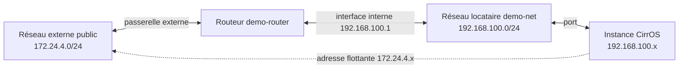
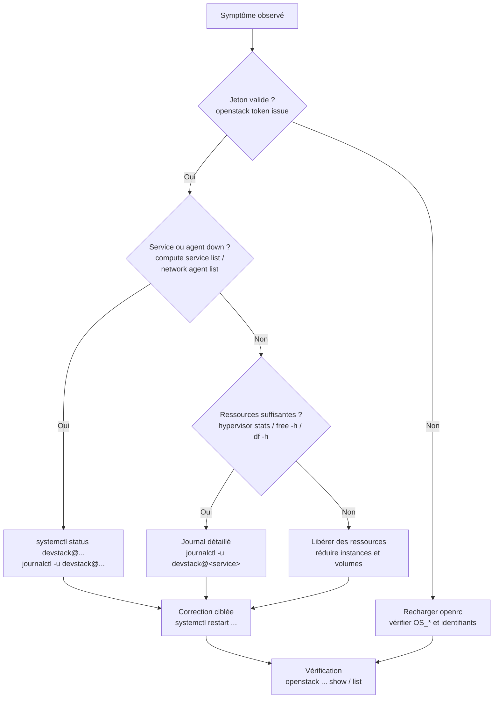
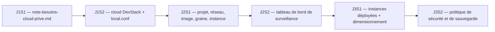

# Configuration d’un cloud d’entreprise avec OpenStack — JOUR 2

## Configuration avancée des services OpenStack (3 h) + Administration et surveillance du Cloud privé (3 h) — 27/10/2026

**Fil conducteur :** Le matin, on configure les services OpenStack sur le cloud DevStack installé au [jour 1](jour-1.md) (`stable/2026.1`) : projets, réseaux, images, graines, instance — objets réutilisés au [jour 3](jour-3.md). L’après-midi, on met en place l’administration et la surveillance (journaux, mesures, dépannage, maintenance), afin que l’environnement soit exploitable et traçable. Deux séquences, sans rupture avec le jour 1, qui alimentent directement le jour 3.

---

## Objectifs du Jour

- Vérifier l’état du cloud DevStack du [jour 1](jour-1.md) (jeton, catalogue, hyperviseur, agents OVN) et réutiliser `local.conf` et `openrc`.
- Maîtriser la configuration avancée de Keystone (domaines, projets, utilisateurs, rôles, RBAC) : isolation multi-projet, moindre privilège.
- Configurer Neutron en profondeur (réseaux, sous-réseaux, ports, routeurs, adresses flottantes, groupes de sécurité) en tenant compte d’OVN et des plages imposées.
- Approfondir Nova (graines, images, paires de clés, cycle de vie des instances, redimensionnement) et corréler ligne de commande et Horizon.
- Mettre en place une administration et une surveillance réalistes pour un cloud en machine virtuelle (journaux, mesures, quotas, hyperviseur).
- Appliquer une démarche de dépannage structurée (arbre de décision) et la maintenance de DevStack (`unstack.sh`, `stack.sh`), avec sauvegarde de configuration.

---

## Planning du Jour

| Séquence | Horaires | Thème | Durée |
|----------|----------|-------|-------|
| S1 | 09h00-09h30 | Rappel et vérification du cloud (jeton, catalogue, hyperviseur, agents OVN) | 30 min |
| S1 | 09h30-10h15 | Keystone : domaines, projets, utilisateurs, rôles, RBAC, isolation multi-projet | 45 min |
| S1 | 10h15-11h00 | Neutron : réseaux, sous-réseaux, routeurs, adresses flottantes, groupes de sécurité, OVN | 45 min |
| S1 | 11h00-11h30 | Nova : graines, images, paires de clés, cycle de vie des instances | 30 min |
| S1 | 11h30-12h00 | Horizon : corrélation interface/ligne de commande, consolidation du [lab J2S1](#lab-j2s1--configuration-avancée-des-services-09h00-12h00) | 30 min |
| — | 12h00-13h00 | Pause déjeuner (unique) | 1 h |
| S2 | 13h00-13h45 | Surveillance des performances : mesures, hyperviseur, quotas, usages | 45 min |
| S2 | 13h45-14h30 | Journaux : `journalctl`, `/var/log`, unités `devstack@*` | 45 min |
| S2 | 14h30-15h15 | Dépannage : cas courants, agents Neutron/OVN, arbre de décision | 45 min |
| S2 | 15h15-16h00 | Maintenance et mises à jour : `unstack.sh`, `stack.sh`, sauvegarde, synthèse du jour | 45 min |

---

## S1 — Configuration avancée des services OpenStack (09h00-12h00)

### Objectifs

- Charger `openrc` et vérifier le cloud avant toute configuration.
- Créer les ressources d’identité (projets, utilisateurs, rôles) selon le moindre privilège.
- Déployer une topologie Neutron complète (réseau locataire, sous-réseau, routeur, passerelle externe, adresse flottante, groupe de sécurité) en tenant compte d’OVN.
- Gérer images, graines, paires de clés et cycle de vie des instances.
- Corréler chaque action de ligne de commande à son équivalent Horizon.

### Contenu Théorique

#### 1. Vérification du cloud en début de séance

Le cloud DevStack du [jour 1](jour-1.md) (branche `stable/2026.1`) doit être revérifié avant toute configuration. L’environnement d’authentification vient du fichier `openrc` livré avec DevStack : exécuté dans le shell courant, il positionne les variables `OS_*` (authentification, projet, adresse du catalogue) et accepte deux arguments, l’utilisateur puis le projet (`source openrc <utilisateur> <projet>`).

> **Concept clé** — Tout passe par Keystone. Un jeton valide et un catalogue à jour sont les prérequis à toute opération sur Nova, Neutron, Glance ou Cinder. Une commande `openstack` qui échoue « sans raison apparente » est presque toujours un environnement d’authentification non chargé.

Les vérifications minimales à effectuer au démarrage de cette séquence sont réunies dans le tableau suivant :

| Vérification | Commande | Objectif |
|--------------|----------|----------|
| Identité | `whoami` | S’assurer d’être connecté en tant qu’utilisateur `stack` (jamais `root`). |
| Environnement | `source openrc admin admin` | Charger les variables d’authentification pour le projet `admin`. |
| Authentification | `openstack token issue` | Obtenir un jeton et confirmer la validité des identifiants. |
| Catalogue | `openstack service list` | Vérifier que les services attendus sont enregistrés (identity, compute, network, image, block-storage, placement, object-store si activé). |
| Points d’accès | `openstack endpoint list` | Contrôler que les adresses pointent vers `192.168.56.10` (réseau host-only). |
| Hyperviseur | `openstack hypervisor list` | Lire le type (QEMU avec libvirt) ; l’accélération KVM se vérifie via `/dev/kvm`. |
| Services de calcul | `openstack compute service list` | Vérifier l’état des services Nova. |
| Agents réseau | `openstack network agent list` | Vérifier les agents OVN (ne pas chercher les agents L3/DHCP historiques). |
| Images et graines | `openstack image list` et `openstack flavor list` | S’assurer que CirrOS et `m1.tiny` sont présents. |

> **Bon à savoir** — Les unités système d’OpenStack dans DevStack sont nommées `devstack@<service>` (par exemple `devstack@n-cpu` pour le calcul). Leur statut se lit avec `systemctl`, leurs journaux avec `journalctl` : c’est l’entrée de diagnostic utilisée dès l’après-midi (séquence S2).

#### 2. Keystone en profondeur : domaines, projets, utilisateurs, rôles, RBAC

Keystone gère l’identité, l’autorisation et le catalogue des services. Quatre notions structurent l’organisation :

- Un **domaine** (*domain*) est un périmètre d’administration des identités, utile dans les déploiements multi-domaines (filiales, environnements distincts). Le laboratoire utilise le domaine par défaut, `Default`.
- Un **projet** (*project*) est un espace de travail isolé dans lequel les ressources (instances, réseaux, volumes) sont créées et comptabilisées. C’est l’unité d’isolation et de facturation.
- Un **utilisateur** (*user*) est une identité authentifiée, rattachée à un ou plusieurs projets.
- Un **rôle** (*role*) est un ensemble de droits accordé pour un couple (utilisateur, projet). Le même utilisateur peut avoir des rôles différents selon le projet.

Le **contrôle d’accès basé sur les rôles** (RBAC, *Role-Based Access Control*, « contrôle d’accès fondé sur les rôles ») consiste à attribuer le strict nécessaire : un utilisateur n’obtient que les droits requis par sa mission. Le compte `admin` dispose de privilèges étendus sur l’ensemble du cloud ; les utilisateurs métier doivent être cantonnés à leur projet.

| Rôle | Portée dans le lab | Usage pédagogique |
|------|--------------------|-------------------|
| `admin` | Global (cloud) | Administration du cloud : création de projets, gestion des services. À réserver à l’administrateur de plateforme. |
| `member` | Projet | Droits standards : créer et gérer des ressources dans son projet (instances, réseaux, volumes). Rôle recommandé pour un utilisateur « équipe ». |
| `reader` | Projet | Droits en lecture seule. Utile pour un rôle de supervision ou d’audit sans droit de modification. |

> **Concept clé** — L’isolation multi-projet est effective si chaque équipe dispose de son propre projet, avec ses propres réseaux, quotas et utilisateurs. Les ressources d’un projet ne sont pas visibles depuis un autre projet, sauf accord explicite (partage de réseau, rôles additionnels).

> **Pourquoi le moindre privilège plutôt qu’un rôle unique ?** — Un compte « super-utilisateur » partagé rend toute action non attribuable et tout abus indétectable. En répartissant `member` par projet, chaque action est rattachée à un compte nominatif, ce qui alimente la journalisation d’audit (sujet de l’après-midi) et limite l’impact d’un identifiant compromis au seul projet concerné.

**Projet et utilisateur (commandes commentées drapeau par drapeau) :**

DevStack crée déjà, à l’installation, un projet `demo` et un utilisateur `demo` (il s’en sert pour ses propres tests). On ne les recrée donc pas : on complète le projet existant, puis on ajoute un utilisateur nominatif.

```bash
# Complément du projet demo fourni par DevStack (sans description par défaut)
openstack project set --description "Projet Demo - cas d'entreprise" demo
# openstack project set : modifie un projet existant
# --description : texte de description affiché dans Horizon (traçabilité)
# demo : nom du projet, repris tel quel dans toute la formation

# Création d’un utilisateur rattaché au projet
openstack user create --project demo --password lab123 demo-user
# --project : rattache immédiatement l’utilisateur au périmètre demo
# --password : mot de passe alphanumérique uniquement (contrainte DevStack),
#   ici lab123, valeur commune du laboratoire (jamais réutilisée ailleurs)
# demo-user : nom du compte, nominatif en entreprise (ici nom de rôle du lab)

# Attribution du rôle member au couple (utilisateur, projet)
openstack role add --project demo --user demo-user member
# --project et --user : ciblent le couple concerné
# member : rôle standard de gestion des ressources du projet (moindre privilège)
```

Le triplet (utilisateur, rôle, projet) constitue l’**assignation de rôle**. Sa lecture est essentielle pour auditer qui peut faire quoi :

```bash
# Liste des assignations du projet demo, avec noms lisibles
openstack role assignment list --project demo --names
# --project : filtre sur le projet
# --names : affiche les noms (utilisateur, rôle, projet) plutôt que les identifiants
```

#### 3. Neutron en profondeur : réseaux, sous-réseaux, ports, routeurs, adresses flottantes, groupes de sécurité

Neutron fournit les services réseau du cloud. Dans DevStack `stable/2026.1`, le moteur sous-jacent est **OVN** (« Open Virtual Network », réseau logique automatisé) : OVN crée et propage les flux réseau sans agents L3/DHCP dédiés, ce qui modifie les réflexes de diagnostic.

| Concept | Définition | Exemple dans le lab |
|---------|------------|---------------------|
| Réseau (*network*) | Réseau logique isolé, appartenant à un projet. | Réseau locataire `demo-net` (192.168.100.0/24). |
| Sous-réseau (*subnet*) | Plage d’adresses IP allouée au réseau, avec passerelle et service de distribution d’adresses. | `demo-subnet`, passerelle 192.168.100.1. |
| Port (*port*) | Point d’attachement virtuel (interface) entre une instance et un réseau. | Créé automatiquement à l’attachement de l’instance. |
| Routeur (*router*) | Relie un réseau locataire à un réseau externe (sortie vers l’extérieur). | `demo-router`, reliant `demo-net` au réseau `public`. |
| Réseau externe (*external network*) | Réseau préexistant dans l’infrastructure (fourni par DevStack), source des adresses flottantes et du SNAT. | `public` (172.24.4.0/24 dans le lab). |
| Adresse flottante (*floating IP*) | Adresse du réseau externe associée temporairement à un port d’instance pour la rendre accessible de l’extérieur. | Adresse 172.24.4.x rattachée à l’instance. |
| Groupe de sécurité (*security group*) | Pare-feu virtuel appliqué aux ports d’instance (règles entrantes et sortantes, par défaut tout est bloqué à l’entrée). | `demo-sg` : autorise SSH (22/tcp) et écho (ICMP). |

Les plages d’adresses sont celles imposées au [jour 1](jour-1.md) : `192.168.56.0/24` réservé à la gestion (host-only), `172.24.4.0/24` pour le réseau externe, `192.168.100.0/24` pour les réseaux locataires, `10.0.2.0/24` interdit (réseau NAT de VirtualBox).

> **Bon à savoir (topologie préexistante)** — DevStack crée par défaut, dans le projet `demo`, un réseau `private` et un routeur `router1` sur la plage `192.168.100.0/26`. Le lab construit sa propre topologie `demo-net` : il retire d’abord ces objets. Neutron autorise deux sous-réseaux qui se chevauchent (`allow_overlapping_ips` vaut `True` depuis Yoga), mais ce chevauchement rend le diagnostic ambigu.



**Fig 6** — Topologie réseau multi-composants à construire : routeur reliant le réseau locataire au réseau externe, instance atteignable par adresse flottante.

**Séquence de commandes (commentées drapeau par drapeau) :**

```bash
# 0. Retrait de la topologie par défaut de DevStack (réseau private, routeur router1)
#    afin de libérer la plage 192.168.100.0/24 pour la topologie du lab.
#    DevStack crée une double pile (IP_VERSION=4+6) : le routeur porte deux
#    interfaces, private-subnet (IPv4) et ipv6-private-subnet (IPv6).
#    Retirer les DEUX, sinon la suppression du routeur échoue en 409 Conflict.
openstack router remove subnet router1 private-subnet
openstack router remove subnet router1 ipv6-private-subnet
openstack router delete router1
openstack subnet delete private-subnet
openstack subnet delete ipv6-private-subnet
openstack network delete private

# 1. Création du réseau locataire dans le projet demo
openstack network create --project demo demo-net
# --project : appartenance au projet (isolation multi-projet)

# 2. Création du sous-réseau avec passerelle et service de résolution
openstack subnet create \
  --project demo \
  --network demo-net \
  --subnet-range 192.168.100.0/24 \
  --gateway 192.168.100.1 \
  --dns-nameserver 8.8.8.8 \
  demo-subnet
# --project : appartenance au projet, au même titre que le réseau
#   (sans ce drapeau, le sous-réseau serait rattaché au projet de l’utilisateur connecté)
# --network : rattache le sous-réseau au réseau logique
# --subnet-range : plage du lab (hors conflit avec host-only et NAT)
# --gateway : passerelle par défaut des instances (première adresse de la plage)
# --dns-nameserver : serveur de résolution de noms (8.8.8.8, accessible via le SNAT)

# 3. Création du routeur dans le projet demo
openstack router create --project demo demo-router

# 4. Connexion du routeur au sous-réseau locataire
openstack router add subnet demo-router demo-subnet
# ajoute l’interface interne du routeur vers le réseau locataire

# 5. Connexion du routeur au réseau externe
openstack router set --external-gateway public demo-router
# --external-gateway : définit la passerelle externe, indispensable au SNAT
#   et à l’attribution d’adresses flottantes (réseau public du lab)

# 6. Allocation d’une adresse flottante depuis le pool public
openstack floating ip create --project demo public
# --project : l’adresse est créditée au projet demo, et non au projet admin
# public : réseau source des adresses flottantes (172.24.4.0/24)

# 7. Groupe de sécurité et règles d’entrée minimales
openstack security group create --project demo demo-sg
openstack security group rule create --proto tcp --dst-port 22 demo-sg
# --proto tcp : protocole TCP ; --dst-port 22 : port de destination SSH
openstack security group rule create --proto icmp demo-sg
# --proto icmp : autorise l’écho (ping) pour le diagnostic
```

> **Attention (groupes de sécurité)** — Un groupe de sécurité neuf n’autorise rien en entrée : c’est la posture par défaut, et c’est une bonne chose. Chaque ouverture doit être justifiée. En entreprise, on restreint en plus la source de la règle. Attention au cas d’une instance jointe par son adresse flottante depuis la VM DevStack : le trafic sort par `br-ex`, dont l’adresse est `172.24.4.1`, et l’instance voit cette adresse comme source. Une règle limitée à `192.168.56.0/24` ne verrait donc jamais ce trafic et couperait l’accès ; la source à autoriser est `172.24.4.1/32` (voir exercice B).

#### 4. Nova en profondeur : graines, images, paires de clés, cycle de vie des instances

Nova orchestre la création des machines virtuelles, avec l’aide de Placement (inventaire des capacités), Glance (image de démarrage) et Neutron (port réseau).

| Élément | Définition | Usage dans le lab |
|---------|------------|-------------------|
| Graine (*flavor*) | Définition de la taille : nombre de vCPU, mémoire, taille du disque racine. | `m1.tiny` (512 Mo, 1 vCPU, 1 Go de disque) : graine de référence du laboratoire. |
| Image (*image*) | Modèle de disque de démarrage (Glance). | CirrOS 0.6.3, enregistrée sous le nom `cirros-0.6.3-x86_64-disk` à l’installation. |
| Paire de clés (*keypair*) | Paire de clés SSH (privée côté client, publique dans Nova) permettant l’accès sans mot de passe. | Clé locale `demo_key`, import sous le nom `demo-key`. |
| Instance (*server*) | Machine virtuelle créée à partir d’une image et d’une graine. | `demo-instance` dans `demo-net`. |
| Redimensionnement (*resize*) | Changement de graine d’une instance, avec confirmation ou annulation. | Passage `m1.tiny` → `m1.small` (si ressources disponibles). |
| Console | Accès visuel à l’instance (VNC via navigateur), indépendant du réseau. | Outil de dépannage quand SSH échoue. |

> **Concept clé (appartenance d’une ressource)** — Un objet OpenStack peut porter un champ `project_id` que l’administrateur fixe lui-même : c’est le cas du réseau, du sous-réseau, du routeur, du groupe de sécurité et de l’adresse flottante, tous créés ici avec `--project demo` depuis le contexte `admin`. D’autres objets sont indissociables de la session en cours : la paire de clés appartient au compte utilisateur, l’instance au projet du jeton. Comme `openstack server create` n’expose aucun drapeau `--project`, la seule façon de faire naître `demo-instance` dans `demo` est de s’authentifier en tant que membre de ce projet.

```bash
# 0. Bascule dans le contexte du projet demo (voir encadré ci-dessus)
source openrc demo-user demo
export OS_PASSWORD=lab123
# openrc <utilisateur> <projet> : l’ordre des arguments compte
# openrc retient ADMIN_PASSWORD par défaut : redéfinir le mot de passe
#   de demo-user, égal à lab123 dans ce laboratoire

# 1. Génération d’une paire de clés SSH locale (si elle n’existe pas)
test -f ~/.ssh/demo_key || ssh-keygen -t rsa -b 2048 -f ~/.ssh/demo_key -N ""
# test -f ... || : ne génère la clé que si elle est absente (évite la question
#   interactive « Overwrite (y/n)? » de ssh-keygen)
# -t rsa : algorithme de signature
# -b 2048 : longueur de la clé en bits
# -f : chemin des fichiers de clé (privée ~/.ssh/demo_key, publique .pub)
# -N "" : sans phrase secrète (convention de lab, à ne pas réutiliser ailleurs)

# 2. Import de la clé publique dans Nova
openstack keypair create --public-key ~/.ssh/demo_key.pub demo-key
# --public-key : fournit le fichier de clé publique à enregistrer

# 3. Lancement de l’instance
openstack server create \
  --flavor m1.tiny \
  --image cirros-0.6.3-x86_64-disk \
  --network demo-net \
  --security-group demo-sg \
  --key-name demo-key \
  demo-instance
# --flavor : taille (m1.tiny, pour limiter la pression mémoire du lab)
# --image : image de démarrage ; DevStack l’enregistre sous son nom de fichier
#   complet (cirros-0.6.3-x86_64-disk), jamais sous le raccourci « cirros »
# --network : réseau locataire d’attache
# --security-group : pare-feu appliqué aux interfaces
# --key-name : clé SSH autorisée à se connecter

# 4. Suivi de l’état jusqu’à ACTIVE
openstack server list
# La colonne Status passe de BUILD à ACTIVE ; un statut ERROR impose un diagnostic (S2)

# 5. Association de l’adresse flottante allouée en amont
openstack server add floating ip demo-instance <ADRESSE_FLOTTANTE>
# <ADRESSE_FLOTTANTE> : valeur affichée par openstack floating ip list
```

> **Attention (nom de l’image)** — DevStack n’enregistre pas l’image sous le raccourci `cirros`, mais sous son nom de fichier complet, `cirros-0.6.3-x86_64-disk`. `--image cirros` échoue avec « No image with a name 'cirros' exists ». Le nom exact se lit dans `openstack image list` ; il dépend de la version de CirrOS livrée par `stable/2026.1`.

Le **redimensionnement** illustre l’ajustement contrôlé des ressources :

```bash
openstack server resize --flavor m1.small demo-instance
# demande un changement de graine ; le statut passe à VERIFY_RESIZE
openstack server resize confirm demo-instance
# confirme après vérification de l’instance redémarrée
# alternative en cas de problème : openstack server resize revert demo-instance
```

> **Attention (redimensionnement)** — `resize` vers une graine plus grande exige de la mémoire et des vCPU libres sur l’hyperviseur. Sur une VM de 6 Go (scénario B), la demande échoue souvent faute de ressources : rester sur `m1.tiny`. Point important : le retour à une graine plus **petite** (`m1.small` → `m1.tiny`) échoue toujours, car Nova ne réduit pas le disque d’une instance en marche (`Resize error: Unable to resize disk down`) : la CLI renvoie `0` sans message, l’instance reste sur l’ancienne graine. Contrôler le résultat par `openstack server show demo-instance -c flavor`. Capacité restante : `openstack hypervisor stats show`.

#### 5. Horizon : corrélation interface et ligne de commande

Horizon expose les mêmes API que la ligne de commande, à travers des pages par ressource. Pour chaque opération réalisée en ligne de commande dans S1, l’apprenant la retrouve dans l’interface :

| Commande | Emplacement Horizon | Intérêt pédagogique |
|----------|---------------------|---------------------|
| `openstack project set` | Identité → Projets | Voir le projet et sa description. |
| `openstack user create`, `role add` | Identité → Utilisateurs | Contrôler l’utilisateur et ses rôles. |
| `openstack network/subnet/router create` | Projet → Réseau → Réseaux / Routeurs | Visualiser la topologie construite. |
| `openstack security group create` | Projet → Réseau → Groupes de sécurité | Lire les règles sous forme de tableau. |
| `openstack keypair create` | Projet → Calcul → Paires de clés | Confirmer l’import de la clé publique. |
| `openstack server create` | Projet → Calcul → Instances | Suivre l’état (BUILD, ACTIVE, ERROR). |
| `openstack volume create` | Projet → Calcul → Volumes | Vérifier la création et l’attachement d’un volume (Cinder). |
| `openstack container list` | Projet → Stockage d’objets → Conteneurs | Parcourir les conteneurs et objets (Swift). |
| `openstack floating ip create` | Projet → Réseau → Adresses flottantes | Vérifier l’association. |
| `openstack console url show` | Projet → Calcul → Instances → Console | Accès console équivalent. |

> **Pourquoi cette double lecture ?** — La ligne de commande est scriptable, journalisable et reproductible : elle sert de procédure d’exploitation écrite. Horizon donne la vue d’ensemble et le diagnostic visuel. Exécuter en ligne de commande puis vérifier dans Horizon ancre la correspondance entre les deux outils.

### Mapping Sécurité

Référentiel principal : **CIS Benchmark for OpenStack** (identifiants de contrôle à confirmer sur la version du benchmark retenue, conformément au cadrage technique).

| Référence | Réf. technique | Description |
|-----------|----------------|-------------|
| CIS OpenStack — Keystone (gestion des identités) | Domaine « comptes et autorisations » | Comptes nominatifs, moindre privilège, pas de partage du compte `admin`. |
| CIS OpenStack — Neutron (segmentation) | Domaine « réseau » | Isolation par projet et par réseau, groupes de sécurité restrictifs. |
| CIS OpenStack — Nova | Domaine « calcul » | Paires de clés, ouverture stricte des ports, quotas maîtrisés. |

> **Pourquoi mapper la sécurité dans cette séquence ?** — Les décisions prises ici (qui accède à quoi, quels ports sont ouverts, quels réseaux sont isolés) dessinent la surface d’attaque du cloud. Une correction après déploiement coûte toujours plus cher qu’une configuration juste dès le départ.

### Lab J2S1 — Configuration avancée des services (09h00-12h00)

#### Environnement

| Élément | Valeur |
|---------|--------|
| Machine virtuelle | VM `lab-openstack` créée sous Windows + VirtualBox (Ubuntu Server 24.04.5 LTS, 3 vCPU — 4 si dédié —, 10 Go si l’hôte a 16 Go, 12-14 Go si l’hôte a 32 Go ou plus, 6 Go si l’hôte a 8 Go (scénario B), virtualisation imbriquée, réseau host-only 192.168.56.0/24) |
| Cloud | DevStack `stable/2026.1`, opérationnel et vérifié en fin de journée 1 |
| Utilisateur | `stack` (session en cours) ; environnement `source openrc admin admin` |
| Identifiants | `admin` / `lab123`, `demo` / `lab123` — valeur utilisée dans ce laboratoire |
| Plages réseau | 192.168.56.0/24 (gestion), 172.24.4.0/24 (externe), 192.168.100.0/24 (locataire) |
| Livrables | Projet `demo`, utilisateur `demo-user`, réseau `demo-net` + routeur `demo-router` + groupe `demo-sg`, instance `demo-instance` joignable par adresse flottante |
| Durée | 3 h (09h00-12h00) |

Les exercices s’enchaînent : chacun prépare le suivant, et le lab s’achève sur une topologie complète et vérifiée, consommée au [jour 3](jour-3.md).

<a id="j2-ex-1-1"></a>

**Exercice 1.1 — Vérification du cloud (09h00-09h30, 30 min)**

```bash
whoami
# doit afficher « stack »

cd /opt/stack/devstack
# se placer dans le répertoire DevStack : openrc s’y trouve

source openrc admin admin
# charge les variables OS_* pour le projet admin

openstack token issue
# confirme que Keystone répond et que les identifiants sont valides

openstack service list
# catalogue : identity, compute, network, image, block-storage, placement (+ object-store)

openstack endpoint list
# les URL doivent contenir 192.168.56.10

openstack hypervisor list && openstack compute service list
# type QEMU (pilote libvirt) et état des services Nova ; KVM via /dev/kvm

openstack network agent list
# agents OVN ; ne pas chercher les agents L3/DHCP historiques

openstack image list && openstack flavor list
# image CirrOS et graine m1.tiny présentes
```

- [ ] Session `stack` confirmée, environnement `admin` chargé
- [ ] Jeton valide obtenu et catalogue complet vérifié
- [ ] Hyperviseur, services Nova et agents OVN en état normal
- [ ] Image CirrOS et graine `m1.tiny` visibles

<a id="j2-ex-1-2"></a>

**Exercice 1.2 — Keystone : projet, utilisateur, rôle (09h30-10h15, 45 min)**

```bash
openstack project set --description "Projet Demo - cas d'entreprise" demo
# complément du projet demo déjà créé par DevStack (ajout de la description)

openstack user create --project demo --password lab123 demo-user
# utilisateur rattaché au projet, mot de passe alphanumérique lab123 (valeur du lab)

openstack role add --project demo --user demo-user member
# moindre privilège : rôle member uniquement

openstack role assignment list --project demo --names
# contrôle : demo-user apparaît avec le rôle member sur le projet demo

openstack project show demo
openstack user show demo-user
# détails de chaque objet créé
```

- [ ] Projet `demo` complété avec description (DevStack l’a créé à l’installation)
- [ ] Utilisateur `demo-user` créé et rattaché à `demo` (mot de passe alphanumérique noté)
- [ ] Rôle `member` attribué et vérifié par `role assignment list`
- [ ] Correspondance Horizon vérifiée : Identité → Projets et Utilisateurs

<a id="j2-ex-1-3"></a>

**Exercice 1.3 — Neutron : topologie réseau complète (10h15-11h00, 45 min)**

```bash
# 0. Retrait de la topologie par défaut de DevStack (réseau private, routeur router1)
#    pour éviter deux réseaux sur la même plage 192.168.100.0/24
#    DevStack crée une double pile (IP_VERSION=4+6) : retirer les deux interfaces (IPv4 et IPv6) du routeur
openstack router remove subnet router1 private-subnet
openstack router remove subnet router1 ipv6-private-subnet
openstack router delete router1
openstack subnet delete private-subnet
openstack subnet delete ipv6-private-subnet
openstack network delete private

# 1. Création du réseau locataire dans le projet demo
openstack network create --project demo demo-net

openstack subnet create --project demo --network demo-net \
  --subnet-range 192.168.100.0/24 \
  --gateway 192.168.100.1 --dns-nameserver 8.8.8.8 demo-subnet
# --project demo : le sous-réseau appartient au projet demo
# (en contexte admin, sans ce drapeau, il serait rattaché au projet admin)

openstack router create --project demo demo-router
openstack router add subnet demo-router demo-subnet
openstack router set --external-gateway public demo-router

openstack floating ip create --project demo public
# --project demo : l’adresse flottante est créditée au projet demo

openstack security group create --project demo demo-sg
openstack security group rule create --proto tcp --dst-port 22 demo-sg
openstack security group rule create --proto icmp demo-sg
```

- [ ] Réseau `demo-net` et sous-réseau 192.168.100.0/24 créés
- [ ] Routeur `demo-router` connecté au sous-réseau puis au réseau `public`
- [ ] Adresse flottante allouée depuis `public`
- [ ] Groupe `demo-sg` créé avec les règles SSH et ICMP
- [ ] Contrôles : `openstack network list`, `router show demo-router`, `floating ip list`
- [ ] Correspondance Horizon vérifiée : Projet → Réseau → Réseaux, Routeurs, Topologie, Groupes de sécurité, Adresses flottantes

<a id="j2-ex-1-4"></a>

**Exercice 1.4 — Nova : instance joignable (11h00-11h30, 30 min)**

```bash
# Bascule dans le contexte du projet demo : openstack server create n’offre pas
# de drapeau --project, l’instance appartient au projet du jeton
source openrc demo-user demo
export OS_PASSWORD=lab123
# openrc <utilisateur> <projet> ; redéfinir le mot de passe (openrc retient ADMIN_PASSWORD),
#   lab123 étant le mot de passe de demo-user dans ce laboratoire

test -f ~/.ssh/demo_key || ssh-keygen -t rsa -b 2048 -f ~/.ssh/demo_key -N ""
# paire de clés locale ; test -f ... || évite d’écraser une clé déjà présente

chmod 600 ~/.ssh/demo_key
# droits stricts sur la clé privée (exigence de SSH)

openstack keypair create --public-key ~/.ssh/demo_key.pub demo-key

openstack server create --flavor m1.tiny --image cirros-0.6.3-x86_64-disk \
  --network demo-net --security-group demo-sg --key-name demo-key demo-instance
# --image : nom exact de l’image CirrOS livrée par DevStack (voir openstack image list)

openstack server list
# attendre le passage à ACTIVE (plusieurs minutes en émulation QEMU)

openstack server add floating ip demo-instance <ADRESSE_FLOTTANTE>
openstack server show demo-instance
# vérifier l’adresse fixe 192.168.100.x et l’adresse flottante associées
```

- [ ] Paire de clés générée (clé privée en droits `600`)
- [ ] Clé `demo-key` importée dans Nova
- [ ] Instance `demo-instance` créée puis état `ACTIVE`
- [ ] Adresse flottante associée et visible dans `server show`
- [ ] Correspondance Horizon vérifiée : Projet → Calcul → Instances et Paires de clés

<a id="j2-ex-1-5"></a>

**Exercice 1.5 — Consolidation Horizon, console et accès (11h30-12h00, 30 min)**

```bash
openstack console url show --novnc demo-instance
# URL de la console web (VNC) : outil de secours si SSH échoue

# Contrôle du câblage du réseau externe sur br-ex (mode OVN) :
# DevStack rattache normalement 172.24.4.0/24 à br-ex ; les adresses flottantes
# sont alors joignables depuis la VM. On vérifie la présence de l’adresse.
ip -br addr show br-ex
# doit afficher 172.24.4.1/24 ; si l’adresse manque, la rétablir :
sudo ip link set br-ex up
sudo ip addr add 172.24.4.1/24 dev br-ex
# ip addr add : donne au pont l’adresse de la plage du réseau externe DevStack
# « Address already assigned » = adresse présente, aucune action nécessaire

ssh -i ~/.ssh/demo_key cirros@<ADRESSE_FLOTTANTE>
# accès SSH depuis la VM ; utilisateur CirrOS : cirros
# si le nom d’hôte est inconnu : ajouter -o StrictHostKeyChecking=no (première connexion)

# Retour en contexte administrateur : les filtres --project et le recensement
# multi-projets exigent le rôle administrateur
source openrc admin admin

# Tour de vérification final des ressources du projet
openstack server list --project demo
openstack network list --project demo
openstack floating ip list --project demo
openstack role assignment list --project demo --names
```

- [ ] Console web ouverte depuis l’URL affichée
- [ ] Connexion SSH établie avec `cirros@<adresse flottante>`
- [ ] Isolation constatée : les ressources `demo` sont distinctes du projet `admin`
- [ ] Recensement final des livrables S1 consigné (projet, utilisateur, réseau, instance)

### Vérification pratique

Contrôle de bout en bout à exécuter seul en fin de séance (environ 20 min) : il rejoue la chaîne complète de S1 et ajoute le redimensionnement.

1. **Rôles et appartenance aux projets** — en contexte administrateur :

```bash
source openrc admin admin
openstack role assignment list --project demo --names
# Une ligne « demo-user member demo » doit figurer : sans elle, l’utilisateur
#   ne voit aucun projet et toutes ses commandes échouent en refus d’autorisation
```

Puis en contexte utilisateur : `source openrc demo-user demo`, `export OS_PASSWORD=lab123`, `openstack project list` — seul le projet `demo` apparaît : c’est l’isolation multi-projet rendue visible. Revenir au contexte `admin` ensuite.

2. **Agents réseau** — `openstack network agent list` : la liste ne contient que des agents OVN (aucun agent L3 ou DHCP au nom historique).

3. **Lecture d’une instance** — `openstack server show demo-instance` ligne à ligne : état (`status`), adresses (`addresses` : adresse fixe 192.168.100.x et flottante), associations (clé, réseau, groupe de sécurité).

4. **Recours console** — `openstack console url show --novnc demo-instance` puis ouverture de l’URL : la console web permet de diagnostiquer une instance injoignable par SSH (groupe de sécurité, routage) sans y accéder.

5. **Capacité et redimensionnement** — en contexte administrateur, `openstack hypervisor stats show` : relever vCPUs et mémoire restants. Puis, en contexte `demo-user` :

```bash
openstack server resize --flavor m1.small demo-instance
# --flavor : nouvelle graine ; l’instance passe par l’état VERIFY_RESIZE
openstack server show demo-instance
# attendre ACTIVE, puis confirmer ou annuler
openstack server resize confirm demo-instance
# alternative en cas de problème : openstack server resize revert demo-instance
# En scénario serré (6 Go, scénario B), la demande échoue souvent : rester en m1.tiny
```

6. **Correspondance Horizon** — ouvrir Projet → Calcul → Instances : retrouver les mêmes valeurs (état, adresses, graine) qu’en ligne de commande.

- [ ] Rôle `member` visible, isolation constatée en contexte `demo-user`
- [ ] Agents OVN listés dans `openstack network agent list`
- [ ] `server show` lu ligne à ligne (états, adresses, associations)
- [ ] Console web ouverte au moins une fois
- [ ] Redimensionnement confirmé (ou refus motivé par la capacité restante)
- [ ] Mêmes valeurs relevées en ligne de commande et dans Horizon

<details>
<summary>Correction détaillée — Lab J2S1</summary>

**Exercice 1.1 — Vérification du cloud**

`whoami` doit afficher `stack`. `source openrc admin admin` positionne `OS_USERNAME`, `OS_PROJECT_NAME`, `OS_AUTH_URL` (au format `http://192.168.56.10/identity/v3`) et les autres variables. `openstack token issue` renvoie un identifiant de jeton, une date d’expiration et le projet `admin` : en cas d’échec, recharger l’environnement avant de soupçonner Keystone. `openstack service list` doit lister `identity`, `compute`, `network`, `image`, `block-storage` et `placement` (et `object-store` si Swift est activé). `openstack network agent list` affiche les agents OVN : une liste vide, alors que `compute service list` est normal, signale un souci Neutron/OVN à diagnostiquer (voir S2).

**Exercice 1.2 — Keystone**

DevStack a déjà créé le projet `demo` (ainsi qu’un utilisateur `demo`) pour ses propres tests : la première commande se contente de lui ajouter une description, et une tentative de création échouerait en `409 Conflict`. L’ordre des commandes suivantes compte : utilisateur, puis rôle (le rôle exige que le projet et l’utilisateur existent). `openstack role assignment list --project demo --names` doit montrer une ligne « demo-user member demo » : sans cette ligne, l’utilisateur ne verra aucun projet à l’ouverture de session et toutes ses commandes échoueront avec une erreur d’autorisation. En complément pédagogique, on peut charger l’environnement de l’utilisateur (`source openrc demo-user demo`, puis `export OS_PASSWORD=lab123` car `openrc` reprend par défaut le mot de passe administrateur) et constater l’isolation multi-projet : dans ce contexte, `openstack project list` échoue en `403 Forbidden` (le rôle `member` n’a pas le droit d’inventaire global) ; l’équivalent autorisé est `openstack project list --my-projects`. De même, `openstack network list` montre `demo-net`, mais aussi `public` et `shared` (réseaux marqués `shared` par DevStack, visibles de tous les projets). Revenir ensuite au contexte administrateur (`source openrc admin admin`) avant l’exercice suivant, qui provisionne au nom du projet. Corrélation Horizon : la création doit apparaître dans Identité → Projets et Identité → Utilisateurs, avec le rôle `member` listé sur la fiche de l’utilisateur.

**Exercice 1.3 — Neutron**

- Étape 0 : DevStack a créé, dans le projet `demo`, le réseau `private` et le routeur `router1` sur la plage `192.168.100.0/24`. On les retire avant de construire `demo-net`, sinon deux sous-réseaux se chevauchent (autorisé par Neutron, mais source de confusion). Comme `IP_VERSION=4+6` par défaut, DevStack attache au routeur deux interfaces (`private-subnet` en IPv4 et `ipv6-private-subnet` en IPv6) : il faut détacher les deux, sinon `router delete` échoue en `409 Conflict` (le routeur conserve un port). L’ordre compte : détacher les deux sous-réseaux du routeur, supprimer le routeur, puis les deux sous-réseaux, puis le réseau.
- `demo-net` et `demo-subnet` (192.168.100.0/24) : hors plages interdites du lab (192.168.56.0/24, 10.0.2.0/24). Après le retrait de la topologie par défaut, `openstack network list` ne doit plus montrer que `demo-net` (et `public`) dans le projet `demo`.
- Le drapeau `--project demo` est répété sur le sous-réseau et sur l’adresse flottante : en contexte `admin`, un objet créé sans ce drapeau serait rattaché au projet `admin`, pas à `demo`. Contrôle : `openstack subnet list --project demo` et `openstack floating ip list --project demo` doivent renvoyer les objets attendus.
- `openstack router show demo-router` doit afficher deux interfaces : l’une vers `demo-subnet`, l’autre vers `public`. L’absence d’interface externe après `router set --external-gateway public` signale que le réseau `public` n’est pas marqué externe ou que le nom diffère : vérifier avec `openstack network show public`.
- L’adresse flottante allouée doit apparaître dans `openstack floating ip list` avec le statut « Down » (pas encore associée) : c’est normal avant l’exercice suivant.
- Groupe de sécurité : par défaut, il ne contient que la règle de sortie implicite (tout autorisé en sortie) ; les règles d’entrée SSH et ICMP doivent être visibles via `openstack security group rule list demo-sg`.

**Exercice 1.4 — Nova**

- La bascule `source openrc demo-user demo` (avec redéfinition de `OS_PASSWORD`) est indispensable : `openstack server create` n’offre pas de drapeau `--project`, l’instance reprend le projet du jeton. Sans elle, `demo-instance` naîtrait dans `admin` et `openstack server list --project demo` resterait vide. La paire de clés, elle, appartient au compte utilisateur : elle se crée donc depuis ce même contexte.
- `ssh-keygen` : si le fichier existe déjà, répondre non (n) pour éviter d’écraser une clé antérieure. `chmod 600` est exigé par SSH, sinon la connexion est refusée (« UNPROTECTED PRIVATE KEY FILE »).
- Le passage à `ACTIVE` prend quelques secondes en KVM imbriqué, plusieurs minutes en émulation QEMU (scénario sans `/dev/kvm`) : ne pas conclure trop vite à un échec.
- `openstack server show demo-instance` : la section `addresses` doit contenir le réseau `demo-net` avec l’adresse 192.168.100.x et l’adresse flottante associée.
- Échec fréquent d’association d’adresse flottante : adresse déjà associée à une autre instance, ou plus d’adresse libre dans `public` (alors libérer une adresse inutilisée, cf. S2).
- En cas d’erreur de connexion SSH : d’abord vérifier la règle TCP/22 du groupe `demo-sg`, puis l’association de l’adresse flottante, puis ouvrir la console web ([exercice 1.5](#j2-ex-1-5)) pour diagnostiquer depuis l’intérieur.

**Exercice 1.5 — Consolidation**

La console web (`--novnc`) est servie par le service `n-novnc` et joignable depuis la machine hôte via l’URL affichée (qui intègre l’adresse `192.168.56.10`). La connexion SSH avec l’utilisateur `cirros` (et non `ubuntu` ni `admin`) doit aboutir à l’invite CirrOS. Le recensement final s’exécute après un retour en contexte administrateur (`source openrc admin admin`) : les filtres `--project` et la vue multi-projets exigent ce rôle. Le recensement sert de contrat : ces objets (projet `demo`, réseau `demo-net`, graine `m1.tiny`, image CirrOS, instance `demo-instance`) sont consommés au [jour 3](jour-3.md) pour le déploiement du scénario complet.

</details>

### Bonnes pratiques et contre-mesures

| Contrôle | Référence | Description |
|----------|-----------|-------------|
| Comptes nominatifs | CIS OpenStack — Keystone | Un compte par rôle d’exploitation ; le compte `admin` jamais partagé. |
| Moindre privilège | CIS OpenStack — RBAC | Rôle `member` par projet, `reader` pour la supervision, aucun droit élargi par facilité. |
| Isolation multi-projet | CIS OpenStack — Neutron | Réseau, quotas et groupes de sécurité propres à chaque projet. |
| Groupes de sécurité par défaut fermés | CIS OpenStack — Neutron | Aucune règle ouverte sans justification ; source restreinte à la plage précise du trafic (réseau interne ou porte externe du routeur `172.24.4.1/32` selon l’accès). |
| Paires de clés, pas de mots de passe | CIS OpenStack — Nova | Accès SSH par clé, clé privée en droits 600, jamais réutilisée hors lab. |
| Plages d’adresses imposées | Méthode — cadrage lab | 192.168.100.0/24 pour les locataires, hors des plages NAT et host-only. |
| Traçabilité des opérations | Méthode — exploitation | Chaque opération effectuée en ligne de commande, avec drapeaux commentés, puis vérifiée dans Horizon. |

> **Bonnes pratiques** — Conservez une trace des objets créés dans S1 (noms, adresses, commandes) : le [jour 3](jour-3.md) les reprendra pour déployer le scénario complet. Une ligne de commande documentée dans un fichier d’exploitation vaut mieux qu’une succession de clics dans l’interface, qu’on ne peut pas relire ni rejouer.

### Exercices

Le lab du matin occupe l’intégralité du créneau : les deux exercices suivants se traitent en autonomie en fin de séance, si le temps le permet.

**Exercice A — Second projet isolé (en autonomie en fin de séance)**

Créer le projet `projet-recette` avec un utilisateur `recette-user` (rôle `member`) et le réseau `recette-net` sur la plage `192.168.110.0/24`. Vérifier, depuis ce projet, que rien n’est visible du projet `demo`.

<details>
<summary>Solution — Exercice A</summary>

```bash
openstack project create --description "Environnement de recette" projet-recette
openstack user create --project projet-recette --password lab123 recette-user
openstack role add --project projet-recette --user recette-user member

openstack network create --project projet-recette recette-net
openstack subnet create --project projet-recette --network recette-net \
  --subnet-range 192.168.110.0/24 \
  --gateway 192.168.110.1 --dns-nameserver 8.8.8.8 recette-subnet
# --project projet-recette : le sous-réseau appartient au même projet que le réseau
# (en contexte admin, sans ce drapeau, le sous-réseau serait rattaché au projet admin)

# Vérification d’isolation : contexte de l’utilisateur recette
source openrc recette-user projet-recette
# openrc <utilisateur> <projet> : l’ordre des deux arguments compte
export OS_PASSWORD=lab123
# openrc reprend ADMIN_PASSWORD par défaut : redéfinir le mot de passe de recette-user
openstack server list
# ne doit afficher aucune instance : projet distinct
openstack network list
# ne doit afficher que les réseaux visibles par recette-user :
# recette-net (son réseau), public (réseau externe) et shared (réseaux marqués
# partagés par DevStack) ; aucun réseau propre à un autre projet
```

La plage 192.168.110.0/24 reste hors des plages réservées du lab et ne chevauche aucun réseau existant. En contexte `admin`, les deux projets sont visibles : c’est la contrepartie attendue du rôle administrateur.

</details>

**Exercice B — Groupe de sécurité restrictif (en autonomie en fin de séance)**

Restreindre la règle SSH de `demo-sg` à la seule porte externe du routeur OVN (`172.24.4.1/32`), puis justifier en deux phrases l’apport de sécurité.

<details>
<summary>Solution — Exercice B</summary>

Le SSH vers une instance atteint celle-ci par son adresse flottante, en traversant le routeur OVN. Le routeur réécrit l’adresse source : l’instance voit arriver la connexion depuis `172.24.4.1` (sa propre porte externe), jamais depuis `192.168.56.0/24`. Restreindre à la plage de gestion coupe donc l’accès ; la restriction utile porte sur `172.24.4.1/32`.

```bash
# Identification de la règle TCP/22 existante
openstack security group rule list demo-sg
# suppression de la règle trop permissive
openstack security group rule delete <IDENTIFIANT_REGLE>
# recréation limitée à la porte externe du routeur OVN
openstack security group rule create --proto tcp --dst-port 22 \
  --remote-ip 172.24.4.1/32 demo-sg
```

La nouvelle règle n’accepte les connexions SSH que depuis la porte externe du routeur (`172.24.4.1`) : c’est le seul point d’entrée du trafic une fois la traduction d’adresse effectuée. Toute autre source est refusée, ce qui réduit la surface d’attaque au strict chemin d’accès externe du locataire.

Compromis pragmatique : pour autoriser à la fois le SSH direct (réseau interne) et le SSH via adresse flottante, créer deux règles — `--remote-ip 172.24.4.1/32` et `--remote-ip 192.168.56.0/24` — et constater que seule la première est sollicitée par la connexion via flottante.

</details>

### Ce qu’on a retenu

> - Tout part de Keystone : projet, utilisateur, rôle forment le triplet d’autorisation, vérifié par `role assignment list`.
> - Le moindre privilège se traduit concrètement : rôle `member` par projet, jamais le compte `admin` partagé.
> - La topologie de base d’un locataire est réseau → sous-réseau → routeur → réseau externe → adresse flottante, avec groupes de sécurité fermés par défaut.
> - L’appartenance d’une ressource se lit à deux endroits : le drapeau `--project` pour le réseau, le contexte d’authentification pour l’instance et la paire de clés.
> - OVN a remplacé les agents L3/DHCP : `openstack network agent list` affiche les agents OVN, et le diagnostic réseau suit cette architecture.
> - Une instance se crée avec une image (Glance), une graine (Nova), un réseau (Neutron) et une paire de clés ; la console web est le recours quand le réseau échoue.
> - Chaque opération en ligne de commande possède son équivalent Horizon : l’alterner rend les deux familles d’outils maîtrisées.

---

## S2 — Administration et surveillance du Cloud privé (13h00-16h00)

### Objectifs

- Obtenir une vue d’exploitation minimale et réaliste (mesures système, hyperviseur, quotas, usages) sans alourdir la VM.
- Lire et interpréter les journaux (`journalctl -u devstack@*`, `/var/log`, `/opt/stack/logs`).
- Appliquer l’arbre de décision aux cas courants (service arrêté, jeton invalide, pool d’adresses flottantes épuisé, instance en échec), en tenant compte d’OVN.
- Connaître `unstack.sh`, `stack.sh` et la sauvegarde de configuration. **Ne pas exécuter `unstack.sh` en fin de journée** : le cloud doit rester fonctionnel pour le [jour 3](jour-3.md). N’utiliser `unstack.sh` qu’en cas de réinitialisation explicite.
- Produire un tableau de bord de surveillance minimal, traçable, réutilisable au [jour 3](jour-3.md).

### Contenu Théorique

#### 1. Surveillance des performances : mesures, hyperviseur, quotas, usages

L’après-midi vise une vue d’exploitation minimale mais utile, adaptée à la VM `lab-openstack` créée par l’apprenant sous Windows + VirtualBox (10 Go attribués sur un hôte 16 Go ; 6 Go en scénario B ; 12-14 Go sur un hôte 32 Go ou plus). La pile complète de supervision (serveur de mesures, base de séries temporelles, tableau de bord graphique) est écartée : elle dépasserait les ressources disponibles et ajouterait peu. La piste retenue combine commandes système natives, consultation des quotas OpenStack et script de collecte léger : aucun port réseau supplémentaire n’est requis, et chaque mesure reste compréhensible.

| Indicateur | Commande | Seuil d’alerte dans le lab | Action associée |
|------------|----------|----------------------------|-----------------|
| Mémoire | `free -h` | moins de 500 Mo libres | Réduire le nombre d’instances, vérifier les arrêts par manque de mémoire (`dmesg`), appliquer le mode minimal. |
| Charge processeur | `uptime` | charge supérieure au nombre de cœurs (4) sur plusieurs minutes | Identifier le processus consommateur (`top`), limiter les redimensionnements. |
| Disque | `df -h /` | moins de 10 Go libres | Purger les journaux anciens, éviter la création massive de volumes (fichier de boucle de Cinder, 30 Go). |
| Hyperviseur | `openstack hypervisor stats show` | vCPU ou mémoire planifiables presque épuisés | Ajuster les graines et les quotas, planifier l’ajout d’un nœud de calcul ([jour 3](jour-3.md)). |
| Services de calcul | `openstack compute service list` | état `down` ou `disabled` | Vérifier l’unité `devstack@n-cpu`, consulter son journal, redémarrer. |
| Agents réseau | `openstack network agent list` | agent `down` | Vérifier les unités OVN, consulter les journaux réseau. |
| Quotas projet | `openstack quota show demo` | usage proche de la limite | Libérer des ressources ou faire ajuster le quota par l’administrateur. |
| Instances | `openstack server list --all-projects` | état `ERROR` ou `SHUTOFF` inattendu | Diagnostiquer par la console et les journaux ([arbre de décision, section 3](#3-dépannage--cas-courants-agents-ovn-arbre-de-décision)). |

> **Pourquoi surveiller les quotas autant que la machine ?** — Un cloud peut paraître sain côté système (mémoire et processeur largement libres) et pourtant bloquer les utilisateurs : quotas de projet épuisés (plus d’instances autorisées, plus d’adresses flottantes disponibles) ou capacité d’hyperviseur atteinte. Les deux plans de surveillance sont complémentaires et se consultent dans le même réflexe.

```bash
# Mesures système de base (aucun paquet supplémentaire)
free -h
# -h : unités lisibles ; surveiller la colonne « available » (sous 500 Mo : alerte)
uptime
# affiche la charge moyenne sur 1, 5 et 15 minutes, à comparer aux 3 vCPU (4 si dédié)
df -h /
# espace libre sur la partition racine (fichier de boucle Cinder : 30 Go)
top -b -n1 | head -15
# -b : sortie non interactive ; -n1 : un seul instantané ; premiers processus par mémoire

# Hyperviseur et capacité restante
openstack hypervisor stats show
# vcpus / vcpus_used, memory_mb / memory_mb_used, running_vms : base du dimensionnement (J3)
openstack compute service list
openstack network agent list
# état des services Nova et des agents OVN

# Usages et quotas du projet
openstack quota show demo
# plafonds configurés pour le projet (instances, vCPU, mémoire, adresses flottantes)
openstack server list --project demo
openstack floating ip list --project demo
```

> **Bon à savoir** — `dstat` est installé par DevStack par défaut (désactivable en mode minimal au [jour 1](jour-1.md)). Quand il est présent, `dstat -cdngy 2 5` fournit un aperçu temps réel — processeur, disque, pagination, réseau et statistiques système — cinq fois à deux secondes d’intervalle. Le mode complet `dstat -a` ajoute en plus la mémoire, le swap et l’usage des systèmes de fichiers. S’il a été désactivé, les commandes ci-dessus suffisent : aucune dépendance externe n’est requise.

#### 2. Journaux : `journalctl`, répertoires `/var/log`, unités `devstack@*`

Chaque service OpenStack tourne sous la forme d’une **unité système** nommée `devstack@<service>` et journalise par défaut dans **journald**, le journal de systemd. C’est donc `journalctl` qui donne accès aux traces applicatives (exceptions Python, requêtes, avertissements) : il n’existe pas de fichier `nova-api.log` ou `neutron-server.log` tant qu’une journalisation fichier n’est pas explicitement activée. Le répertoire `/opt/stack/logs/` complète le dispositif avec le journal d’installation `stack.sh.log` et un instantané de diagnostic (`worlddump`) ; les journaux du réseau logique OVN, eux, sont écrits par les paquets système dans `/var/log/ovn/`.

| Source | Contenu | Quand l’ouvrir |
|--------|---------|----------------|
| `journalctl -u devstack@<service>` | Journal systemd unifié (démarrage, erreurs, traces applicatives) | Premier réflexe : service `down`, redémarrage raté, exception applicative. |
| `/opt/stack/logs/stack.sh.log` | Journal complet de `stack.sh` | Échec d’installation ou de mise à jour. |
| `/var/log/ovn/ovn-*.log` et unités `ovn-central`/`ovn-controller` | Journaux du réseau logique (OVN/OVS) | Connectivité entre instances, routeurs, adresses flottantes. |
| `/opt/stack/logs/worlddump*.txt` | Instantané de diagnostic (processus, réseau, état des services) | Après un échec de `stack.sh` ou un incident. |
| `/var/log/syslog` | Journal système global | Problèmes de noyau, de mémoire, de réseau. |
| `/var/log/apache2/horizon_error.log` | Journaux d’Horizon (Apache) | Interface injoignable ou erreur HTTP. |

```bash
# Suivi en temps réel d’un service (quitter par CTRL+C)
sudo journalctl -u devstack@n-api -f
# -u : cible l’unité DevStack du service API Nova ; -f : suit le journal à mesure qu’il s’écrit

# Erreurs des trente dernières minutes, pour un service donné
sudo journalctl -u devstack@n-cpu --since -30m | grep -iE "error|traceback"
# --since -30m : fenêtre glissante de 30 minutes
# le filtre textuel est plus fiable que --priority : DevStack journalise beaucoup
# de lignes applicatives à sévérité 6, où le mot « error » figure dans le texte

# Dernières erreurs de l’ensemble des services DevStack
sudo journalctl --since -15m | grep -iE "error|traceback"
# regroupe les messages récents, puis retient les marques utiles

# Variante : cibler les avertissements et erreurs de sévérité déclarée
sudo journalctl --since -15m --priority warning | grep -iE "error|traceback"
# --priority warning : se restreint aux sévérités 4 et inférieures

# Journal détaillé d’un service (traces applicatives dans journald)
sudo journalctl -u devstack@n-api -n 40 --no-pager
# -n 40 : 40 dernières lignes (la fin du journal contient l’erreur la plus récente)
# --no-pager : affiche directement sans ouvrir de paginateur

# Journal du réseau logique (OVN) : ici, un vrai fichier dans /var/log/ovn
sudo tail -n 40 /var/log/ovn/ovn-controller.log
# les journaux OVN sont écrits sur disque, contrairement aux services OpenStack
# sudo requis : le fichier appartient à root (lecture privilégiée)

# Journal d’installation
tail -n 30 /opt/stack/logs/stack.sh.log

# Journal système : arrêts par manque de mémoire
sudo dmesg | grep -i "out of memory"
# dmesg : messages du noyau ; rechercher les kills OOM (Out Of Memory)
```

> **Bon à savoir (journalisation fichier)** — Si un fichier par service est souhaité (archivage, envoi vers un collecteur), on l’active en ajoutant `log_file = /opt/stack/logs/nova-api.log` dans la section `[DEFAULT]` du fichier de configuration du service (`/etc/nova/nova.conf`), puis en redémarrant l’unité concernée. Par défaut, DevStack s’en passe : tout passe par journald.

> **Attention** — La copie intégrale d’un journal dans un livrable est à proscrire : on reformule et on ne conserve que les lignes significatives (horodatage, identifiant de service, message d’erreur). C’est une règle d’exploitation comme de rédaction : un extrait lisible vaut mieux qu’un journal entier.

#### 3. Dépannage : cas courants, agents OVN, arbre de décision

Plutôt que du tâtonnement, on adopte une démarche descendante : confirmer l’identité, puis les services, puis les ressources, puis les journaux. L’arbre de décision ci-dessous synthétise la méthode.

| Cas | Symptôme | Vérification rapide | Parade |
|-----|----------|---------------------|--------|
| Service arrêté | `compute service list` affiche `down` | `systemctl status devstack@n-cpu` | `sudo systemctl restart devstack@n-cpu` puis revérification. |
| Jeton invalide | erreur d’autorisation (401) à chaque commande | `source openrc admin admin`, variables `OS_*` | Recharger l’environnement ; vérifier le mot de passe dans `local.conf` si persistant. |
| Pool d’adresses flottantes épuisé | `floating ip create public` échoue | `openstack floating ip list` | Libérer une adresse libre (`floating ip delete`) ; en production, étendre le pool du réseau externe. |
| Instance en échec | état `ERROR` dans `server list` | `server show` (champ `fault`), console, `journalctl -u devstack@n-cpu` | Identifier la cause (capacité, image, réseau) puis recréer l’instance si nécessaire. |
| Horizon injoignable | page blanche ou connexion refusée depuis l’hôte | `systemctl status apache2`, `curl -I http://192.168.56.10/dashboard/` depuis la VM | Vérifier l’interface host-only puis redémarrer Apache. |
| Instance injoignable par SSH | connexion refusée ou délai dépassé | groupe de sécurité, adresse flottante, routeur, console | Corriger la règle TCP/22, vérifier `router show`, diagnostiquer via la console. |
| Agent OVN `down` | `network agent list` montre un agent arrêté | `systemctl status ovn-central ovn-controller` | Redémarrer les unités OVN et OVS, consulter `/var/log/ovn/ovn-*.log`. |
| Ping ou SSH vers une adresse flottante échoue depuis la VM | `br-ex` non câblé : DevStack (mode OVN) ne rattache pas `172.24.4.0/24` au pont externe | `ip -br addr show br-ex` (aucune adresse `172.24.4.x`) | `sudo ip link set br-ex up` puis `sudo ip addr add 172.24.4.1/24 dev br-ex` (variante si conflit d’adresse : `sudo ip route add 172.24.4.0/24 dev br-ex`). |



**Fig 7** — Arbre de décision de dépannage : confirmer l’authentification, puis les services, puis les ressources, avant d’ouvrir les journaux détaillés.

**Exemple guidé : instance `demo-instance` en échec.** On relève l’état (`openstack server list`), on lit le message de panne dans `openstack server show demo-instance` (champ `fault`), on ouvre la console (`openstack console url show demo-instance`) pour observer le démarrage, puis on consulte le journal du service de calcul (`journalctl -u devstack@n-cpu --since -15m`). La cause identifiée (capacité insuffisante, image invalide, port réseau absent) oriente la correction, puis on vérifie par une nouvelle commande d’état.

> **Attention (anciens réflexes réseau)** — Le déploiement OVN de DevStack ne possède pas d’agent « routeur L3 » ni d’agent « DHCP » historique. Chercher `q-l3-agent` donne une liste vide et laisse croire à une panne. Contrôle correct : `openstack network agent list`, `systemctl status ovn-central ovn-controller`, journaux `/var/log/ovn/ovn-*.log`.

#### 4. Maintenance, mises à jour et sauvegarde de configuration

DevStack offre trois niveaux d’intervention, à connaître précisément pour ne pas détruire le travail accompli :

| Script | Rôle | Portée des données | Usage |
|--------|------|--------------------|-------|
| `./unstack.sh` | Arrête proprement tous les services (OpenStack, OVN/OVS, MySQL, RabbitMQ) | **Conservées** : bases, images, volumes, clés, réseaux sont laissés intacts sur disque | Arrêt planifié avant modification de `local.conf`. |
| `./stack.sh` | Reconfigure et redémarre l’ensemble, en relisant `local.conf` | **Détruites et recréées** : `stack.sh` supprime puis recrée les bases (keystone, nova_api, nova_cell, neutron, glance, cinder, placement) ; projets, utilisateurs, réseaux, routeurs, groupes de sécurité, instances et adresses flottantes sont perdus | Relance après `unstack.sh` ou après correction de `local.conf`. |
| `./clean.sh` | Supprime les données d’installation (bases, environnements, fichiers générés) | **Détruites** | État d’installation inconnu ou endommagé, uniquement. |

> **Point important (conservation des données)** — `unstack.sh` seul arrête les services sans toucher aux données : le cloud est à l’arrêt, mais `demo` et `demo-instance` subsistent. En revanche `stack.sh` **recrée les bases** à chaque exécution : relancer l’installation repart d’un cloud vide. Sur cette version de DevStack (`stable/2026.1`), la séquence `unstack.sh && stack.sh` n’est donc **pas neutre** pour les données.
>
> **Règle d’or** — `clean.sh` n’est jamais un premier secours : il efface tout le travail du laboratoire. Mais `stack.sh` l’est presque autant : `unstack.sh` seul est rejouable sans perte, la paire `unstack.sh && stack.sh` ne se lance qu’après un instantané de machine (`VBoxManage snapshot`) ou une sauvegarde des bases, dans un créneau complet.

**Avant toute intervention : la sauvegarde.** `local.conf` contient l’intégrité de la configuration du laboratoire (adresses, mots de passe, services activés) ; les fichiers `openrc` et les paires de clés donnent accès aux ressources. Ces trois éléments sont sauvegardés horodatés :

```bash
# Horodatage réutilisable dans les noms de fichiers de sauvegarde
STAMP=$(date +%Y%m%d-%H%M%S)
# date : date courante ; +%FORMAT : format horodaté unique pour éviter tout écrasement

# Sauvegarde de la configuration DevStack (le fichier unique à préserver)
cp /opt/stack/devstack/local.conf /opt/stack/devstack/local.conf.bak.$STAMP
# cp : copie ; le suffixe horodaté empêche l’écrasement d’une sauvegarde antérieure

# Sauvegarde des environnements d’authentification
cp /opt/stack/devstack/openrc /opt/stack/devstack/openrc.bak.$STAMP

# Sauvegarde des paires de clés (accès SSH aux instances)
cp -a ~/.ssh ~/ssh-bak.$STAMP
# -a : copie archive, conserve les droits et les liens symboliques

# Sauvegarde des journaux récents (diagnostic post-incident)
tar czf ~/logs-bak.$STAMP.tar.gz /opt/stack/logs 2>/dev/null || true
# tar : archive ; c : crée, z : compresse (gzip), f : fichier de sortie
# 2>/dev/null || true : n’interrompt pas le script si un fichier est inaccessible
```

**Procédure de redémarrage contrôlé :**

1. Sauvegarder (`local.conf`, `openrc`, `~/.ssh`).
2. Prendre un instantané de machine (`VBoxManage snapshot lab-openstack take avant-stack`) — c’est le seul moyen de revenir aux données si `stack.sh` est exécuté.
3. Vérifier l’état courant (`openstack token issue`, `compute service list`, `network agent list`).
4. Arrêter proprement : `cd /opt/stack/devstack && ./unstack.sh` et attendre la fin.
5. Appliquer la modification dans `local.conf` si nécessaire (seul fichier relu à chaque exécution).
6. Relancer : `./stack.sh` (30 à 90 min selon le poste) — les données sont recréées.
7. Recharger l’environnement et rejouer la chaîne de vérification ([exercice 1.1 du matin](#j2-ex-1-1)).

**Mises à jour DevStack.** Mettre à jour consiste à synchroniser la branche stable figée puis à relancer l’installation. La règle du laboratoire reste valable : aucune bascule sur `master`, aucune migration vers `stable/2026.2` (trop récente) pendant la session.

```bash
cd /opt/stack/devstack
git fetch origin
# récupère les dernières révisions du dépôt sans modifier la copie locale

git log --oneline -5 origin/stable/2026.1
# inspecte les cinq dernières révisions à intégrer avant de se lancer

git pull origin stable/2026.1
# synchronise la branche stable/2026.1 (Gazpacho) avec ses révisions mises à jour

./unstack.sh && ./stack.sh
# arrêt propre puis reconfiguration avec les sources mises à jour (30 à 90 min)
# stack.sh recrée les bases : prendre un instantané avant, les données du lab seront perdues
```

> **Bonnes pratiques (mise à jour)** — Exécuter une mise à jour uniquement sur un cloud à l’état connu, après sauvegarde, et avec un créneau complet devant soi (`stack.sh` dure 30 à 90 minutes). En formation, on décrit la procédure et on l’illustre ; on l’exécute intégralement seulement si le temps le permet. Après mise à jour, rejouer la chaîne de vérification complète avant toute autre opération.

#### 5. Pile de supervision légère : choix et justification

Plusieurs options se présentent pour outiller la surveillance, et le choix doit rester compatible avec la VM du laboratoire (10 Go attribués sur un hôte 16 Go ; 6 Go en scénario B) qui exécute déjà l’ensemble d’OpenStack :

| Option | Principe | Verdict dans ce lab |
|--------|----------|---------------------|
| **Script de collecte + tableau de bord texte** (retenu) | Un script interroge les commandes clés à intervalle régulier et consigne les résultats dans un fichier horodaté | Aucun service supplémentaire, aucun port ouvert, réutilisable au [jour 3](jour-3.md) |
| Telegraf + InfluxDB + Grafana | Agent de collecte, base de mesures, tableaux de bord graphiques | Écriture attractive, mais trois services supplémentaires (150 à 300 Mo de mémoire et de disque) : disproportionné pour un usage ponctuel et fragile sur un poste serré |
| `dstat` + journal système | Collecte native existante | Excellent en appoint (et déjà présent), mais ne conserve pas d’historique exploitable après la séance |
| Prometheus + exporteur OpenStack | Supervision orientée alertes | Modèle de production, trop lourd et sans alerte utile à configurer en 45 min |

Le script de collecte retenu reste compréhensible, modifiable et conservé : l’apprenant voit ce qui est mesuré et peut l’adapter à son poste. Un déploiement Telegraf (export des mêmes mesures vers une base) se documente comme prolongement, sans être exigé pour valider la séquence.

```bash
# Création du répertoire de travail (hérité du jour 1)
mkdir -p ~/formation-openstack

# Script de collecte : instantané complet de l’état du cloud
cat > ~/formation-openstack/check-cloud.sh <<'EOF'
#!/usr/bin/env bash
# Instantané de l’état du cloud DevStack — à exécuter à intervalle régulier
# Pas de « set -u » : le fichier openrc de DevStack référence des variables
# non définies, ce qui interromprait le script dès le chargement de l’environnement.

STAMP=$(date +%F_%H-%M-%S)
OUT=~/formation-openstack/etat-cloud-$STAMP.txt
# fichier de sortie horodaté : l’historique est conservé, chaque exécution est traçable

{
  echo "=== État du cloud — $STAMP ==="
  source /opt/stack/devstack/openrc admin admin 2>/dev/null
  openstack token issue >/dev/null 2>&1 \
    && echo "[OK] Jeton valide" \
    || echo "[ERREUR] Jeton invalide — recharger openrc"
  openstack compute service list
  openstack network agent list
  openstack hypervisor stats show
  echo "--- Système ---"
  free -h
  df -h / | tail -n 1
  uptime
} > "$OUT" 2>&1
# le bloc entier est redirigé vers le fichier de sortie, erreurs incluses

echo "Mesures consignées dans $OUT"
EOF
chmod +x ~/formation-openstack/check-cloud.sh
# rend le script exécutable
```

> **Concept clé** — Une supervision utile repose sur trois propriétés : elle est **périodique** (un instantané isolé ne révèle pas une tendance), elle est **conservée** (l’historique permet de comparer avant/après incident) et elle est **lisible** (un opérateur pressé doit repérer l’anomalie sans outil complémentaire). Le script satisfait ces trois critères à coût nul.

### Mapping Sécurité

| Référence | Réf. technique | Description |
|-----------|----------------|-------------|
| CIS OpenStack — Journalisation | Domaine « audit et traçabilité » | Consulter et conserver les journaux ; ne pas désactiver la journalisation. |
| CIS OpenStack — Gestion des ressources | Domaine « quotas et limites » | Quotas par projet pour prévenir l’épuisement de ressources et l’abus. |

> **Pourquoi ce mapping dans une séquence d’administration ?** — Surveiller, c’est aussi détecter : consommation inexpliquée, série de connexions échouées, journal qui s’interrompt brutalement. La surveillance complète le moindre privilège appliqué le matin — l’un limite les dégâts possibles, l’autre les rend détectables.

### Lab J2S2 — Administration et surveillance (13h00-16h00)

#### Environnement

| Élément | Valeur |
|---------|--------|
| Machine virtuelle | VM `lab-openstack` (Ubuntu Server 24.04 LTS), cloud DevStack `stable/2026.1` en fonctionnement |
| État en début d’après-midi | Projet `demo`, réseau `demo-net`, instance `demo-instance` (livrables de S1) |
| Outils | `journalctl`, `systemctl`, `free`, `df`, `top`, `dstat` (si présent), CLI `openstack` |
| Livrables | Tableau de bord `~/formation-openstack/surveillance-cloud.md`, script `check-cloud.sh`, sauvegardes horodatées |
| Durée | 3 h (13h00-16h00) |

<a id="j2-ex-2-1"></a>

**Exercice 2.1 — Relevé de performance et d’usage (13h00-13h45, 45 min)**

```bash
# 1. Mesures système
free -h
uptime
df -h /

# 2. Hyperviseur et capacité
openstack hypervisor stats show
openstack compute service list
openstack network agent list

# 3. Quotas et usages du projet
openstack quota show demo
openstack server list --project demo
openstack floating ip list --project demo

# 4. Période d’observation (facultatif si dstat présent)
dstat -cdngy 2 5
# c : processeur, d : disque, g : pagination, n : réseau, y : statistiques système
# (y regroupe interruptions et changements de contexte)
# 2 : intervalle en secondes, 5 : nombre d’échantillons
```

- [ ] Mesures système relevées (mémoire disponible, charge, espace disque)
- [ ] Capacité d’hyperviseur relevée (`vcpus_used`, `memory_mb_used`, `running_vms`)
- [ ] Quotas du projet `demo` consultés et usages rapprochés
- [ ] État des services Nova et des agents OVN consigné
- [ ] Résultats consignés dans les [sections 2 à 4 du tableau de bord](#j2-tableau-bord) ([exercice 2.4](#j2-ex-2-4))

<a id="j2-ex-2-2"></a>

**Exercice 2.2 — Lecture des journaux (13h45-14h30, 45 min)**

Cette lecture applique la [section 2](#2-journaux--journalctl-répertoires-varlog-unités-devstack) de la théorie.

```bash
# 1. Démarrage récent d’un service API
sudo journalctl -u devstack@n-api -n 20
# -n 20 : vingt dernières lignes du journal de l’API Nova

# 2. Erreurs récentes sur l’ensemble des services
sudo journalctl --since -30m | grep -iE "error|traceback"
# filtre textuel : plus fiable que --priority

# 3. Journaux détaillés applicatifs (journald)
sudo journalctl -u devstack@n-api -n 25 --no-pager
sudo journalctl -u devstack@neutron-api -n 25 --no-pager

# 4. Réseau logique (OVN) : unités et fichiers sur disque
sudo journalctl -u ovn-central -n 10
sudo journalctl -u ovn-controller -n 10
sudo tail -n 15 /var/log/ovn/ovn-controller.log

# 5. Journal système et Horizon
sudo dmesg | grep -i "out of memory"
sudo tail -n 15 /var/log/apache2/horizon_error.log
```

- [ ] Journal de démarrage d’un service `devstack@*` lu et compris (format, horodatage, sévérité)
- [ ] Erreurs des trente dernières minutes recherchées (et réinterprétées en langage clair)
- [ ] Journaux applicatifs des API Nova et Neutron consultés via `journalctl`
- [ ] Journaux OVN consultés (nord et contrôleur)
- [ ] Vérifications système (mémoire, Horizon) effectuées
- [ ] Deux lignes significatives reformulées dans la [section 5 du tableau de bord](#j2-tableau-bord)

<a id="j2-ex-2-3"></a>

**Exercice 2.3 — Dépannage dirigé (14h30-15h15, 45 min)**

Quatre scénarios, dans l’ordre de l’arbre de décision (Fig 7). Chaque scénario se conclut par une vérification.

**Scénario A — Service arrêté (10 min)**

```bash
sudo systemctl status devstack@n-cpu --no-pager
# état courant de l’unité (active / failed / inactive)

sudo journalctl -u devstack@n-cpu -n 20
# dernière activité avant l’arrêt

sudo systemctl restart devstack@n-cpu
# redémarrage ciblé de l’unité

openstack compute service list
# vérification : l’état repasse à « up »
```

- [ ] État de l’unité relevé avant intervention
- [ ] Journal consulté, cause recherchée
- [ ] Redémarrage effectué et état revérifié dans `compute service list`
- [ ] Correspondance Horizon vérifiée : Admin → Tableau de bord (état des services) et Admin → Hyperviseurs (capacité du nœud de calcul)

**Scénario B — Pool d’adresses flottantes (10 min)**

```bash
openstack floating ip list
# inventaire : adresses libres et associées

openstack floating ip create --project demo public
# allocation d’une adresse dans le pool, créditée au projet demo

openstack floating ip delete <ADRESSE_NON_UTILISEE>
# libération d’une adresse inutilisée : le pool retrouve de la capacité
```

- [ ] Pool actuel inventorié (libres / associées)
- [ ] Allocation puis libération d’une adresse observées
- [ ] Comportement en cas de pool épuisé expliqué (message d’erreur attendu et parade)

**Scénario C — Instance en échec : diagnostic guidé (15 min)**

```bash
source openrc demo-user demo
export OS_PASSWORD=lab123
# demo-instance appartient au projet demo : en contexte admin, server show
#   renvoie « No Server found » (sauf en ciblant l’identifiant de l’instance)

openstack server list
# repérer l’état de demo-instance (ACTIVE ; ERROR si le scénario est provoqué)

openstack server show demo-instance
# lire le champ fault : message de panne explicite

openstack console url show --novnc demo-instance
# ouvrir la console pour observer l’état réel de l’instance

sudo journalctl -u devstack@n-cpu --since -15m
# journal du service de calcul : détail de l’erreur (journald)
```

- [ ] État et message de panne relevés (`server show`)
- [ ] Console ouverte et observations consignées
- [ ] Journal du service de calcul consulté
- [ ] Cause probable identifiée et correction proposée, conformément à l’arbre de décision

**Scénario D — Agents OVN et routage (10 min)**

```bash
source openrc admin admin
# retour au contexte administrateur : network agent list exige le rôle admin

openstack network agent list
# état des agents OVN (présence et état « up »)

openstack router show demo-router
# interfaces du routeur : locataire et externe

openstack floating ip list --project demo
# adresse flottante associée à demo-instance

# Depuis l’instance : test de sortie vers l’extérieur
# (depuis la VM, en SSH sur l’adresse flottante)
ping -c 3 8.8.8.8
# -c 3 : trois paquets échos ; vérifie le SNAT via le routeur et le réseau externe
```

- [ ] Agents OVN listés et en état normal
- [ ] Routeur vérifié : interfaces locataire et externe présentes
- [ ] Sortie Internet testée depuis l’instance (ping vers 8.8.8.8)
- [ ] Parcours réseau complet (instance → routeur → réseau externe → NAT) verbalisé

<a id="j2-ex-2-4"></a>

**Exercice 2.4 — Sauvegarde, tableau de bord et maintenance (15h15-16h00, 45 min)**

Cet exercice reprend la [section 4](#4-maintenance-mises-à-jour-et-sauvegarde-de-configuration) (sauvegardes) et la [section 5](#5-pile-de-supervision-légère--choix-et-justification) (script de collecte) de la théorie.

```bash
# 1. Sauvegardes horodatées
STAMP=$(date +%Y%m%d-%H%M%S)
cp /opt/stack/devstack/local.conf /opt/stack/devstack/local.conf.bak.$STAMP
cp /opt/stack/devstack/openrc /opt/stack/devstack/openrc.bak.$STAMP
cp -a ~/.ssh ~/ssh-bak.$STAMP

# 2. Création du script de collecte
mkdir -p ~/formation-openstack
# ... écriture de check-cloud.sh ...

# 3. Exécution du script et lecture du résultat
~/formation-openstack/check-cloud.sh
ls -l ~/formation-openstack/etat-cloud-*.txt
```

<a id="j2-tableau-bord"></a>

Ensuite, rédiger le tableau de bord `~/formation-openstack/surveillance-cloud.md` selon la structure imposée :

```markdown
# Tableau de bord de surveillance — Cloud DevStack (Jour 2)

## 1. Contexte
- Date et heure du relevé, projet courant, configuration de la VM

## 2. État global
- [ ] Jeton valide (openstack token issue)
- [ ] Services Nova en état (compute service list)
- [ ] Agents OVN en état (network agent list)
- [ ] Hyperviseur opérationnel

## 3. Ressources système
- Mémoire disponible, charge processeur, espace disque (valeurs relevées)

## 4. Ressources OpenStack
- Capacité hyperviseur utilisée / totale, quotas et usages du projet,
  instances actives, adresses flottantes libres et associées

## 5. Journaux récents
- Erreurs des trente dernières minutes (reformulées), état des journaux OVN

## 6. Actions correctives
- Interventions réalisées et vérifications associées
```

Enfin, le redémarrage contrôlé : **à ne pas exécuter en fin de journée**. Le cloud doit rester actif pour le [jour 3](jour-3.md). Décrire la procédure pas à pas (commandes, durée, contrôles) dans le tableau de bord et l’exécuter seulement si un créneau le permet, après un instantané de machine. `./unstack.sh` arrête proprement les services sans détruire les données (projet `demo` et `demo-instance` subsistent). `./stack.sh` relance l’installation mais repart d’un état réinitialisé : les données peuvent être perdues (la relance dure 30 à 90 min). Ne jamais laisser le cloud arrêté à la fin du jour 2.

```bash
cd /opt/stack/devstack
./unstack.sh
# arrêt propre de tous les services ; les données (projet demo, instance) restent sur disque

# Si relance exécutée (données recréées, cloud vidé) :
./stack.sh
# reconfiguration et redémarrage (30 à 90 min) ; les bases sont supprimées puis recréées

# Re-vérification après redémarrage
source openrc admin admin
openstack token issue
openstack compute service list
openstack network agent list
openstack server list --project demo
# après unstack.sh seul : demo-instance est toujours présente
# après unstack.sh && stack.sh : la liste est vide (normal, les bases ont été recréées)
```

- [ ] Sauvegardes horodatées de `local.conf`, `openrc` et `~/.ssh` présentes
- [ ] Script `check-cloud.sh` créé, exécuté et fichier `etat-cloud-*.txt` produit
- [ ] Tableau de bord `surveillance-cloud.md` complet ([sections 1 à 6](#j2-tableau-bord), valeurs réelles)
- [ ] `unstack.sh` exécuté ou procédure de redémarrage décrite et validée
- [ ] Re-vérification post-maintenance : jeton, services, agents rétablis ; instance `demo` présente après `unstack.sh` seul, ou liste vide assumée après `stack.sh`
- [ ] Démarche de dépannage reformulée en trois étapes dans le tableau de bord

### Vérification pratique

Contrôle de synthèse à exécuter seul en clôture de S2 (environ 15 min). Si la relance `stack.sh` de l’[exercice 2.4](#j2-ex-2-4) n’a pas eu lieu (créneau insuffisant), n’exécuter que les étapes 2 et 3, qui ne dépendent pas des services OpenStack.

1. **Journal d’un service et journaux OVN** — les traces applicatives et les journaux réseau vivent à deux endroits distincts :

```bash
sudo journalctl -u devstack@n-api -n 10 --no-pager
# Relever horodatage, sévérité, message : c’est journald qui stocke les traces
#   applicatives des services DevStack
ls -l /var/log/ovn/
# Les journaux OVN (ovn-northd, ovn-controller) sont écrits sur disque par les
#   paquets système, pas dans journald — consulter dès qu’un flux réseau ne
#   circule pas
```

2. **Vue agents contre vue unités** — `openstack network agent list` donne la vue OpenStack (agents OVN, état `up`) ; `systemctl status ovn-central ovn-controller` donne la vue système (processus actifs ou non). Les deux se complètent : un agent `down` dans la liste invite à contrôler l’unité correspondante.

3. **Différence `unstack.sh` / `stack.sh` / `clean.sh`** — après l’arrêt (`unstack.sh`) seul, `openstack server list --project demo` en contexte `admin` montre encore `demo-instance` : l’arrêt ne touche pas aux données. La relance (`stack.sh`) recrée en revanche les bases (keystone, nova, neutron, …) : la même commande ne montre alors plus rien. `./clean.sh` va plus loin et efface tous les fichiers générés. Règle : `unstack.sh` seul est rejouable sans perte, `stack.sh` et `clean.sh` ne s’utilisent qu’après un instantané, jamais dans une séquence de maintenance ordinaire.

4. **Fichier de mesures** — relire `etat-cloud-<date>.txt`, produit par `check-cloud.sh` : c’est le gabarit de chaque section du tableau de bord. Vérifier qu’aucune valeur n’y est vide.

- [ ] Journal de `n-api` lu, journaux OVN localisés dans `/var/log/ovn/`
- [ ] Agents OVN (`network agent list`) et unités systemd confrontés
- [ ] Différence `unstack.sh` / `stack.sh` / `clean.sh` comprise : arrêt sans perte, relance qui recrée les bases, remise à zéro destructrice
- [ ] `etat-cloud-<date>.txt` complet, sans valeur vide

<details>
<summary>Correction détaillée — Lab J2S2</summary>

**Exercice 2.1 — Relevé de performance**

`free -h` : la colonne « available » (et non « free ») est la mémoire réellement mobilisable ; sous 1 Go, le risque d’arrêt par manque de mémoire devient sérieux sur une VM à 10 Go (500 Mo à 1 Go de marge en scénario B à 6 Go). `uptime` : la charge doit rester sous 3 (nombre de vCPU ; 4 si dédié) ; une charge soutenue au-dessus signale un processus monopolisant le processeur. `openstack hypervisor stats show` : comparer `vcpus_used` à `vcpus` et `memory_mb_used` à `memory_mb` donne la capacité réellement disponible pour de nouvelles instances — c’est la donnée que le [jour 3](jour-3.md) utilisera pour le dimensionnement. `openstack quota show demo` montre les plafonds (instances, vCPU, mémoire, adresses flottantes) ; rapprocher ces plafonds des usages réels (`server list`, `floating ip list`) révèle un quota proche de la limite avant qu’il ne bloque les utilisateurs.

**Exercice 2.2 — Journaux**

`journalctl -u devstack@n-api -n 20` : les lignes affichent horodatage, hôte, identifiant de processus, sévérité et message ; lire l’horodatage permet de corréler une erreur à l’action utilisateur déclenchante. `journalctl --since -30m | grep -iE "error|traceback"` : retenir le filtre textuel, car DevStack journalise beaucoup de lignes applicatives à sévérité 6 où le mot « error » figure dans le texte ; le filtre `--priority err` seul peut ne rien remonter alors que des erreurs existent. Un résultat vide après filtrage textuel indique réellement aucune erreur récente. Dans le journal d’un service, les lignes les plus récentes portent l’incident ; les traces Python (« Traceback ») indiquent l’exception et son contexte. Les journaux OVN (`ovn-northd` pour le plan de contrôle logique, `ovn-controller` pour son implantation sur l’hôte) sont consultés dès qu’un flux réseau ne circule pas ; la lecture de `/var/log/ovn/*.log` exige `sudo` (fichiers appartenant à root). `sudo dmesg | grep -i "out of memory"` : la présence de lignes « Out of memory: Killed process » prouve un arrêt par manque de mémoire et justifie le passage en mode minimal ou l’ajout de mémoire. Les deux lignes à consigner dans le tableau de bord doivent être reformulées : on conserve le fait (heure, service, nature du problème), pas le texte brut.

**Exercice 2.3 — Dépannage dirigé**

- *Scénario A* : `systemctl status` distingue `active` (en service), `failed` (échec) et `inactive` (jamais démarré ou arrêté proprement). Après `restart`, `openstack compute service list` doit afficher l’état `up` pour `n-cpu` : sans ce contrôle, le redémarrage n’est pas considéré comme réussi.
- *Scénario B* : `openstack floating ip list` sépare les adresses libres et associées. La création échoue avec `ConflictException: 409, Quota exceeded for resources: ['floatingip']` quand le quota du projet est atteint (50 adresses par défaut) — ce n’est pas le pool externe qui s’épuise, c’est le quota de projet. La parade de laboratoire est la libération d’une adresse inutilisée (`floating ip delete`) ; côté administration, on relève le quota ou on étend la plage du réseau externe — opération hors périmètre du lab.
- *Scénario C* : le champ `fault` de `server show` contient le message de panne remonté par Nova (par exemple une capacité insuffisante ou une image invalide). Point de contexte : `server show` s’exécute dans le projet courant ; en contexte `admin`, une instance du projet `demo` renvoie « No Server found ». Passer en contexte membre (`source openrc demo-user demo` puis `export OS_PASSWORD=lab123`) ou nommer l’instance avec son identifiant et `--os-project-id`. La console distingue un problème de démarrage (message d’erreur affiché) d’un problème de réseau (instance démarrée mais injoignable). Le journal du service de calcul (`sudo journalctl -u devstack@n-cpu`) apporte le détail ; la correction dépend de la cause : capacité (réduire la graine ou libérer des instances), réseau (groupe de sécurité, routeur), image (réimporter CirrOS).
- *Scénario D* : `network agent list` doit afficher les agents OVN en état `up`. `router show demo-router` doit présenter deux interfaces (192.168.100.1 vers le locataire, et l’interface externe vers `public`). Le ping vers 8.8.8.8 depuis l’instance valide toute la chaîne : groupe de sécurité (sortie autorisée par défaut), routeur, SNAT sur le réseau externe, interface NAT de la VM. Un échec se localise dans l’ordre : adresse flottante associée, routeur connecté, interface externe, puis accès Internet de la VM.

**Exercice 2.4 — Sauvegarde et tableau de bord**

Les sauvegardes doivent exister avec leur suffixe horodaté (`local.conf.bak.<date>`, `openrc.bak.<date>`, `ssh-bak.<date>`) : un nom sans horodatage s’écrase à la sauvegarde suivante. Le script `check-cloud.sh` doit s’exécuter sans erreur et produire un fichier `etat-cloud-<date>.txt` contenant les mêmes données que l’[exercice 2.1](#j2-ex-2-1). Le tableau de bord est validé s’il contient des **valeurs réelles** dans toutes ses sections (et non des cases cochées sans chiffres). Concernant le redémarrage : après `unstack.sh` seul, les services sont arrêtés mais le projet `demo`, ses réseaux et `demo-instance` subsistent dans les bases — c’est ce que l’exercice vérifie. Attention : la relance `stack.sh` **supprime et recrée les bases**, le cloud repart vide ; d’où l’instantané préalable. `clean.sh`, lui, efface tous les fichiers générés et n’a pas sa place dans cette séquence. En cas de créneau insuffisant pour `stack.sh`, la procédure décrite (commandes, durée, contrôles) vaut exécution, à condition d’être écrite dans le tableau de bord.

</details>

### Bonnes pratiques et contre-mesures

| Contrôle | Référence | Description |
|----------|-----------|-------------|
| Surveillance périodique et conservée | Méthode — exploitation | Script de collecte horodaté plutôt qu’observations isolées ; historique conservé pour comparaison. |
| Lecture structurée des journaux | CIS OpenStack — Journalisation | `journalctl` par unité d’abord, journaux OVN et journal d’installation ensuite ; jamais de purge sans analyse. |
| Quotas et limites | CIS OpenStack — Ressources | Consulter quotas et usages avant saturation ; ajuster par la procédure d’administration. |
| Arrêt et relance propres | DevStack — documentation | `unstack.sh` avant changement, `stack.sh` pour relancer ; `clean.sh` réservé aux cas endommagés. |
| Sauvegarde avant intervention | Méthode — continuité | `local.conf`, `openrc` et paires de clés sauvegardés horodatés avant toute maintenance. |
| Mise à jour maîtrisée | Méthode — maintenance | Branche `stable/2026.1` figée, `git pull` uniquement sur cloud à l’état connu et créneau complet. |

> **Bonnes pratiques** — Postez le script `check-cloud.sh` en tâche planifiée (`cron`) si vous souhaitez un historique continu : une entrée toutes les dix minutes suffit pour reconstituer la courbe d’un incident. Vérifiez alors que l’espace disque des fichiers de mesures reste borné (rotation simple des anciens fichiers) : une surveillance qui remplit le disque crée la panne qu’elle cherchait à éviter.

### Exercices

Le lab de l’après-midi occupe le créneau : les deux exercices suivants sont à emporter, à traiter entre deux sessions de surveillance ou après la journée.

**Exercice C — Mini-procédure d’urgence (à emporter)**

Rédiger une procédure en trois étapes maximum pour « Horizon inaccessible depuis la machine hôte », avec commande de vérification et critère de réussite pour chacune.

<details>
<summary>Solution — Exercice C</summary>

1. **Joignabilité du réseau de gestion.** Depuis la machine hôte : `ping -c 2 192.168.56.10`. Critère de réussite : réponses reçues. Sinon, vérifier l’adaptateur host-only de la machine virtuelle dans VirtualBox/VMware.
2. **Serveur web et service Horizon.** Depuis la VM : `systemctl status apache2 --no-pager` puis `curl -I http://192.168.56.10/dashboard/`. Critère de réussite : état `active` et réponse HTTP (200 ou 302). Sinon : `sudo systemctl restart apache2`, puis consulter `/var/log/apache2/horizon_error.log`.
3. **Accès final.** Depuis la machine hôte, ouvrir `http://192.168.56.10/dashboard`. Critère de réussite : affichage de la page d’ouverture de session.

La procédure suit l’arbre de décision du jour : d’abord le chemin réseau, ensuite le service, enfin la consultation du journal.

</details>

**Exercice D — Lecture critique d’un état saturé (à emporter)**

Un collègue vous transmet : 380 Mo de mémoire disponible, charge à 5,4 sur 3 vCPU, `vcpus_used` égal à `vcpus`, disque à 92 %. Donner trois actions immédiates et justifier leur ordre de priorité.

<details>
<summary>Solution — Exercice D</summary>

1. **Stabiliser la mémoire (immédiat).** 380 Mo disponibles annoncent un arrêt prochain par manque de mémoire. Action : `openstack server list --all-projects`, arrêter les instances non critiques (`openstack server stop <identifiant>`), puis recontrôler `free -h`. La mémoire prime car son épuisement arrête le nœud entier.
2. **Réduire la charge processeur (court délai).** Une charge de 5,4 sur 3 vCPU signifie des requêtes en attente ; relier avec `top -b -n1 | head -15` pour identifier le processus, puis vérifier que ce n’est pas un pic légitime d’instance.
3. **Traiter le disque (dès que possible).** 92 % d’occupation risque d’empêcher la création de volumes et la rotation des journaux ; `df -h /` pour localiser, puis purge des journaux anciens et vérification du fichier de boucle de Cinder.

L’ordre se justifie par l’irréversibilité : la saturation mémoire tue des processus (perte d’état), la charge ralentit, le disque se vide progressivement. Le constat complet (`vcpus_used` = `vcpus`) confirme par ailleurs qu’aucune nouvelle instance ne peut être créée : c’est un signal de dimensionnement à reporter au [jour 3](jour-3.md).

</details>

### Ce qu’on a retenu

> - Surveiller deux plans : le système (mémoire, charge, disque) et le cloud (hyperviseur, quotas, agents) ; les deux peuvent être saturés indépendamment.
> - `journalctl -u devstack@*` pour l’état des services et le détail applicatif, `/opt/stack/logs/` pour le journal d’installation, `/var/log/ovn/` pour les journaux OVN : cette hiérarchie évite de noyer le diagnostic.
> - Le dépannage suit un ordre fixe : jeton, services et agents, ressources, journaux, correction vérifiée.
> - OVN impose ses propres contrôles : `openstack network agent list` et unités `ovn-central`/`ovn-controller`, jamais les agents L3/DHCP historiques.
> - `unstack.sh` arrête sans détruire, `stack.sh` relance, `clean.sh` efface : la sauvegarde horodatée de `local.conf` précède toute intervention.
> - Une supervision légère et comprise (script horodaté + tableau de bord texte) vaut mieux qu’une pile complète mal maîtrisée en machine virtuelle.

---

## Synthèse du Jour

### Couverture Jour 2

| Séquence | Thème | Livrable produit | Réutilisation au [jour 3](jour-3.md) |
|----------|-------|------------------|-------------------------|
| S1 | Configuration avancée : Keystone, Neutron (OVN), Nova, Horizon | Projet `demo`, utilisateur `demo-user`, réseau `demo-net` + routeur + groupe `demo-sg`, instance `demo-instance` avec adresse flottante | [Jour 3](jour-3.md) (déploiement du scénario complet) |
| S2 | Administration, surveillance et dépannage | Tableau de bord `surveillance-cloud.md`, script `check-cloud.sh`, sauvegardes horodatées, procédure de maintenance maîtrisée | [Jour 3](jour-3.md) (méthodes de vérification et de surveillance réutilisées) |

### Ce que le jour 2 a établi

| Question | Réponse apportée |
|----------|------------------|
| Qui peut faire quoi ? | Projets, utilisateurs et rôles (Keystone), attribués selon le moindre privilège et vérifiables par `role assignment list`. |
| Comment isoler les équipes ? | Un projet, un réseau locataire et un groupe de sécurité par équipe ; le routeur relie le locataire au réseau externe. |
| Comment atteindre une instance ? | Adresse flottante depuis le réseau externe, ou console web en secours ; SSH par paire de clés. |
| Quels réflexes OVN ? | `openstack network agent list` et unités `ovn-central`/`ovn-controller` remplacent les agents L3/DHCP historiques. |
| Comment surveiller ? | Mesures système, capacité d’hyperviseur, quotas et usages, relevés par un script horodaté léger. |
| Comment diagnostiquer ? | Arbre de décision : jeton, services et agents, ressources, journaux, correction vérifiée. |
| Comment maintenir ? | Sauvegarde, `unstack.sh`, modification dans `local.conf`, `stack.sh`, re-vérification ; `clean.sh` en dernier recours. |



**Fig 8** — Chaîne des livrables : le [jour 2](jour-2.md) consomme le cloud du [jour 1](jour-1.md) et prépare les ressources et la méthode de surveillance du [jour 3](jour-3.md).

---

## Mémo — Commandes Essentielles

```bash
# ----- Authentification (à refaire chaque session) -----
cd /opt/stack/devstack                            # répertoire DevStack (openrc s’y trouve)
source openrc admin admin                # environnement admin (variables OS_*)
openstack token issue                    # jeton Keystone

# ----- Vérifications (fin J1, début S1, après maintenance) -----
openstack service list                   # catalogue des services
openstack endpoint list                  # points d’accès (URL 192.168.56.10)
openstack hypervisor list                # type QEMU ; KVM via /dev/kvm
openstack compute service list           # services Nova (états up/down)
openstack network agent list             # agents réseau OVN (pas q-l3/q-dhcp)
openstack image list ; openstack flavor list   # CirrOS et m1.tiny

# ----- Keystone (S1) -----
openstack project set --description "Projet Demo - cas d'entreprise" demo   # demo déjà créé par DevStack
openstack user create --project demo --password lab123 demo-user
openstack role add --project demo --user demo-user member
openstack role assignment list --project demo --names   # qui peut faire quoi

# ----- Neutron (S1) — contexte admin, ressources créditées au projet demo -----
openstack network create --project demo demo-net
openstack subnet create --project demo --network demo-net --subnet-range 192.168.100.0/24 \
  --gateway 192.168.100.1 --dns-nameserver 8.8.8.8 demo-subnet
openstack router create --project demo demo-router
openstack router add subnet demo-router demo-subnet
openstack router set --external-gateway public demo-router
openstack floating ip create --project demo public
openstack security group create --project demo demo-sg
openstack security group rule create --proto tcp --dst-port 22 demo-sg
openstack security group rule create --proto icmp demo-sg

# ----- Nova (S1) — contexte demo-user (server create n’a pas de --project) -----
source openrc demo-user demo ; export OS_PASSWORD=lab123
ssh-keygen -t rsa -b 2048 -f ~/.ssh/demo_key -N ""   # paire de clés (lab)
chmod 600 ~/.ssh/demo_key
openstack keypair create --public-key ~/.ssh/demo_key.pub demo-key
openstack server create --flavor m1.tiny --image cirros-0.6.3-x86_64-disk \
  --network demo-net --security-group demo-sg --key-name demo-key demo-instance
openstack server add floating ip demo-instance <ADRESSE_FLOTTANTE>
openstack console url show --novnc demo-instance      # recours si SSH échoue
openstack server resize --flavor m1.small demo-instance   # puis resize confirm
source openrc admin admin                # retour admin pour les filtres --project

# ----- Surveillance et journaux (S2) -----
free -h ; uptime ; df -h /               # mémoire, charge, disque
openstack hypervisor stats show          # capacité utilisée / totale
openstack quota show demo                # plafonds du projet
sudo journalctl -u devstack@n-api -n 20  # journal d’un service
sudo journalctl --since -30m | grep -iE "error|traceback"   # erreurs récentes
dmesg | grep -i "out of memory"          # arrêts par manque de mémoire

# ----- Maintenance (S2) -----
STAMP=$(date +%Y%m%d-%H%M%S)
cp /opt/stack/devstack/local.conf /opt/stack/devstack/local.conf.bak.$STAMP    # sauvegarde horodatée
cd /opt/stack/devstack && ./unstack.sh            # arrêt propre (données conservées)
./stack.sh                               # relance (30 à 90 min)
# ./clean.sh                             # DÉSTRUCTIF : données supprimées, dernier recours
```

---

## Ressources

### Outils et composants utilisés

| Outil | Version / branche | Usage dans la journée |
|-------|-------------------|------------------------|
| Ubuntu Server LTS | 24.04 (Noble) | Système de la machine virtuelle |
| DevStack | `stable/2026.1` (Gazpacho) | Cloud en nœud unique, maintenu et mis à jour |
| OpenStack CLI | `openstack` (python-openstackclient) | Configuration, surveillance, dépannage |
| OVN | fourni par DevStack | Moteur réseau logique de Neutron (diagnostic dédié) |
| systemd / `journalctl` | inclus dans Ubuntu | Supervision des unités `devstack@*` |
| `dstat` | installé par DevStack (désactivable en mode minimal) | Observabilité temps réel, en appoint |

### Références

| Document | Lien |
|----------|------|
| Documentation officielle d’OpenStack | <https://docs.openstack.org/> |
| Guide d’administration d’OpenStack | <https://docs.openstack.org/admin/> |
| Keystone (domaines, projets, rôles) | <https://docs.openstack.org/keystone/> |
| Neutron (réseaux, groupes de sécurité, OVN) | <https://docs.openstack.org/neutron/> |
| Nova (instances, redimensionnement) | <https://docs.openstack.org/nova/> |
| Administration du réseau avec OVN | <https://docs.openstack.org/neutron/latest/admin/ovn/index.html> |
| Documentation de DevStack (scripts et journaux) | <https://docs.openstack.org/devstack/> |
| Commande `openstack` (python-openstackclient) | <https://docs.openstack.org/python-openstackclient/> |
| Notices de version 2026.1 | <https://releases.openstack.org/gazpacho/> |
| CIS Benchmarks (dont OpenStack) | <https://www.cisecurity.org/benchmarks> |
