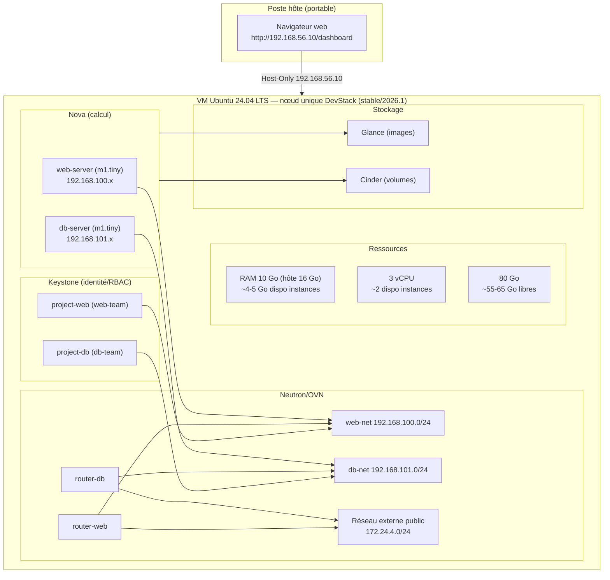
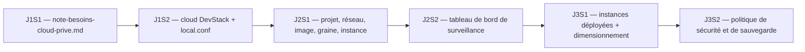

# Configuration d’un cloud d’entreprise avec OpenStack — JOUR 3

## Conception d’un Cloud d’entreprise (3 h) + Optimisation et sécurisation du Cloud privé (3 h) — 28/10/2026

**Fil conducteur :** Le matin, la note d’analyse des besoins du [jour 1](jour-1.md) devient une architecture cible dimensionnée sur la VM du laboratoire (10 Go/3 vCPU de référence sur hôte 16 Go/4c/4T ; 6 Go/2 vCPU en scénario B ; 12-14 Go/4 vCPU sur hôte 32 Go), puis un scénario complet est déployé : deux instances isolées à rôles représentatifs (« serveur web » et « serveur de base de données »), en réutilisant les projets, réseaux, images et graines des jours précédents. L’après-midi, cet environnement est sécurisé (RBAC, moindre privilège, groupes de sécurité), optimisé (goulots en nœud unique), sauvegardé et restauré, puis la formation se clôt par une synthèse et une feuille de route d’entreprise.

---

## Objectifs du Jour

- Traduire la note d’analyse des besoins du [jour 1](jour-1.md) en architecture cible dimensionnée sur la VM du laboratoire (10 Go/3 vCPU de référence sur hôte 16 Go/4c/4T ; 6 Go/2 vCPU en scénario B ; 12-14 Go/4 vCPU sur hôte 32 Go), avec marges et oversubscription raisonnée.
- Appliquer une démarche de planification (calcul, réseau, stockage) au regard des contraintes du laboratoire (virtualisation imbriquée, réseau NAT/interne, pas de port entrant public).
- Déployer un scénario complet multi-projets de bout en bout (deux instances à rôles représentatifs, sans service applicatif installé) en réutilisant les méthodes des [jours 1](jour-1.md) et [2](jour-2.md).
- Valider le déploiement par des tests de connectivité (SSH via adresse flottante, console web en secours) et documenter les résultats.
- Appliquer moindre privilège, RBAC et groupes de sécurité, puis formuler des recommandations de durcissement adaptées au laboratoire.
- Identifier les goulots d’étranglement en nœud unique et proposer des pistes d’optimisation réalistes.
- Mettre en place et tester une politique de sauvegarde et de restauration (instantanés, `local.conf`).
- Clore la formation par une synthèse des trois jours et une feuille de route de mise en œuvre en entreprise.

---

## Planning du Jour

| Séquence | Horaires | Thème | Durée |
|----------|----------|-------|-------|
| S1 | 09h00-09h45 | Planification et dimensionnement : traduction des besoins en architecture cible, contraintes VM (10 Go/3 vCPU de référence sur hôte 16 Go), marges, oversubscription | 45 min |
| S1 | 09h45-10h30 | Scénario complet d’entreprise : choix d’architecture, projets, réseaux, images, graines, quotas justifiés | 45 min |
| S1 | 10h30-11h45 | [Lab J3S1](#j3-lab-s1) : déploiement du scénario complet ([exercices 1.1](#j3-ex-1-1) à [1.4](#j3-ex-1-4) — vérifications, projets, réseaux, instances) | 1 h 15 |
| S1 | 11h45-12h00 | [Lab J3S1](#j3-lab-s1) : validation du déploiement, tests de connectivité, documentation ([exercice 1.5](#j3-ex-1-5)) | 15 min |
| — | 12h00-13h00 | Pause déjeuner (unique) | 1 h |
| S2 | 13h00-13h45 | Bonnes pratiques de sécurité et gestion des accès (RBAC, moindre privilège, groupes de sécurité, isolation réseau) | 45 min |
| S2 | 13h45-14h10 | Durcissement et optimisation (images de confiance, quotas justifiés, goulots d’étranglement en nœud unique, performances/coûts) | 25 min |
| S2 | 14h10-14h30 | Politique de sauvegarde et de restauration (instantanés, Cinder, sauvegarde de configuration, plan de reprise) | 20 min |
| S2 | 14h30-16h00 | [Lab J3S2](#j3-lab-s2) : sécurité, optimisation, sauvegarde, synthèse ([exercices 2.1](#j3-ex-2-1) à [2.4](#j3-ex-2-4)) | 1 h 30 |

---

<a id="j3-s1"></a>

## S1 — Conception d’un Cloud d’entreprise (09h00-12h00)

### Objectifs

- Traduire la note d’analyse des besoins du [jour 1](jour-1.md) en architecture cible et justifier le dimensionnement au regard des ressources réelles de la VM (10 Go/3 vCPU de référence sur hôte 16 Go/4c/4T ; 6 Go/2 vCPU en scénario B ; 12-14 Go/4 vCPU sur hôte 32 Go), avec marges et ratio d’oversubscription.
- Définir les projets, rôles, réseaux, images, graines et quotas justifiés pour un scénario complet à deux instances isolées.
- Déployer les deux instances à rôles représentatifs (`web-server` et `db-server`) en réutilisant la topologie et les méthodes des [jours 1](jour-1.md) et [2](jour-2.md).
- Valider le déploiement par des tests de connectivité (SSH via adresse flottante, console web en secours) et documenter les résultats.

### Contenu Théorique

#### 1. De l’analyse des besoins au dimensionnement

La note d’analyse des besoins produite au [jour 1](jour-1.md) (`note-besoins-cloud-prive.md`) constitue le point d’entrée du dimensionnement. Pour un Cloud d’entreprise, le dimensionnement doit rester honnête : dans un nœud unique (DevStack), toutes les ressources (contrôle, calcul, stockage, réseau) sont mutualisées sur la même VM. Il faut donc prévoir des marges pour les services OpenStack eux-mêmes (Keystone, Nova, Neutron/OVN, Glance, Cinder, RabbitMQ, MySQL, etcd, Apache/Horizon), pour le système d’exploitation Ubuntu et pour la charge de travail.

> **Concept clé** — Dimensionner honnêtement signifie : calculer le budget de ressources réellement disponible pour les instances, après avoir soustrait l’empreinte des services du cloud. L’objectif n’est pas de saturer la VM, mais de garantir la stabilité et la reproductibilité du laboratoire.

#### 2. Contraintes VM et budget de ressources

Le laboratoire s’exécute dans une VM soumise aux contraintes suivantes, conformes au cahier des charges :

| Élément | Valeur recommandée | Remarques |
|---------|---------------------|-----------|
| RAM | 10 Go sur un hôte 16 Go | **VM du laboratoire : 10 Go / 3 vCPU** sur un hôte 16 Go / 4c/4T. En scénario B (hôte 8 Go), réduire à 6 Go / 2 vCPU et prévoir 4 Go de swap. Sur hôte 32 Go, 12-14 Go / 4 vCPU. Une à deux instances `m1.tiny` (1 Go au total) tiennent ; les budgets ci-dessous sont donnés pour 10 Go, avec la variante 6 Go. |
| CPU | 3 vCPU (4 si hôte dédié) | 2 vCPU en scénario B ; 4 vCPU sur hôte 32 Go ou dédié. Virtualisation imbriquée activée si la VM héberge KVM. |
| Disque | 60-80 Go (alloué dynamiquement) | Cinder utilise un fichier de boucle LVM (~30 Go creux), DevStack occupe ~10 Go, marge pour images/journaux. |
| Réseau | NAT + Host-Only | Éviter ports entrants publics. Accès Horizon via `http://192.168.56.10/dashboard`. |
| Virtualisation | Accélération KVM si `/dev/kvm` existe | En mode OVN, `hypervisor list` affiche `QEMU` même quand KVM est actif : ce champ ne permet pas de conclure. Contrôle fiable : `ls -l /dev/kvm` et `-accel kvm` dans la ligne de commande du processus d’instance. |

**Budget de ressources type (VM 10 Go/3 vCPU de référence sur hôte 16 Go/4c/4T ; variante 6 Go/2 vCPU en scénario B) :**

| Ressource | Estimation (services OpenStack + OS) | Disponible pour instances (10 Go) | Commentaire |
|-----------|---------------------------------------|----------------------------|-------------|
| RAM | ~4-5 Go sur 10 Go | ~4-5 Go | Laisser toujours 1 Go libre. Sur 10 Go, une à deux instances `m1.tiny` (1 Go au total) tiennent avec marge ; ne pas en ajouter sans surveiller `free -h`. En variante 6 Go, ~2 Go disponibles et une seule `m1.tiny` recommandée. |
| vCPU | ~1 vCPU | ~2 vCPU | Avec 3 vCPU alloués, rester à 1:1 (deux `m1.tiny` = 2 vCPU) ; éviter l’oversubscription en lab. En variante 6 Go/2 vCPU, une seule `m1.tiny` à 1:1. |
| Stockage | ~15-25 Go utilisés | ~55-65 Go libres sur 80 Go | Dépend de Cinder/Swift et des images. En variante 60 Go, ~35-45 Go libres. Surveiller avec `df -h /`. |

<a id="j3-repere-pratique"></a>

> **Repère pratique (VM de référence à 10 Go/3 vCPU)** — La VM `lab-openstack` de référence est configurée à 10 Go/3 vCPU sur un hôte 16 Go/4c/4T. Le budget des instances se réduit en conséquence : ~4-5 Go disponibles (1 Go à garder libre), soit **une à deux instances `m1.tiny` (1 Go au total)**. Pour le scénario à deux instances (`web-server` + `db-server`), les lancer toutes les deux reste réaliste ; au-delà, arrêter ou supprimer une instance avant d’en lancer d’autres. En variante 6 Go/2 vCPU (scénario B), ~2 Go disponibles et une seule `m1.tiny` recommandée. Sur un hôte 32 Go, attribuer 12-14 Go/4 vCPU laisse ~7-9 Go disponibles.

> **Bon à savoir** — L’oversubscription (allouer plus de vCPU/RAM virtuels que physiques) est courant en Cloud. En nœud unique et en laboratoire, mieux vaut rester conservateur : privilégier `m1.tiny` (512 Mo, 1 vCPU) pour les instances du laboratoire, `m1.small` (2 Go, 1 vCPU) uniquement si la mémoire le permet.

#### 3. Scénario complet d’entreprise

Reprenons le cas d’entreprise du [jour 1](jour-1.md). Objectif : déployer deux instances isolées dans des projets distincts (ou au minimum avec isolation réseau) pour illustrer la séparation des rôles. Ces deux instances jouent un **rôle représentatif** : elles ne recevront aucun service applicatif. CirrOS, l’image de référence du laboratoire, est un système minimal qui n’héberge ni serveur HTTP ni moteur de base de données ; ce que l’on valide ici, c’est l’isolation réseau et le contrôle d’accès entre les deux rôles, pas un logiciel métier.

| Instance | Rôle représentatif | Graine (« flavor ») suggérée | Justification |
|----------|--------------------|------------------------------|---------------|
| `web-server` | « Serveur web » frontal | `m1.tiny` (512 Mo, 1 vCPU, 1 Go disque) | Charge légère, accessible via adresse flottante. |
| `db-server` | « Serveur de base de données » | `m1.tiny` (512 Mo, 1 vCPU, 1 Go disque) | Isolé du web, règles de sécurité restreintes (accès « base de données » uniquement depuis le réseau web). |

> **Pourquoi un rôle représentatif plutôt qu’un vrai service ?** — Installer un serveur HTTP ou un moteur de base de données déborderait le créneau et les ressources de la VM sans rien apprendre de plus sur OpenStack. L’isolation par projet, les groupes de sécurité et les tests de connectivité s’appliquent de la même façon à un service réel : en entreprise, il suffira de remplacer CirrOS par une image métier, les commandes restant identiques.

> **Pourquoi deux projets ?** — Pour renforcer l’isolation multi-projet (Keystone), on peut créer `project-web` et `project-db`, chacun avec son propre réseau locataire, son propre utilisateur (`member`) et son propre groupe de sécurité. C’est directement aligné avec le principe du moindre privilège vu au [jour 2](jour-2.md).

#### 4. Architecture cible dimensionnée



**Fig 9** — Architecture cible dimensionnée pour le scénario complet (nœud unique). Deux réseaux locataires isolés illustrent la séparation entre « serveur web » et « serveur de base de données ». Les adresses flottantes (réseau externe `172.24.4.0/24`) permettent l’accès depuis la VM DevStack elle-même ; l’accès depuis le poste hôte se fait par le réseau host-only (Horizon).

> **Note sur les plages** : on utilise `192.168.100.0/24` pour `web-net` et `192.168.101.0/24` pour `db-net`. Ces plages sont hors conflit avec `192.168.56.0/24` (host-only), `10.0.2.0/24` (NAT VirtualBox) et `172.24.4.0/24` (réseau externe). Attention : `web-net` réutilise la plage `192.168.100.0/24` déjà employée par `demo-net` au [jour 2](jour-2.md). Neutron tolère ce chevauchement (`allow_overlapping_ips` vaut `True`), mais il rend le diagnostic ambigu. Deux options : conserver `demo-net` et accepter le chevauchement (les deux réseaux restent isolés par projet), ou supprimer la topologie du [jour 2](jour-2.md) avant de commencer (`openstack router remove subnet demo-router demo-subnet`, `openstack router delete demo-router`, `openstack network delete demo-net`, en contexte `admin`).

### Mapping Sécurité

Référentiel : principes des **CIS Benchmarks** (cloud et Ubuntu), transposés à OpenStack. Il n’existe pas de benchmark CIS OpenStack dédié ; les correspondances ci-dessous sont pédagogiques et ne citent pas d’identifiants CIS officiels.

| Référence | Réf. technique | Description |
|-----------|----------------|-------------|
| CIS (transposé) — Conception et dimensionnement | Domaine « quotas et isolation » | Quotas justifiés par projet, marges de ressources, pas de sur-allocation. |
| CIS (transposé) — Neutron (segmentation) | Domaine « réseau » | Réseaux locataires distincts par projet, adresses flottantes limitées à ce qui est nécessaire. |
| CIS (transposé) — Nova (calcul) | Domaine « limites de ressources » | Flavors justifiés, nombre d’instances contenu dans le budget réel de la VM. |

> **Pourquoi mapper la sécurité dans cette séquence ?** — Les choix de dimensionnement et d’isolation pris ici (quotas, réseaux par projet, adresses flottantes) fixent la surface d’attaque du déploiement. Une architecture qui isole dès la conception coûte moins cher qu’un durcissement subi après coup.

<a id="j3-lab-s1"></a>

### Lab J3S1 — Déploiement et validation du scénario (10h30-12h00)

**Durée : 1 h 30 — [exercices 1.1](#j3-ex-1-1) à [1.5](#j3-ex-1-5), checkpoints cochables**

Le cloud du [jour 1](jour-1.md) tourne toujours sur la VM `lab-openstack` sous le compte `stack`. Identifiants du laboratoire, communs aux trois jours : `admin`/`lab123` (administration), `web-user`/`lab123` et `db-user`/`lab123` (créés en [exercice 1.2](#j3-ex-1-2)), `ENCRYPTION_PASS=lab123` (phrase secrète réutilisée en séance 2).

<a id="j3-ex-1-1"></a>

#### Exercice 1.1 : Vérification du cloud et chargement de l’environnement (10h30-10h40, 10 min)

1. **Vérifier l’état du cloud** (5 min) : s’assurer d’être connecté en tant qu’utilisateur `stack` (jamais `root`).
2. **Charger l’environnement admin** (5 min) : `source openrc admin admin`, puis vérifier jeton, catalogue, images et graines, hyperviseur, agents OVN.

```bash
# 1. Vérification rapide
whoami
cd /opt/stack/devstack          # répertoire DevStack (openrc s’y trouve)
source openrc admin admin
openstack token issue
openstack service list
openstack image list ; openstack flavor list  # CirrOS et m1.tiny requis plus bas
openstack hypervisor list
openstack network agent list  # agents OVN
```

> **Point de vigilance** : avec OVN, on ne recherche pas les agents `q-l3`/`q-dhcp`. Se fier à `openstack network agent list`. Par ailleurs, relever le nom exact de l’image CirrOS dans `openstack image list` : il dépend de la version livrée par `stable/2026.1` et s’utilise tel quel dans `--image` ([rappel du jour 2](jour-2.md)).

> **Rejouabilité du lab** — Sur cette version de DevStack, certaines créations sont protégées contre les doublons et échouent proprement en `409 Conflict` (`project create`, `user create`, `keypair create`) ; d’autres **non** et recréent un second objet du même nom (`network create`, `security group create`) ou allouent une nouvelle adresse (`floating ip create`). Relancer le lab sur un état déjà créé produit alors des doublons et des erreurs en cascade (`More than one Network exists with the name 'web-net'`). Avant de rejouer, vérifier l’existence des objets et les supprimer ou les réutiliser :
>
> ```bash
> openstack network list --project project-web        # web-net déjà présent ?
> openstack security group list --project project-web # web-sg déjà présent ?
> openstack keypair list                              # web-key déjà présent ?
> openstack floating ip list --project project-web    # adresse déjà allouée ?
> ```
>
> En cas de doute, repartir d’un instantané de machine pris avant le lab.

<a id="j3-ex-1-2"></a>

#### Exercice 1.2 : Créer les projets, utilisateurs et rôles (10h40-10h55, 15 min)

1. **Créer `project-web`** (5 min) avec description traçable.
2. **Créer `web-user`** (5 min) et lui attribuer le rôle `member`.
3. **Répéter pour `project-db` / `db-user`** (5 min).

```bash
# project-web
openstack project create --description "Projet Web - cas d'entreprise (J3)" project-web
openstack user create --project project-web --password lab123 web-user
openstack role add --project project-web --user web-user member

# project-db
openstack project create --description "Projet DB - cas d'entreprise (J3)" project-db
openstack user create --project project-db --password lab123 db-user
openstack role add --project project-db --user db-user member

# Vérification
openstack role assignment list --names --project project-web
openstack role assignment list --names --project project-db
```

> **Bonnes pratiques** : mots de passe alphanumériques uniquement (contrainte DevStack) — `lab123`, la valeur unique du laboratoire, y répond. Comptes nominatifs distincts par projet, rôle `member` seul : c’est le moindre privilège appliqué.

<a id="j3-ex-1-3"></a>

#### Exercice 1.3 : Créer les réseaux, sous-réseaux, routeurs et adresses flottantes (10h55-11h20, 25 min)

1. **Créer `web-net` / `web-subnet`** (8 min) dans `project-web` (plage `192.168.100.0/24`).
2. **Créer `db-net` / `db-subnet`** (8 min) dans `project-db` (plage `192.168.101.0/24`).
3. **Créer routeurs et connecter au réseau externe `public`** (9 min). Allouer une adresse flottante par projet.

```bash
# ----- Topologie de project-web (contexte admin, ressources créditées au projet) -----
openstack network create --project project-web web-net
# --project : appartenance au projet (isolation multi-projet)

openstack subnet create --project project-web --network web-net \
  --subnet-range 192.168.100.0/24 --gateway 192.168.100.1 \
  --dns-nameserver 8.8.8.8 web-subnet
# --network : rattache le sous-réseau au réseau logique
# --subnet-range : plage du lab (hors conflit avec host-only et NAT)
# --gateway : passerelle par défaut des instances (première adresse de la plage)
# --dns-nameserver : résolution de noms, accessible via le SNAT du routeur
#
# Attention : 192.168.100.0/24 est aussi la plage de demo-net créée au jour 2.
# Si le projet demo existe encore, deux sous-réseaux partagent la même plage
# (autorisé par Neutron, mais source de confusion dans les diagnostics).
# Le plus simple : nettoyer le projet demo en début de journée, ou accepter le
# chevauchement en le signalant. Vérification : openstack subnet list --all-projects

openstack router create --project project-web web-router
openstack router add subnet web-router web-subnet
# interface interne du routeur vers le réseau locataire
openstack router set --external-gateway public web-router
# passerelle externe : indispensable au SNAT et aux adresses flottantes
openstack floating ip create --project project-web public
# --project : adresse créditée au projet ; public : réseau source (172.24.4.0/24)

# ----- Topologie de project-db (même schéma, plage distincte) -----
openstack network create --project project-db db-net
openstack subnet create --project project-db --network db-net \
  --subnet-range 192.168.101.0/24 --gateway 192.168.101.1 \
  --dns-nameserver 8.8.8.8 db-subnet
# même lecture des drapeaux que pour web-subnet, avec la plage 192.168.101.0/24
openstack router create --project project-db db-router
openstack router add subnet db-router db-subnet
openstack router set --external-gateway public db-router
openstack floating ip create --project project-db public
```

> **Point de vigilance** : toujours spécifier `--project` lors de la création de ressources réseau/subnet/router/floating-ip pour qu’elles appartiennent au bon projet.

<a id="j3-ex-1-4"></a>

#### Exercice 1.4 : Déployer les deux instances et leur affecter des adresses flottantes (11h20-11h45, 25 min)

1. **Préparer les paires de clés** (8 min) pour `web-user` et `db-user` (ou réutiliser une paire existante).
2. **Créer les groupes de sécurité minimaux** (7 min) : SSH (22/tcp) + ICMP autorisés. Pour `db-server`, prévoir la restriction au réseau web, appliquée en [S2](#j3-s2) ([exercice 2.1](#j3-ex-2-1)).
3. **Lancer `web-server` et `db-server`** (10 min) avec graine `m1.tiny`, image CirrOS, réseau dédié et groupe de sécurité dédié (rôles représentatifs, sans service applicatif). L’adresse flottante à associer est celle allouée à l’[exercice 1.3](#j3-ex-1-3).

```bash
# ----- Contexte web-user : l’instance naît dans le projet du jeton -----
source openrc web-user project-web
export OS_PASSWORD=lab123
# openrc réécrit OS_PASSWORD avec ADMIN_PASSWORD : redéfinir après le source

test -f ~/.ssh/web_key || ssh-keygen -t rsa -b 2048 -f ~/.ssh/web_key -N ""
# test -f ... || : ne génère la clé que si elle est absente (sinon ssh-keygen
# demande « Overwrite (y/n)? » et échoue en mode non interactif)
# -t rsa : algorithme de signature ; -b 2048 : longueur en bits
# -f : chemin des fichiers de clé (privée et .pub) ; -N "" : sans phrase secrète (convention de lab)
chmod 600 ~/.ssh/web_key
# droits stricts sur la clé privée (exigence de SSH)
openstack keypair create --public-key ~/.ssh/web_key.pub web-key
# --public-key : enregistre la clé publique dans Nova

openstack security group create web-sg
# groupe de sécurité neuf : tout est bloqué en entrée, la sortie est autorisée
openstack security group rule create --proto tcp --dst-port 22 web-sg
# --proto tcp : protocole ; --dst-port 22 : port de destination SSH
openstack security group rule create --proto icmp web-sg
# --proto icmp : autorise l’écho (ping) pour le diagnostic

openstack server create --flavor m1.tiny --image cirros-0.6.3-x86_64-disk \
  --network web-net --security-group web-sg --key-name web-key web-server
# --flavor : graine (taille) ; --image : nom exact relevé dans openstack image list
# --network : réseau locataire d’attache ; --security-group : pare-feu appliqué
# --key-name : clé SSH autorisée ; web-server : nom de l’instance
openstack floating ip list
# relever l’adresse libre allouée (colonne Floating IP)
openstack server add floating ip web-server <IP_FLOTTANTE_WEB>
# associe l’adresse flottante à l’instance

# ----- Contexte db-user (même schéma) -----
source openrc db-user project-db
export OS_PASSWORD=lab123
test -f ~/.ssh/db_key || ssh-keygen -t rsa -b 2048 -f ~/.ssh/db_key -N ""
chmod 600 ~/.ssh/db_key
openstack keypair create --public-key ~/.ssh/db_key.pub db-key
openstack security group create db-sg
openstack security group rule create --proto tcp --dst-port 22 db-sg
openstack security group rule create --proto icmp db-sg
# la restriction de db-sg au réseau web se fait en S2
openstack server create --flavor m1.tiny --image cirros-0.6.3-x86_64-disk \
  --network db-net --security-group db-sg --key-name db-key db-server
# mêmes drapeaux que pour web-server, dans le périmètre db
openstack floating ip list
openstack server add floating ip db-server <IP_FLOTTANTE_DB>
```

> **Ordre des commandes** : le script `openrc` réécrit `OS_PASSWORD` avec le mot de passe administrateur ([rappel du jour 2](jour-2.md)). D’où l’ordre obligatoire `source openrc web-user project-web` puis `export OS_PASSWORD=lab123` ; inverser les deux écrase le bon mot de passe.

> **Conseil pratique** : pour `db-sg`, restreindre l’accès SSH et le port « base de données » aux adresses du réseau web (`192.168.100.0/24`) plutôt qu’à `0.0.0.0/0`. C’est un premier pas vers le durcissement (abordé en [S2](#j3-s2), [exercice 2.1](#j3-ex-2-1)). Le port « base de données » n’est ici qu’une représentation : CirrOS n’héberge aucun serveur de base de données.

<a id="j3-ex-1-5"></a>

#### Exercice 1.5 : Validation et documentation (11h45-12h00, 15 min)

1. **Vérifier l’état des instances** (5 min) : `openstack server list --all-projects` ou par projet.
2. **Tester la connectivité** (5 min) : ping ICMP via adresse flottante, SSH avec la clé privée. Utiliser la console web (`openstack console url show --novnc`) en secours.
3. **Documenter** (5 min) : noter adresses IP fixes/flottantes, projets, utilisateurs, réseaux dans le tableau ci-dessous.

Gabarit de documentation à recopier et compléter avec les valeurs réelles :

| Rôle | Projet | Utilisateur (rôle) | Réseau | IP fixe | Adresse flottante | Groupe de sécurité |
|------|--------|--------------------|--------|---------|-------------------|--------------------|
| Serveur web | `project-web` | `web-user` (member) | `web-net` (192.168.100.0/24) | 192.168.100.x | 172.24.4.x | `web-sg` |
| Serveur base | `project-db` | `db-user` (member) | `db-net` (192.168.101.0/24) | 192.168.101.x | 172.24.4.x | `db-sg` |

Renseigner chaque cellule à partir de `openstack server show <instance> -c addresses` (adresses fixe et flottante), `openstack role assignment list --names --project <projet>` (utilisateur et rôle), `openstack network list --project <projet>` (réseau) et `openstack security group list --project <projet>` (groupe). Pour le détail et la variante, voir [jour 2, exercice 1.5](jour-2.md#j2-ex-1-5).

```bash
# Contrôle du câblage du réseau externe sur br-ex (mode OVN) :
# DevStack rattache normalement 172.24.4.0/24 à br-ex. Vérifier la présence
# de l’adresse ; sinon ping et SSH vers les adresses flottantes échouent.
ip -br addr show br-ex
# doit afficher 172.24.4.1/24 ; si l’adresse manque, la rétablir :
sudo ip link set br-ex up
sudo ip addr add 172.24.4.1/24 dev br-ex
# « Address already assigned » = adresse déjà présente, aucune action


# Retour admin pour vue globale
source openrc admin admin
openstack server list --all-projects
# server list accepte --all-projects ; floating ip list ne l’accepte pas
# (option absente de l’API) : cibler chaque projet avec --project
openstack floating ip list --project project-web
openstack floating ip list --project project-db

# Tests depuis la VM DevStack (les adresses flottantes 172.24.4.x ne sont pas routées vers le poste hôte)
# Depuis la VM : ping <IP_FLOTTANTE_WEB>, ssh -i ~/.ssh/web_key cirros@<IP_FLOTTANTE_WEB>
# Console web : source openrc web-user project-web && export OS_PASSWORD=lab123 && openstack console url show --novnc web-server
```

**Checkpoints [S1](#j3-s1) :**

- [ ] cloud vérifié
- [ ] projets, utilisateurs et rôles créés
- [ ] réseaux, routeurs et adresses flottantes opérationnels
- [ ] deux instances fonctionnelles
- [ ] connectivité validée
- [ ] résultats documentés

**Correspondance Horizon — retrouver le déploiement dans l’interface.** Chaque action de ligne de commande de [S1](#j3-s1) se contrôle visuellement dans Horizon (session `admin` / `lab123`) :

| Action CLI | Chemin Horizon |
|------------|----------------|
| `openstack project create` / `user create` / `role add` | Identité → Projets, Utilisateurs |
| `openstack network create` / `subnet create` | Projet → Réseau → Réseaux |
| `openstack router create` / `add subnet` / `set --external-gateway` | Projet → Réseau → Routeurs |
| `openstack security group create` / `rule create` | Projet → Réseau → Groupes de sécurité |
| `openstack floating ip create` / `add floating ip` | Projet → Réseau → Adresses flottantes |
| `openstack server create` / `server list` | Projet → Calcul → Instances |
| `openstack console url show` | Projet → Calcul → Instances → Console |
| `openstack hypervisor stats show` | Admin → Tableau de bord (capacité de l’hyperviseur) |

> **Conseil pratique** : basculer le projet courant en haut d’écran (menu déroulant) pour vérifier l’isolation — les ressources de `project-web` et `project-db` ne s’affichent jamais ensemble. C’est la traduction visuelle du moindre privilège appliqué en ligne de commande.

### Vérification pratique

Contrôle croisé des livrables de [S1](#j3-s1), à mener seul (environ 15 min). Il relie la note d’analyse des besoins du [jour 1](jour-1.md) à l’infrastructure réellement déployée.

1. **Note face à la capacité réelle** — relever les hypothèses de la [section 8 de `note-besoins-cloud-prive.md`](jour-1.md#j1-note-structure), puis comparer avec la capacité de l’hyperviseur :

```bash
source openrc admin admin
openstack hypervisor stats show
# memory_mb et memory_mb_used : garder une marge sous les capacités. Sur 10 Go,
#   viser au moins 1 Go libre ; sur 6 Go, 500 Mo à 1 Go ; sur 12-14 Go, 2 à 4 Go.
#   vcpus et vcpus_used : idem pour les vCPU
```

Les marges prévues dans la note doivent tenir face aux chiffres réels ; un écart important se consigne dans la feuille de route ([exercice 2.4](#j3-ex-2-4)).

2. **Isolation des projets** — `openstack role assignment list --project project-web --names` puis `openstack role assignment list --project project-db --names` : chaque utilisateur n’a de rôle que dans son projet. Bascule en contexte locataire (`source openrc web-user project-web`, `export OS_PASSWORD=lab123`) : `openstack project list` échoue en `403 Forbidden` (le rôle `member` n’a pas le droit d’inventaire global) ; l’équivalent autorisé est `openstack project list --my-projects`, qui ne montre que `project-web`. Revenir au contexte `admin` ensuite.

3. **Connectivité** — refaire les tests de l’[exercice 1.5](#j3-ex-1-5), une fois `br-ex` câblé :

```bash
# Depuis la VM DevStack, en contexte web-user :
ping -c 4 <IP_FLOTTANTE_WEB>
ssh -i ~/.ssh/web_key cirros@<IP_FLOTTANTE_WEB>
# Rappel : vérifier ip -br addr show br-ex ; si 172.24.4.1/24 manque,
#   sudo ip link set br-ex up et sudo ip addr add 172.24.4.1/24 dev br-ex
```

4. **Documentation** — vérifier que le tableau de l’[exercice 1.5](#j3-ex-1-5) contient bien les adresses fixes, les adresses flottantes, les projets et les réseaux des deux instances.

- [ ] Marges prévues dans la note tenables face à la capacité réelle de l’hyperviseur
- [ ] Isolation confirmée : un projet, un utilisateur, un réseau par direction
- [ ] Ping et SSH réussis vers les deux adresses flottantes après câblage de `br-ex`
- [ ] Tableau de documentation complet (adresses, projets, réseaux)

### Correction pas à pas (repliée)

<details><summary>Correction détaillée — Lab J3S1</summary>

1. **Exercice 1.1 — Vérification du cloud** : `openstack network agent list` doit afficher les agents OVN (`OVN Controller Gateway agent`, et `OVN Metadata agent` ou `OVN agent` selon la version) avec `Alive` à `:-)` et `State` à `UP`. Les processus `ovn-northd`, `ovn-controller` et `ovsdb-server` sont des unités systemd, pas des agents Neutron : les contrôler avec `systemctl status ovn-central ovn-controller`. Note : `hypervisor list` affiche `QEMU` comme type d’hyperviseur dans cette version de DevStack, même lorsque l’accélération KVM est active (instance lancée avec `-accel kvm`) ; ce champ ne permet donc pas de conclure à l’absence de KVM. Le contrôle fiable est `ls -l /dev/kvm` et la présence de `-accel kvm` dans la ligne de commande du processus d’instance.
2. **Exercice 1.2 — Projets et rôles** : `openstack role assignment list --names --project project-web` montre `web-user` avec rôle `member`.
3. **Exercice 1.3 — Réseaux** : `web-net` (192.168.100.0/24), `db-net` (192.168.101.0/24), routeurs connectés à `public`. Éviter chevauchement avec `192.168.56.0/24` et `10.0.2.0/24`.
4. **Exercice 1.4 — Instances** : `openstack server list --all-projects` affiche `web-server` et `db-server` dans l’état `ACTIVE`.
5. **Exercice 1.5 — Connectivité** : après câblage de `br-ex` (voir le bloc « Tests depuis la VM » dans l’[exercice 1.4](#j3-ex-1-4)), `ping -c 4 <IP_FLOTTANTE_WEB>` réussi ; `ssh -i ~/.ssh/web_key cirros@<IP_FLOTTANTE_WEB>` fonctionne. Console web accessible si SSH bloqué.
6. **Contrôle final — Ressources** : `free -h`, `df -h /`, `openstack hypervisor stats show` pour vérifier la charge.

**Dépannage — symptômes fréquents du déploiement :**

| Symptôme | Cause probable | Remède |
|----------|----------------|--------|
| SSH vers l’adresse flottante en échec (connexion refusée ou délai dépassé) | Règle TCP/22 absente du groupe de sécurité, adresse flottante non associée, routeur sans interface externe, `br-ex` non câblé | Lister les règles (`openstack security group rule list <groupe>`) et vérifier la règle 22/tcp ; relire l’association dans `openstack server show <instance>` ; vérifier le routeur (`openstack router show <routeur>`) ; contrôler `ip -br addr show br-ex` et, si l’adresse `172.24.4.1/24` manque, faire `sudo ip link set br-ex up` puis `sudo ip addr add 172.24.4.1/24 dev br-ex` ; sinon recourir à la console web |
| Instance en état `ERROR` | Capacité insuffisante (mémoire ou vCPU), image invalide, port réseau absent | Lire le champ `fault` de `openstack server show <instance>` ; comparer avec `openstack hypervisor stats show` ; corriger puis recréer l’instance |

</details>

### Bonnes pratiques et contre-mesures

| Bonnes pratiques | Contre-mesures / vigilance |
|-------------------|-----------------------------|
| Dimensionner avec marges (1 Go libre sur 10 Go ; 500 Mo à 1 Go sur 6 Go ; 2-4 Go sur 12-14 Go) | Une à deux instances `m1.tiny` sur 10 Go/3 vCPU ; une seule sur 6 Go/2 vCPU ; davantage seulement si `free -h` et la charge le permettent. |
| Isoler par projet/réseau | Ne pas réutiliser la même plage pour web et db. Vérifier absence de chevauchement. |
| Spécifier `--project` systématiquement | Éviter de créer des ressources dans le mauvais projet (erreur fréquente). |
| Utiliser adresses flottantes uniquement si nécessaire | Accès via host-only/console web possible. Pas de port entrant public requis. |
| Tester avec console web en secours | Utile si règles de groupe de sécurité trop restrictives ou problème SSH. |

### Exercices + solutions (repliées)

<details><summary>Exercices complémentaires (à emporter — le [lab J3S1](#j3-lab-s1) occupe le créneau)</summary>

1. **Exercice A** (à emporter) : Justifier le dimensionnement dans un tableau (RAM/CPU/disque alloués et disponibles). Indiquer marges.
2. **Exercice B** (à emporter) : Créer un troisième réseau isolé et expliquer pourquoi ce n’est pas nécessaire ici.
3. **Exercice C** (à emporter) : Comparer accès via adresse flottante et accès par console web (avantages/inconvénients).

</details>

<details><summary>Solutions</summary>

1. **A** : sur la VM de référence (10 Go/3 vCPU), ~4-5 Go disponibles pour les instances ; les deux `m1.tiny` (1 Go au total) tiennent avec marge. En variante 6 Go/2 vCPU, ~2 Go disponibles et une seule `m1.tiny` recommandée. Sur un hôte 32 Go (12-14 Go/4 vCPU), la marge monte à 7-9 Go. Disque suffisant.
2. **B** : Un seul réseau par projet suffit. Créer un réseau supplémentaire augmente la complexité sans valeur pédagogique ici.
3. **C** : L’adresse flottante permet le SSH depuis la VM DevStack ; la console web est accessible depuis Horizon (poste hôte via host-only) sans SSH, utile en dépannage. Aucun port entrant public requis.

</details>

### Ce qu’on a retenu

> - Le dimensionnement part de la note d’analyse des besoins, pas de l’envie de saturer la VM.
> - En nœud unique, l’empreinte des services OpenStack est non négligeable : prévoir des marges.
> - L’isolation multi-projet + réseaux distincts renforce la séparation entre rôles (web/db).
> - OVN change les réflexes : diagnostic via `openstack network agent list` et unités `ovn-*`.
> - Toujours valider par tests concrets (ping + SSH + console web).

---

<a id="j3-s2"></a>

## S2 — Optimisation et sécurisation du Cloud privé (13h00-16h00)

### Objectifs

- Appliquer les bonnes pratiques de sécurité et de gestion des accès (Keystone RBAC, moindre privilège, groupes de sécurité, isolation réseau).
- Formuler des recommandations de durcissement adaptées au laboratoire et identifier les points de vigilance (CIS/OpenStack best practices).
- Identifier les goulots d’étranglement en nœud unique, proposer des pistes d’optimisation des performances et des coûts réalistes.
- Mettre en place une politique de sauvegarde et de restauration réaliste en laboratoire (instantanés d’instances, volumes Cinder si disponibles, sauvegarde de `local.conf` et configurations).
- Clore la formation par une synthèse des trois jours et une feuille de route de mise en œuvre en entreprise.

### Contenu Théorique

#### 1. Sécurité et gestion des accès : RBAC et moindre privilège

Le principe du moindre privilège consiste à n’accorder que les droits strictement nécessaires à l’accomplissement d’une tâche. Dans OpenStack, cela se traduit par :

| Élément | Recommandation | Justification |
|---------|----------------|---------------|
| Projets | Un projet par équipe/application | Isolation des ressources et des quotas. |
| Utilisateurs | Un compte nominatif par personne | Traçabilité des actions (journalisation). |
| Rôles | `member` par défaut ; `reader` pour supervision/audit ; `admin` réservé aux administrateurs de plateforme | Limite l’impact d’un compte compromis. |
| Groupes de sécurité | Règles minimales (seulement ports nécessaires) | Réduction de la surface d’attaque. |
| Isolation réseau | Réseaux locataires distincts, pas de partage inutile | Séparation entre environnements (web/db). |

> **Concept clé** — L’isolation est à plusieurs niveaux : identité (Keystone), réseau (Neutron), calcul (Nova), stockage (Cinder/Glance). Un seul niveau défaillant peut compromettre l’isolation globale.

#### 2. Groupes de sécurité et restriction des points d’accès

Les groupes de sécurité sont des pare-feux virtuels appliqués aux ports d’instance. Par défaut, tout trafic entrant est bloqué ; seules les règles explicites autorisent le trafic.

| Scénario | Règles recommandées | Commentaire |
|----------|---------------------|-------------|
| `web-server` | SSH (22/tcp) ; ICMP ; HTTP (80/tcp) si exposé | Restreindre SSH à la source réelle du trafic : `172.24.4.1/32` (adresse de `br-ex` sur la VM DevStack) pour un accès depuis cette VM via adresse flottante, ou le réseau interne pour un accès direct. Le port HTTP reste fermé ici, CirrOS n’hébergeant pas de serveur HTTP. |
| `db-server` | SSH restreint au réseau web (`192.168.100.0/24`) ; port « base de données » restreint au réseau web ; ICMP | Jamais autoriser 0.0.0.0/0 pour SSH/DB ; le port « base de données » est une représentation, aucun serveur de base de données n’étant installé. |

> **Bon à savoir** — Dans ce laboratoire, l’accès se fait via host-only (`192.168.56.10`) et adresses flottantes. Aucun port entrant public n’est requis. C’est une contrainte réaliste (environnement réseau avec droits limités).

#### 3. Durcissement : images, mots de passe, clés

| Domaine | Recommandation lab | Remarques |
|---------|--------------------|-----------|
| Images | Utiliser des images officielles/validées (CirrOS ici pour le laboratoire). En production, images de base durcies, signées. | Ne pas utiliser d’images non vérifiées. |
| Authentification | Mots de passe alphanumériques, comptes nominaux, rotation à envisager. | Éviter partage de compte `admin`. |
| Accès SSH | Authentification par clé uniquement (désactiver mot de passe si configuré). | Clés avec permissions 600. |
| Horizon/API | Accès restreint au réseau de gestion (host-only). | HTTP en clair dans ce laboratoire ; terminaison TLS (certificat auto-signé) présentée comme option de durcissement, à prévoir en production. |
| Secrets | Jamais committer mots de passe/clés. Utiliser gabarits. | Conformément aux règles de sécurité projet. |

#### 4. Optimisation : performances, coûts, goulots d’étranglement en nœud unique

En nœud unique (DevStack), les goulots d’étranglement typiques sont :

| Ressource | Symptôme | Piste d’optimisation (lab) |
|-----------|----------|----------------------------|
| RAM | OOM, services instables, instances en `ERROR` | Réduire nombre d’instances, utiliser `m1.tiny`, ajouter swap (6 Go VM en scénario B), désactiver services non essentiels (tempest, dstat si inutile). |
| CPU | Instances lentes, `stack.sh` long | Limiter oversubscription (max 2-3 vCPU virtuels), privilégier KVM (`/dev/kvm`), éviter resize simultanés. |
| Disque I/O | Lenteur, Cinder saturé | Allouer 60-80 Go, surveiller `df -h /`, `iostat` si disponible. Éviter la création massive de volumes et d’instantanés. |
| Réseau | Latence accrue | OVN efficace en lab ; éviter topologies sur-complexes. |

**Optimisation coûts (réaliste)** : privilégier des graines justifiées (`m1.tiny`), quotas restrictifs par projet, libérer ressources inutilisées (arrêter/supprimer instances non utilisées), éviter duplication d’images.

#### 5. Sauvegarde et restauration réaliste en laboratoire

L’objectif est de mettre en place une politique simple, reproductible et réaliste pour le lab. Le tableau ci-dessous fixe le périmètre : ce qui mérite d’être sauvegardé, à quelle fréquence, et surtout si la restauration a déjà été exercée.

| Élément | Méthode | Fréquence (lab) | Restauration testée ? |
|---------|---------|-----------------|------------------------|
| `local.conf` | Copie horodatée, doublée d’une copie chiffrée (`ENCRYPTION_PASS`) | Avant modification / avant `stack.sh`/`unstack.sh` | Oui (déchiffrement puis `cmp`). |
| Configurations OpenStack | Sauvegarde des fichiers générés par DevStack (`/opt/stack/devstack/`, fichiers openrc) | Après configuration stable | Oui. |
| Instances (état) | Instantané Nova (image instantanée) | Après déploiement validé | Testable (créer une instance depuis l’instantané). |
| Volumes (données) | Instantané Cinder (si volumes utilisés) | Après modification données | Testable. |
| Swift (si activé) | Sauvegarde objets (optionnel [jour 3](jour-3.md)) | Selon besoin | Optionnel. |

> **Attention** — `./clean.sh` est destructif : il supprime les données. `./unstack.sh` arrête les services sans détruire les données. Sauvegarder avant toute exécution de `clean.sh`.

Reste à enchaîner ces opérations dans un ordre sûr : le plan de reprise minimal ci-dessous tient en six étapes, chacune rejouable indépendamment des autres.

**Plan de reprise minimal (lab)** :

1. Sauvegarder `/opt/stack/devstack/local.conf` horodaté, avec sa copie chiffrée (`openssl enc`, phrase secrète `ENCRYPTION_PASS`).
2. Sauvegarder `openrc` et clés SSH.
3. Créer un instantané Nova des instances validées.
4. Si Cinder est utilisé, créer un instantané de volume.
5. Tester la restauration : créer une instance depuis l’instantané Nova et vérifier la connectivité.
6. En cas de réinstallation : restaurer `local.conf`, relancer `stack.sh`, réimporter les instantanés si besoin.

### Mapping Sécurité

Référentiel : principes des **CIS Benchmarks** (cloud et Ubuntu), transposés à OpenStack. Il n’existe pas de benchmark CIS OpenStack dédié ; les correspondances ci-dessous sont pédagogiques et ne citent pas d’identifiants CIS officiels.

| Référence | Réf. technique | Description |
|-----------|----------------|-------------|
| CIS (transposé) — Keystone (gestion des identités) | Domaine « comptes et autorisations » | Comptes nominatifs, moindre privilège, `admin` réservé à l’administration de plateforme. |
| CIS (transposé) — Neutron (segmentation) | Domaine « réseau » | Groupes de sécurité restrictifs, jamais `0.0.0.0/0` pour SSH ou base de données. |
| CIS (transposé) — Journalisation | Domaine « audit et traçabilité » | Consulter et conserver les journaux ; ne pas désactiver la journalisation ([rappel du jour 2](jour-2.md)). |
| CIS (transposé) — Sauvegarde | Domaine « protection des données » | Sauvegardes horodatées, restaurations testées périodiquement. |

> **Pourquoi mapper la sécurité dans cette séquence ?** — Le matin a construit le déploiement ; l’après-midi doit le rendre défendable. Les deux volets sont indissociables : une sauvegarde non testée et un compte trop privilégié se neutralisent l’un l’autre.

<a id="j3-lab-s2"></a>

### Lab J3S2 — Sécurisation, optimisation et sauvegarde (14h30-16h00)

**Durée : 1 h 30 — [exercices 2.1](#j3-ex-2-1) à [2.4](#j3-ex-2-4), checkpoints cochables**

Mêmes identifiants qu’en séance 1. La phrase secrète de chiffrement n’est pas présente dans le shell par défaut : la séance 2 commence par `export ENCRYPTION_PASS=lab123`, à renouveler dans toute nouvelle session de terminal.

<a id="j3-ex-2-1"></a>

#### Exercice 2.1 : Renforcer la sécurité (RBAC, groupes de sécurité restrictifs) (14h30-14h50, 20 min)

1. **Vérifier assignations rôles** (5 min) : s’assurer `web-user`/`db-user` n’ont que `member`.
2. **Restreindre `db-sg`** (10 min) : supprimer la règle SSH ouverte sur `0.0.0.0/0`, puis autoriser SSH et ICMP uniquement depuis le réseau web (`192.168.100.0/24`). Le même principe s’appliquerait au port d’un vrai serveur de base de données.
3. **Vérifier** (5 min) : lister les règles du groupe de sécurité.

```bash
source openrc admin admin
openstack role assignment list --names --project project-web
# --names : affiche les noms lisibles (utilisateur, rôle, projet)
openstack role assignment list --names --project project-db

# Restreindre db-sg (contexte db-user)
source openrc db-user project-db
export OS_PASSWORD=lab123
# openrc réécrit OS_PASSWORD : redéfinir le mot de passe de db-user après le source
openstack security group rule list db-sg
# repérer les lignes dont la colonne IP Range vaut « 0.0.0.0/0 » (SSH et ICMP par
# défaut) et relever leurs identifiants : il faut supprimer les DEUX règles
# ouvertes, sinon le checkpoint « plus de 0.0.0.0/0 » ne peut pas être atteint.
openstack security group rule delete <IDENTIFIANT_REGLE_SSH>
openstack security group rule delete <IDENTIFIANT_REGLE_ICMP>
# recréer des règles limitées au réseau web :
openstack security group rule create --proto tcp --dst-port 22 --remote-ip 192.168.100.0/24 db-sg
# --proto / --dst-port : SSH reste ouvert, mais la source est bornée…
# --remote-ip : …à une plage précise, jamais 0.0.0.0/0
openstack security group rule create --proto icmp --remote-ip 192.168.100.0/24 db-sg
# écho ICMP depuis le réseau web uniquement
openstack security group rule list db-sg
# contrôle : plus aucune ligne 0.0.0.0/0 en entrée
```

> **Remarque sur la source réelle du trafic** — `web-server` et `db-server` vivent dans des projets et réseaux distincts ; leur seul chemin entre eux passe par les routeurs et le réseau externe. Une connexion de `web-server` vers l’adresse flottante de `db-server` arrive avec l’adresse externe de `router-web` comme source (à relever avec `openstack router show web-router`), pas avec `192.168.100.0/24`. Un accès SSH depuis la VM DevStack vers l’adresse flottante de `db-server` arrive, lui, depuis `172.24.4.1` (adresse de `br-ex`). La restriction `--remote-ip 192.168.100.0/24` illustre donc le principe (borner la source d’une règle plutôt que `0.0.0.0/0`), mais elle ne correspond à aucun de ces deux flux. Pour un test fonctionnel entre web et db, autoriser l’adresse externe du routeur web ; pour conserver l’accès depuis la VM, ajouter `172.24.4.1/32`.

> **Attention** : supprimer une règle active peut couper l’accès. Toujours garder une session ouverte ou prévoir console web.

<a id="j3-ex-2-2"></a>

#### Exercice 2.2 : Optimisation et identification des goulots d’étranglement (14h50-15h10, 20 min)

1. **Mesurer l’état courant** (8 min) : RAM, CPU, disque, charge.
2. **Vérifier capacité hyperviseur** (7 min) : `openstack hypervisor stats show`.
3. **Proposer actions concrètes** (5 min) : documenter 2-3 pistes réalistes.

```bash
free -h
# colonne « available » : mémoire réellement mobilisable
uptime
# charge à comparer au nombre de cœurs (4 dans la VM)
df -h /
# espace disque, repérer le fichier de boucle de Cinder (~30 Go creux)
top -b -n1 | head -20
# sortie non interactive ; -n1 : un seul instantané des processus
source openrc admin admin
openstack hypervisor stats show
# capacité utilisée / totale : base du dimensionnement (J3)
openstack server list --all-projects
# instances en place et leur consommation, en vue multi-projets (rôle admin)
```

> **Objectif** : constater que 2×512 Mo = 1 Go alloué, marge confortable sur 10 Go/3 vCPU ; en scénario B (6 Go/2 vCPU), une seule instance est recommandée. Ne pas ajouter d’autres instances sans surveiller `free -h`.

<a id="j3-ex-2-3"></a>

#### Exercice 2.3 : Sauvegarde et restauration (15h10-15h40, 30 min)

1. **Sauvegarder configurations** (8 min) : copier `local.conf` horodaté, en produire une copie chiffrée avec la phrase secrète `ENCRYPTION_PASS`, sauvegarder `openrc` et clés SSH.
2. **Créer les instantanés Nova** (10 min) : un instantané par instance, dans le contexte de son projet (l’image reste alors propriétaire du projet qui possède l’instance).
3. **Tester la restauration** (12 min) : recréer une instance depuis l’instantané dans le même contexte projet, vérifier qu’elle démarre, puis la supprimer.

La phrase secrète `ENCRYPTION_PASS` est introduite à l’[exercice 0.4 du jour 1](jour-1.md#j1-ex-0-4) ; elle doit être réexportée dans chaque nouvelle session.

```bash
# ----- Sauvegarde des configurations (utilisateur stack, aucune authentification requise) -----
STAMP=$(date +%Y%m%d-%H%M%S)
# date : date courante ; +%FORMAT : suffixe horodaté unique (pas d’écrasement)
cp /opt/stack/devstack/local.conf /opt/stack/devstack/local.conf.bak.$STAMP
# copie du fichier unique à préserver, suffixe horodaté
cp -a ~/.ssh ~/ssh-bak.$STAMP && echo "Sauvegarde des clés SSH effectuée"
# -a : copie archive, conserve les permissions (600 sur les clés privées)
# && : le message ne s’affiche que si la copie réussit

# ----- Copie chiffrée de local.conf (phrase secrète ENCRYPTION_PASS) -----
# Une nouvelle session impose un réexport : export ENCRYPTION_PASS=lab123
test -n "$ENCRYPTION_PASS" && echo "phrase secrète chargée"
# test -n : vrai si la variable n’est pas vide ; sans cette vérification,
#   openssl chifferait avec une phrase vide et le déchiffrement échouerait plus tard

openssl enc -aes-256-cbc -pbkdf2 -salt \
  -pass pass:"$ENCRYPTION_PASS" \
  -in /opt/stack/devstack/local.conf -out /opt/stack/devstack/local.conf.enc.$STAMP
# enc : chiffrement ou déchiffrement (selon -d)
# -aes-256-cbc : AES, clé de 256 bits, mode bloc (le mode de chaînage par défaut ici)
# -pbkdf2 : dérivation de clé robuste à partir de la phrase secrète
# -salt : sel aléatoire, deux chiffrages du même fichier diffèrent toujours
# -pass pass:"…" : phrase secrète lue dans la variable, jamais tapée en clair
# -in / -out : fichier d’entrée en clair, fichier de sortie chiffré

# Contrôle obligatoire : déchiffrer et comparer à l’original
openssl enc -aes-256-cbc -pbkdf2 -d \
  -pass pass:"$ENCRYPTION_PASS" \
  -in /opt/stack/devstack/local.conf.enc.$STAMP -out /opt/stack/devstack/local.conf.dechiffr.$STAMP
# -d : mode déchiffrement (mêmes drapeaux que pour chiffrer)
cmp /opt/stack/devstack/local.conf /opt/stack/devstack/local.conf.dechiffr.$STAMP \
  && echo "copie chiffrée exploitable"
# cmp : comparaison octet à octet ; aucune sortie = fichiers identiques
rm -f /opt/stack/devstack/local.conf.dechiffr.$STAMP
# suppression du fichier temporaire : seul le .enc est conservé

# ----- Instantané de web-server (contexte web-user : l’image reste dans project-web) -----
source openrc web-user project-web
export OS_PASSWORD=lab123
# openrc réécrit OS_PASSWORD : redéfinir le mot de passe de web-user après le source
openstack server image create --name web-server-snap-$STAMP web-server
# server image create : fabrique une image Glance depuis l’état de l’instance
# --name : nom horodaté de l’image produite
openstack image list | grep snap
# contrôle : l’image instantanée apparaît dans le projet de web-user

# ----- Instantané de db-server (contexte db-user) -----
source openrc db-user project-db
export OS_PASSWORD=lab123
openstack server image create --name db-server-snap-$STAMP db-server

# ----- Test de restauration, même contexte que l’instantané (web-user / project-web) -----
source openrc web-user project-web
export OS_PASSWORD=lab123
openstack server create --flavor m1.tiny --image web-server-snap-$STAMP \
  --network web-net --security-group web-sg --key-name web-key web-server-restore-test
# --image : l’instantané vient du même projet, donc il est visible ici
# --key-name web-key : la paire appartient à web-user, indispensable au démarrage
openstack server list
# attendre l’état ACTIVE, puis supprimer l’instance de test
openstack server delete web-server-restore-test
```

> **Pourquoi dans le contexte projet ?** — Une image créée depuis `admin` appartient au projet `admin` et reste invisible pour `web-user` ; de même, la paire de clés `web-key` est propre à `web-user`. Créer l’instantané et le restaurer dans le même contexte projet garantit la cohérence de propriété et évite l’erreur « Keypair not found ».

> **Note Cinder** : si des volumes sont créés (`openstack volume create`), on peut aussi créer un instantané de volume avec `openstack volume snapshot create`. Non nécessaire pour le présent laboratoire.

<a id="j3-ex-2-4"></a>

#### Exercice 2.4 : Synthèse des trois jours + feuille de route (15h40-16h00, 20 min)

1. **Récapituler la chaîne des livrables** (8 min) : J1→J2→J3.
2. **Lister objectifs atteints** (7 min) : vérifier chaque objectif du [jour 3](jour-3.md).
3. **Rédiger feuille de route** (5 min) : actions concrètes pour mise en œuvre en entreprise.

**Checkpoints [S2](#j3-s2) :**

- [ ] sécurité renforcée (RBAC et groupes de sécurité restrictifs)
- [ ] goulots identifiés et pistes proposées
- [ ] sauvegarde des configurations faite et copie chiffrée déchiffrée sans erreur
- [ ] instantanés Nova créés
- [ ] test de restauration réussi
- [ ] synthèse et feuille de route complétées

**Correspondance Horizon — contrôler la sécurisation dans l’interface.** Les actions de durcissement de [S2](#j3-s2) se vérifient visuellement dans Horizon :

| Action CLI | Chemin Horizon |
|------------|----------------|
| `openstack security group rule list` / `rule delete` / `rule create` | Projet → Réseau → Groupes de sécurité → Gérer les règles |
| `openstack role assignment list` | Identité → Projets → (fiche projet) → Utilisateurs affectés |
| `openstack server image create` (instantané) | Projet → Calcul → Images (l’instantané apparaît comme image) |
| `openstack image list` | Projet → Calcul → Images |
| `openstack hypervisor stats show` | Admin → Tableau de bord (capacité de l’hyperviseur) |
| `openstack server list --all-projects` | Admin → Calcul → Instances (vue tous projets) |

> **Conseil pratique** : après avoir restreint `db-sg` au réseau web, ouvrir Projet → Réseau → Groupes de sécurité → `db-sg` et vérifier que la colonne « Plage IP distante » n’affiche plus `0.0.0.0/0` pour SSH. C’est la preuve visuelle du durcissement, plus parlante qu’une ligne de commande pour un rapport d’audit.

### Vérification pratique

Contrôle final des acquis de [S2](#j3-s2), à mener seul (environ 15 min) :

1. **Groupe de sécurité `db-sg`** — la restriction de l’[exercice 2.1](#j3-ex-2-1) est en place :

```bash
source openrc db-user project-db
export OS_PASSWORD=lab123
openstack security group rule list db-sg
# La règle SSH depuis 0.0.0.0/0 doit avoir disparu ; l’accès « base de
#   données » n’accepte que 192.168.100.0/24 (plage du réseau web)
```

2. **Ressources** — `free -h` et `openstack hypervisor stats show` (contexte `admin`) : relever la marge mémoire et les vCPU restants ; conserver ces valeurs pour la feuille de route.

3. **Sauvegarde chiffrée** — rejouer le contrôle de l’[exercice 2.3](#j3-ex-2-3) : la commande `cmp` entre `local.conf` et sa copie déchiffrée ne doit signaler aucune différence (aucune sortie = fichiers identiques).

4. **Instantanés** — `openstack image list` dans chaque projet : les images horodatées `web-server-snap-*` et `db-server-snap-*` sont présentes, et le test de restauration de l’[exercice 2.3](#j3-ex-2-3) a abouti.

- [ ] `db-sg` limité aux plages attendues (plus de `0.0.0.0/0` en entrée)
- [ ] Marges mémoire et vCPU relevées et consignées
- [ ] Copie chiffrée déchiffrée sans erreur (`cmp` silencieux)
- [ ] Instantanés présents dans leurs projets respectifs, restauration validée

### Correction pas à pas (repliée)

<details><summary>Correction détaillée — Lab J3S2</summary>

1. **Exercice 2.1 — RBAC et groupes de sécurité** : seuls `web-user`/`db-user` avec rôle `member` dans leurs projets ; `admin` réservé à l’administration de plateforme. `db-sg` n’autorise plus SSH depuis `0.0.0.0/0` ; règles ciblées sur `192.168.100.0/24`.
2. **Exercice 2.2 — Ressources** : `hypervisor stats show` indique la mémoire utilisée et libre, les vCPU et le disque. Sur 10 Go, viser au moins 1 Go libre ; sur 6 Go, 500 Mo à 1 Go ; sur 12-14 Go, 2 à 4 Go.
3. **Exercice 2.3 — Sauvegarde** : `local.conf.bak.$STAMP` existe ; clés sauvegardées dans `~/ssh-bak.$STAMP` ; `local.conf.enc.$STAMP` se déchiffre avec `ENCRYPTION_PASS` et `cmp` ne signale aucune différence. Un déchiffrement en erreur « bad decrypt » signale presque toujours une phrase secrète absente ou différente au chiffrement et au déchiffrement.
4. **Exercice 2.3 — Instantanés** : images `web-server-snap-*` (projet `project-web`) et `db-server-snap-*` (projet `project-db`) visibles dans `openstack image list` depuis le contexte correspondant.
5. **Exercice 2.3 — Test restauration** : instance `web-server-restore-test` créée dans `project-web` passe en `ACTIVE`, puis supprimée proprement.

**Dépannage — symptômes fréquents de la sauvegarde :**

| Symptôme | Cause probable | Remède |
|----------|----------------|--------|
| Instance recréée depuis l’instantané en `ERROR` ou inaccessible par SSH | Image créée dans un autre projet (invisible ou non importable), paire de clés absente du contexte de restauration | Vérifier `openstack image list` dans le bon projet ; recréer l’instance avec la paire de clés du même utilisateur (`--key-name`) ; lire le champ `fault` de `openstack server show` |
| Mot de passe refusé après `source openrc` | `openrc` a réécrit `OS_PASSWORD` avec `ADMIN_PASSWORD` | Réexécuter `export OS_PASSWORD=lab123` juste après le `source` |

</details>

### Bonnes pratiques et contre-mesures

| Bonnes pratiques | Contre-mesures / vigilance |
|-------------------|-----------------------------|
| Moindre privilège systématique | `admin` uniquement pour administration plateforme. `member` pour équipes. |
| Groupes de sécurité restrictifs | Éviter `0.0.0.0/0`. Cibler réseaux/plages connus. |
| Sauvegarde avant modification | Toujours sauvegarder `local.conf` avant `stack.sh`/`unstack.sh`. |
| Instantanés testés | Ne pas se contenter de créer l’instantané : tester la restauration. |
| Surveiller ressources | `free -h`, `sudo dmesg \| grep -i oom`, `df -h /` régulièrement. |
| Pas de ports entrants publics | Préférer host-only + adresses flottantes internes au lab. |

### Exercices + solutions (repliées)

<details><summary>Exercices complémentaires (à emporter — le [lab J3S2](#j3-lab-s2) occupe le créneau)</summary>

1. **Exercice D** (à emporter) : Rédiger 3 règles de durcissement concrètes applicables demain en entreprise.
2. **Exercice E** (à emporter) : Proposer un plan de reprise en 5 points, réaliste pour ce lab.
3. **Exercice F** (à emporter) : Identifier 2 goulots d’étranglement sur la VM de référence (10 Go/3 vCPU) et proposer des parades ; décrire ce qui change sur un hôte 32 Go (12-14 Go/4 vCPU).

</details>

<details><summary>Solutions</summary>

1. **D** : (a) Désactiver comptes partagés, utiliser comptes nominaux + RBAC ; (b) groupes de sécurité restrictifs (cibler IPs/réseaux) ; (c) Sauvegarde horodatée de configs + instantanés testés.
2. **E** : Sauvegarder `local.conf` + clés ; instantanés Nova/Cinder ; documenter adresses/IPs ; tester restauration ; conserver procédure.
3. **F** : RAM (OOM) → mode minimal, swap 4 Go, limiter à une seule instance `m1.tiny` sur 6 Go/2 vCPU. CPU (QEMU si pas KVM) → accepter lenteur ou binôme.

</details>

### Ce qu’on a retenu

> - Sécurité = défense en profondeur (identité + réseau + accès).
> - Moindre privilège et groupes de sécurité restrictifs sont les leviers les plus efficaces en lab.
> - Sauvegarde sans test de restauration est une fausse assurance.
> - En nœud unique, la sobriété prime sur le sur-dimensionnement virtuel.
> - La continuité J1→J2→J3 permet d’aboutir à un scénario complet, sécurisé et sauvegardable.

---

## Synthèse du Jour

Le matin, la note d’analyse des besoins du [jour 1](jour-1.md) a été traduite en architecture cible dimensionnée sur la VM du laboratoire (10 Go/3 vCPU de référence sur hôte 16 Go/4c/4T ; 6 Go/2 vCPU en scénario B ; 12-14 Go/4 vCPU sur hôte 32 Go, marges, oversubscription raisonnée), puis un scénario complet a été déployé avec deux instances isolées à rôles représentatifs. L’après-midi, cet environnement a été renforcé (RBAC, groupes de sécurité), optimisé (goulots en nœud unique identifiés) et sauvegardé, avec restauration testée. Le tout reste cohérent avec les contraintes du laboratoire : virtualisation imbriquée, réseau NAT/interne, aucun port entrant public requis.

---

## Synthèse de la Formation

Les trois jours n’ont formé qu’une seule progression : chaque livrable est la matière première du jour suivant. Le tableau qui suit en donne le récapitulatif, puis la chaîne des livrables montre l’enchaînement.

### Objectifs atteints (trois jours)

| Jour | Objectifs clés | Livrable |
|------|----------------|-----------|
| [Jour 1](jour-1.md) (26/10/2026) | Concepts Cloud privé, modèles IaaS/PaaS/SaaS, public/privé/hybride ; analyse des besoins ; présentation OpenStack ; installation DevStack `stable/2026.1` sur Ubuntu 24.04 LTS. | `note-besoins-cloud-prive.md`, cloud DevStack opérationnel, `local.conf`. |
| [Jour 2](jour-2.md) (27/10/2026) | Configuration avancée Keystone/Neutron/Nova/Horizon ; topologie réseau multi-projet ; instance fonctionnelle ; administration/surveillance ; journaux, diagnostic, maintenance (`unstack.sh`/`stack.sh`). | Projet/réseau/image/graine, instance fonctionnelle, tableau de bord de surveillance, méthode de dépannage. |
| [Jour 3](jour-3.md) (28/10/2026) | Conception d’entreprise, dimensionnement honnête, scénario complet (2 instances à rôles représentatifs), sécurité/durcissement, optimisation, sauvegarde/restauration testée, synthèse finale. | Architecture cible dimensionnée, 2 instances opérationnelles, politique sécurité+sauvegarde, synthèse + feuille de route. |

### Chaîne des livrables



**Fig 10** — Chaîne des livrables sur 3 jours : chaque étape consomme le résultat de la précédente et aboutit à un environnement complet, sécurisé et sauvegardable.

### Feuille de route de mise en œuvre en entreprise

| Étape | Action | Priorité | Responsable | Indicateur de réussite |
|-------|--------|----------|-------------|------------------------|
| 1 | Valider périmètre via analyse des besoins (6 questions) | Haute | MOA/DIRSI | Note d’analyse validée, cas d’usage pilote identifié. |
| 2 | Dimensionner matériel selon charge réelle (marges) | Haute | Infra | CAPEX/OPEX justifiés, ressources suffisantes avec marge. |
| 3 | Choisir solution (DevStack pour preuve de concept ou pilote, Kolla-Ansible ou OpenStack-Ansible (OSA) pour production) | Haute | Architecture | Choix documenté, compromis traçable. |
| 4 | Mettre en place identité/RBAC (projets, rôles nominaux, moindre privilège) | Haute | Sécurité/Infra | Matrice rôles validée, comptes partagés éliminés. |
| 5 | Concevoir réseau (segmentation, groupes de sécurité restrictifs) | Haute | Réseau/Sécu | Topologie validée, règles minimales appliquées. |
| 6 | Déployer une preuve de concept sur un scénario restreint | Moyenne-Haute | Équipe projet | Instances fonctionnelles, tests validés. |
| 7 | Mettre en place surveillance + journalisation | Haute | Exploitation | Alertes basiques, journaux centralisés envisagés. |
| 8 | Définir politique sauvegarde/restauration (testée) | Haute | Exploitation/Sauvegarde | Procédure écrite, restauration testée périodiquement. |
| 9 | Durcissement progressif (images validées, accès restreints) | Moyenne | Sécurité | Points critiques traités, traçabilité. |
| 10 | Capitaliser (documentation, procédures d’exploitation) | Moyenne | Équipe | Documentation à jour, transfert de compétences. |

> **Conseil** : commencer petit (preuve de concept), prouver la valeur, puis industrialiser. Ne pas viser la complexité dès le départ.

---

## Mémo — Commandes Essentielles (Jour 3)

```bash
# ----- Vérification du cloud (à refaire à chaque session) -----
whoami                            # contrôle : doit afficher « stack »
cd /opt/stack/devstack                     # répertoire DevStack (openrc s’y trouve)
source openrc admin admin         # environnement admin (variables OS_*)
openstack token issue             # jeton Keystone
openstack service list            # catalogue (block-storage pour Cinder)
openstack image list ; openstack flavor list  # nom exact de CirrOS et graines
openstack hypervisor list         # hyperviseur (KVM ou QEMU)
openstack network agent list      # agents OVN (pas q-l3/q-dhcp)

# ----- Projets, utilisateurs, rôles -----
openstack project create --description "Projet Web - cas d'entreprise (J3)" project-web
# --description : libellé traçable affiché dans Horizon
openstack user create --project project-web --password lab123 web-user
# --project : rattachement au périmètre ; --password : alphanumérique (contrainte DevStack),
#   lab123 : valeur unique du laboratoire
openstack role add --project project-web --user web-user member
# --project et --user : ciblent le couple ; member : moindre privilège
openstack role assignment list --names --project project-web
# --names : noms lisibles ; contrôle « qui peut faire quoi »

# ----- Réseaux (web ; identique pour db avec la plage 192.168.101.0/24) -----
openstack network create --project project-web web-net
# --project : appartenance au projet (isolation multi-projet)
openstack subnet create --project project-web --network web-net --subnet-range 192.168.100.0/24 --gateway 192.168.100.1 --dns-nameserver 8.8.8.8 web-subnet
# --network : réseau d’attache ; --subnet-range : plage du lab
# --gateway : passerelle des instances ; --dns-nameserver : résolution via le SNAT
openstack router create --project project-web web-router
openstack router add subnet web-router web-subnet
# interface interne du routeur vers le réseau locataire
openstack router set --external-gateway public web-router
# passerelle externe : indispensable au SNAT et aux adresses flottantes
openstack floating ip create --project project-web public
# --project : adresse créditée au projet ; public : réseau source (172.24.4.0/24)

# ----- Instances et groupes de sécurité (contexte web-user) -----
source openrc web-user project-web ; export OS_PASSWORD=lab123
# openrc réécrit OS_PASSWORD : toujours redéfinir le mot de passe après le source
ssh-keygen -t rsa -b 2048 -f ~/.ssh/web_key -N ""
# idempotence : préfixer par « test -f ~/.ssh/web_key || » pour ne pas écraser
# une clé existante (sinon ssh-keygen demande confirmation et échoue hors interaction)
# -t rsa -b 2048 : algorithme et longueur ; -f : fichiers de clé ; -N "" : sans phrase (lab)
chmod 600 ~/.ssh/web_key          # droits stricts exigés par SSH sur la clé privée
openstack keypair create --public-key ~/.ssh/web_key.pub web-key
# --public-key : enregistre la clé publique dans Nova
openstack security group create web-sg
# groupe neuf : tout bloqué en entrée, sortie autorisée
openstack security group rule create --proto tcp --dst-port 22 web-sg
# --proto tcp --dst-port 22 : ouvre l’entrée SSH
openstack security group rule create --proto icmp web-sg
# --proto icmp : écho (ping) pour le diagnostic
openstack server create --flavor m1.tiny --image cirros-0.6.3-x86_64-disk --network web-net --security-group web-sg --key-name web-key web-server
# --flavor : graine ; --image : nom exact de CirrOS ; --network : réseau d’attache
# --security-group : pare-feu ; --key-name : clé autorisée
openstack server add floating ip web-server <ADRESSE_FLOTTANTE>
# associe l’adresse allouée par floating ip create

# ----- Validation (contexte admin : --all-projects exige le rôle admin) -----
source openrc admin admin
openstack server list --all-projects
# floating ip list ne connaît pas --all-projects : cibler le projet
openstack floating ip list --project project-web
openstack console url show --novnc web-server  # console web : recours si SSH échoue
# console url show s’exécute dans le projet courant : en contexte admin,
# une instance du projet project-web renvoie « No Server found » ;
# lancer plutôt : source openrc web-user project-web && export OS_PASSWORD=lab123
# puis openstack console url show --novnc web-server

# ----- Sécurité : restreindre db-sg (contexte db-user) -----
source openrc db-user project-db ; export OS_PASSWORD=lab123
# supprimer les règles ouvertes sur 0.0.0.0/0 (SSH et ICMP créées à l’ex. 1.4) :
openstack security group rule list db-sg
# relever les identifiants des lignes 0.0.0.0/0 puis :
# openstack security group rule delete <ID_SSH> ; openstack security group rule delete <ID_ICMP>
openstack security group rule create --proto tcp --dst-port 22 --remote-ip 192.168.100.0/24 db-sg
# --remote-ip : limite la source au réseau web (jamais 0.0.0.0/0)

# ----- Ressources -----
free -h; uptime; df -h /          # mémoire disponible, charge, espace disque
openstack hypervisor stats show   # capacité utilisée / totale (base du dimensionnement)

# ----- Sauvegarde et instantanés -----
STAMP=$(date +%Y%m%d-%H%M%S)     # suffixe horodaté unique
cp /opt/stack/devstack/local.conf /opt/stack/devstack/local.conf.bak.$STAMP
# sauvegarde du fichier unique à préserver
openssl enc -aes-256-cbc -pbkdf2 -salt -pass pass:"$ENCRYPTION_PASS" \
  -in /opt/stack/devstack/local.conf -out /opt/stack/devstack/local.conf.enc.$STAMP
# copie chiffrée (export ENCRYPTION_PASS=lab123 en amont) ; contrôle :
#   même commande avec -d et vérification cmp contre l’original
cp -a ~/.ssh ~/ssh-bak.$STAMP     # -a : préserve les permissions des clés (600)
source openrc web-user project-web ; export OS_PASSWORD=lab123
openstack server image create --name web-server-snap-$STAMP web-server
# fabrique une image Glance à partir de l’instance (contexte projet)
openstack image list | grep snap  # contrôle de l’image produite

# ----- Maintenance (rappel du jour 2) -----
cd /opt/stack/devstack && ./unstack.sh     # arrêt propre (données conservées)
./stack.sh                        # relance (30 à 90 min)
# ./clean.sh                      # destructif — dernier recours
```

---

## Ressources

### Outils et composants utilisés

| Outil | Version / branche | Usage dans la journée |
|-------|-------------------|------------------------|
| Ubuntu Server LTS | 24.04 (Noble) | Système VM |
| DevStack | `stable/2026.1` (Gazpacho) | Cloud nœud unique |
| OpenStack CLI | `python-openstackclient` | Configuration, validation, sauvegarde |
| OVN | fourni par DevStack | Réseau Neutron |
| systemd / `journalctl` | Ubuntu | Unités `devstack@*` |
| Horizon | inclus | Interface web, console VNC |

### Références

| Document | Lien |
|----------|------|
| Documentation OpenStack | <https://docs.openstack.org/> |
| DevStack | <https://docs.openstack.org/devstack/> |
| Keystone RBAC | <https://docs.openstack.org/keystone/latest/admin/service-api-protection.html> |
| Neutron/OVN | <https://docs.openstack.org/neutron/latest/admin/ovn/index.html> |
| Nova (instantanés et images) | <https://docs.openstack.org/nova/latest/user/launch-instances.html> |
| Cinder (instantanés et volumes) | <https://docs.openstack.org/cinder/latest/> |
| CIS Benchmarks (cloud et OS ; pas de benchmark OpenStack dédié) | <https://www.cisecurity.org/benchmarks> |

---

**Fin de la formation « Configuration d’un cloud d’entreprise avec OpenStack » ([jours 1](jour-1.md), [2](jour-2.md) et [3](jour-3.md), 28/10/2026).**
