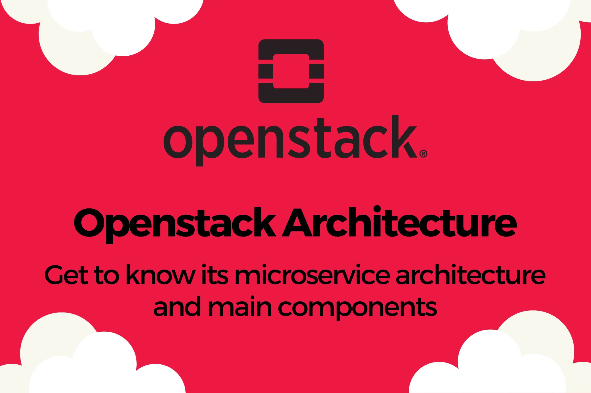

# Dans les coulisses de l'architecture microservices d'OpenStack

**Catégories :** Open Source · OpenStack  
**Publié le :** 27 mai 2024

**Rédigé par :** Thzuska Pico  
**Relu par :** Dmitry Galkin

OpenStack est devenu l'une des plateformes cloud open source les plus puissantes et les plus flexibles disponibles aujourd'hui. OpenStack offre un cadre modulaire et évolutif pour bâtir des clouds privés, publics et hybrides, avec beaucoup d'innovation et de flexibilité. Son architecture modulaire, fondée sur les microservices, est l'une des principales raisons de son évolutivité, de sa flexibilité et de son adoption massive par les entreprises et les fournisseurs de services.

Dans cet article, nous portons un regard neuf sur les composants essentiels de l'architecture microservices d'OpenStack, sur la manière dont ils interagissent et sur les raisons pour lesquelles cette conception est indispensable aux environnements cloud modernes.

Si vous débutez avec OpenStack, vous voudrez peut-être commencer par notre guide d'introduction de la série OpenStack.

## Qu'est-ce qu'une architecture microservices ?

Imaginez que vous essayiez de gérer une ville entière depuis une seule salle de contrôle. Chaque décision — les feux de circulation, l'électricité, l'approvisionnement en eau — dépendrait d'un système massif et centralisé. Si quelque chose se passe mal, tout s'effondre avec lui. C'est essentiellement ainsi que fonctionnent les architectures **monolithiques** traditionnelles.

L'architecture microservices adopte une approche très différente. Au lieu de construire un grand système étroitement connecté, elle décompose le tout en services plus petits et indépendants. Chacun de ces services a une responsabilité claire et communique avec les autres via des API. Voyez cela plutôt comme une ville bien organisée où chaque service — transport, services publics, urgences — fonctionne de manière indépendante mais collabore lorsque c'est nécessaire.

Cette indépendance est ce qui rend les microservices si puissants. Chaque service peut être développé, mis à jour, déployé et mis à l'échelle selon son propre calendrier, sans perturber le reste du système. Les équipes peuvent travailler en parallèle, les améliorations peuvent être déployées plus rapidement et les incidents peuvent être mieux contenus.

Dans le contexte d'OpenStack, cela signifie qu'au lieu d'un seul moteur cloud géant, OpenStack fonctionne comme une collection de services spécialisés. Chaque fonctionnalité essentielle — calcul, réseau, stockage, identité, etc. — est prise en charge par son propre service dédié. Chaque service se concentre sur une tâche qu'il accomplit bien, tandis que les API relient le tout pour former une plateforme cloud cohérente.

## Pourquoi l'architecture microservices est-elle importante ?

Une architecture microservices a un impact direct sur le comportement de votre infrastructure dans des conditions réelles. Lorsque la demande augmente, vous n'avez pas besoin de mettre à l'échelle toute la plateforme : vous pouvez ne mettre à l'échelle que les services sous pression, par exemple le calcul ou le réseau. Lorsque vous voulez introduire une nouvelle fonctionnalité ou mettre à niveau un composant, vous pouvez le faire sans risquer une interruption de service sur l'ensemble du système. Et si quelque chose échoue, l'impact est généralement limité à un seul service plutôt que de se propager à tout votre environnement.

Un autre avantage majeur est l'extensibilité. Comme les services communiquent via des API bien définies, il devient beaucoup plus facile d'intégrer des outils tiers, des frameworks d'automatisation ou des solutions sur mesure. C'est particulièrement précieux dans les environnements cloud modernes, où flexibilité et interopérabilité sont essentielles.

En bref, les microservices améliorent :

- **L'évolutivité** : les services peuvent être mis à l'échelle indépendamment selon la demande
- **La flexibilité** : les composants peuvent être remplacés ou mis à niveau sans affecter l'ensemble du système
- **La résilience** : les défaillances sont isolées au niveau des services individuels
- **L'extensibilité** : intégration plus facile avec des outils tiers et des solutions sur mesure

## Services OpenStack essentiels (composants principaux)

### Nova (Calcul)

**Nova** est le moteur de calcul d'OpenStack, chargé de provisionner et de gérer les machines virtuelles (VM). Il gère la capacité de calcul en créant, planifiant, migrant et supprimant des ressources. Il permet l'automatisation des ressources responsables de la virtualisation des services et du calcul haute performance. Nova prend en charge plusieurs hyperviseurs (KVM, Xen, ESXi, Hyper-V), la plupart des clouds s'appuyant sur KVM.

Grâce à Nova, les utilisateurs peuvent lancer, arrêter et redimensionner des instances de calcul à la demande, tandis que les administrateurs disposent d'un contrôle fin sur les ressources de calcul, garantissant des performances optimales et une utilisation efficace des ressources grâce à la planification dynamique des VM et aux capacités de migration à chaud (live-migration).

**Les responsabilités de Nova en bref :**

- Interaction avec l'hyperviseur
- Planification des instances et gestion du cycle de vie des VM
- Mise à l'échelle des charges de calcul
- Migration des VM entre hyperviseurs

### Neutron (Réseau)

**Neutron** est le composant réseau d'OpenStack, qui permet la création et la gestion de réseaux virtuels, de routeurs et de groupes de sécurité. C'est un service piloté par API qui gère tout ce qui touche aux réseaux définis par logiciel, aux ports et aux adresses IP flottantes, permettant une forte isolation entre les tenants et les projets au sein du cloud OpenStack. Il met en œuvre le Virtual Routing and Forwarding (VRF) et le routage distribué, et prend en charge le routage statique et dynamique, la passerelle L2 (L2 Gateway) et des tables de routage séparées.

En faisant abstraction des ressources réseau et en fournissant des API de configuration réseau, Neutron permet aux utilisateurs de bâtir des topologies réseau complexes et d'établir une connectivité sécurisée entre les instances cloud et les réseaux externes.

**Les fonctionnalités clés de Neutron en bref :**

- Réseau défini par logiciel (SDN)
- Isolation des réseaux par tenant
- Services de pare-feu
- Services VPN site à site
- IPAM, et plus encore

### Cinder (Stockage bloc)

Cinder offre des services de stockage bloc pour OpenStack, en fournissant des volumes de stockage persistants pour les VM et les conteneurs. Ce stockage est rendu accessible via une API en libre-service, et l'attachement/détachement de volumes fonctionne en « hot-plug », ce qui signifie que vous n'avez pas besoin d'arrêter une VM en cours d'exécution pour effectuer n'importe quelle opération, y compris les snapshots.

Avec Cinder, les utilisateurs peuvent créer, attacher, détacher, prendre des snapshots et sauvegarder des volumes de stockage bloc indépendamment des instances de calcul, offrant des solutions de stockage évolutives et fiables pour des charges de travail variées. Les utilisateurs peuvent définir et gérer la quantité de stockage cloud nécessaire à leurs VM.

Cinder prend en charge plus de 30 backends de stockage, notamment Ceph, Dell Power Storage, Huawei, IBM Spectrum, LinBIT, NetApp ONTAP, Pure Storage, StorPool, etc., ce qui signifie que vous pouvez facilement intégrer n'importe quel stockage existant dans votre cloud OpenStack sans avoir à investir dans du nouveau matériel ou une solution de stockage définie par logiciel.

**Les fonctionnalités clés de Cinder en bref :**

- Gestion des volumes
- Capacités de snapshot et de sauvegarde
- Intégration avec divers backends de stockage via des pilotes (drivers)

### Keystone (Identité)

**Keystone** est le service d'identité d'OpenStack, fournissant des services d'authentification, d'autorisation et de fédération pour les utilisateurs, les services et les ressources. Il est responsable de tous les types d'authentification et d'autorisation dans OpenStack et prend en charge LDAP, l'authentification à deux facteurs (2FA), l'intégration Keycloak, les jetons JWS/JWT et Fernet.

En centralisant la gestion des identités, Keystone permet un contrôle d'accès sécurisé et l'authentification unique (single sign-on) sur tous les services OpenStack, garantissant une sécurité et une conformité robustes de votre cloud. Un moteur de politiques flexible est un élément essentiel de chaque service OpenStack, permettant un haut degré de personnalisation et la mise en œuvre de politiques RBAC (contrôle d'accès basé sur les rôles) adaptées à la structure de votre organisation ou à vos exigences de sécurité et d'audit.

**Les fonctionnalités clés de Keystone en bref :**

- Authentification basée sur des jetons pour toutes les interactions API
- Gestion des utilisateurs, des rôles et des groupes
- Gestion de la hiérarchie multi-tenant (domaines, projets, sous-domaines)
- Catalogue de services (liste des services OpenStack disponibles dans le cloud)
- Fédération avec d'autres fournisseurs d'identité (par exemple Entra ID, LDAP, Keycloak, etc.)

### Glance (Service d'images)

Glance est le service d'images d'OpenStack, qui facilite la découverte, l'enregistrement et la récupération d'images de machines virtuelles via le réseau. Ces images sont conservées dans une large gamme de systèmes de stockage back-end pris en charge, les solutions de stockage objet telles que Swift, S3 ou Ceph RBD étant les plus populaires.

En maintenant un catalogue d'images préconfigurées, Glance rationalise le processus de déploiement et permet de lancer facilement des instances à partir d'images standardisées. Il permet aux utilisateurs et aux administrateurs d'importer et d'exporter des images dans différents formats (Raw, VHD, VMDK, QCOW2, AMI), en prenant en charge toutes sortes d'hyperviseurs, y compris le choix le plus populaire : KVM.

Enfin, et non des moindres, Glance prend en charge la signature d'images et effectue la validation des signatures afin de garantir la sécurité de votre cloud et de prévenir d'éventuelles attaques de la chaîne d'approvisionnement (supply chain).

**Les fonctionnalités clés de Glance en bref :**

- Découverte et récupération d'images
- Intégration du stockage d'images
- Prise en charge du versionnement
- Métadonnées d'images qui aident Nova à appliquer des paramètres spéciaux (par exemple pour les VM Windows)

### Horizon (Tableau de bord)

**Horizon** fournit une interface de tableau de bord web pour OpenStack, offrant aux administrateurs et aux utilisateurs un endroit unifié pour gérer et surveiller toutes les ressources du cloud. Avec Horizon, les utilisateurs peuvent visualiser et contrôler leurs projets OpenStack en créant et en gérant des VM, des volumes, des réseaux, etc.

Horizon est basé sur le populaire framework web Django et permet une personnalisation telle que le changement de thème et l'utilisation de vos propres couleurs et logos pour personnaliser l'expérience cloud de votre organisation.

**Les fonctionnalités clés d'Horizon en bref :**

- Tableau de bord convivial
- Contrôles administratifs dans une vue séparée
- Provisionnement en libre-service de toutes les ressources (VM, stockage bloc, réseaux, routeurs, etc.)

### Barbican (Gestion des clés)

**Barbican** est le service de gestion des clés d'OpenStack, conçu pour gérer et stocker des secrets de sécurité tels que des clés de chiffrement, des certificats et des mots de passe. En fournissant un référentiel centralisé et sécurisé pour la gestion des informations sensibles, Barbican renforce la posture de sécurité des déploiements OpenStack, garantissant que les clés cryptographiques et autres secrets sont traités avec les plus hauts niveaux de sécurité.

**Les fonctionnalités clés de Barbican en bref :**

- Stockage sécurisé des secrets (clés, certificats, identifiants)
- Prise en charge des modules de sécurité matériels (HSM)
- Nova s'intègre à Barbican pour le chiffrement des disques
- Octavia (LBaaS) peut récupérer des certificats SSL depuis Barbican pour ses répartiteurs de charge

### Heat (Orchestration)

**Heat** est le service d'orchestration d'OpenStack, permettant aux utilisateurs de définir et de gérer l'infrastructure en tant que code (IaC) au moyen de modèles (templates). En automatisant le déploiement et la mise à l'échelle des ressources cloud, Heat rationalise le processus de provisionnement d'applications et de services complexes sur OpenStack, améliorant agilité et efficacité. L'utilisation de l'IaC est considérée comme une meilleure pratique du secteur : elle favorise la collaboration des équipes, accélère les déploiements et réduit les erreurs humaines.

OpenStack Heat prend bien en charge les modèles CloudFormation, bien connus des utilisateurs d'AWS, ce qui facilite la migration d'AWS vers OpenStack.

**Les fonctionnalités clés de Heat en bref :**

- Infrastructure en tant que code (IaC) à l'aide de modèles
- Provisionnement automatisé d'environnements complexes
- Gestion des dépendances entre les ressources (par exemple VM et répartiteurs de charge)

### Swift (Stockage objet)

**Swift** est un service de stockage objet qui fournit une solution de stockage objet durable et évolutive horizontalement. Il possède de grandes capacités de tolérance aux pannes pour stocker et récupérer de grands volumes de données non structurées grâce à une API RESTful similaire à l'API Simple Storage Service (AWS S3), qui est aujourd'hui le standard de facto du secteur.

Swift permet aux utilisateurs de stocker des données sous forme d'objets dans des conteneurs, facilitant un accès transparent et une réplication sur des clusters de stockage distribués. Étant un stockage distribué, il est également utilisé pour fournir un stockage redondant au sein de serveurs regroupés en cluster. Il est parfaitement capable de gérer des pétaoctets de données.

Bien que Swift soit l'un des premiers composants d'OpenStack et qu'il soit prêt pour la production, de nombreuses entreprises préfèrent utiliser l'API S3 native pour le stockage objet fournie par Ceph — une solution de stockage définie par logiciel open source souvent utilisée avec OpenStack. Il est également possible d'activer un middleware de compatibilité AWS S3 pour Swift, mais celui-ci tend à être plus lent que l'API Swift native.

**Les fonctionnalités clés de Swift en bref :**

- Stockage hautement évolutif
- Redondance et durabilité des données
- Accès via API RESTful

## Comment ces services fonctionnent ensemble

Chaque service OpenStack communique via des API HTTP REST, et la plupart des services utilisent des files d'attente AMQP basées sur RabbitMQ pour la communication au sein d'un même service. Une base de données MySQL ou compatible est nécessaire pour conserver les informations persistantes sur l'état du cloud, telles que les noms de projets, les utilisateurs, les rôles, les noms de machines virtuelles, les plages d'adresses IP réseau, etc. Ce couplage lâche est ce qui permet à OpenStack de fonctionner comme une plateforme basée sur les microservices. Schématiquement, cette architecture est représentée sur le diagramme ci-dessous :

*Architecture microservices d'OpenStack*

Examinons un scénario typique de provisionnement de VM. Un utilisateur ou un administrateur se connecte au tableau de bord web tel qu'OpenStack Horizon ou Skyline. L'utilisateur doit être authentifié via une méthode prise en charge, qui est par défaut le couple nom d'utilisateur / mot de passe, mais qui pourrait aussi être un SSO via OIDC ou LDAP par exemple. (Alternativement, une CLI OpenStack ou des outils IaC tels qu'OpenTofu ou Ansible peuvent être utilisés pour interagir avec OpenStack.)

Chaque requête API dans OpenStack doit être vérifiée par le service d'identité Keystone. Cela se produit non seulement lors de la connexion à l'interface web, mais aussi lorsqu'un utilisateur demande une nouvelle VM ou liste les VM existantes du projet. En coulisses, lorsqu'une nouvelle VM est demandée, voici ce qui se passe :

- Keystone authentifie la requête
- Nova planifie l'instance en fonction de la zone de disponibilité (AZ) et du gabarit (flavor) demandés, puis trouve un hyperviseur optimal dans le cloud selon l'état actuel
- Neutron provisionne un port virtuel et effectue son rattachement (port binding) au réseau demandé
- Glance fournit l'image de base pour le système d'exploitation
- Cinder provisionne et monte le stockage bloc pour la VM
- La VM devient active dans OpenStack Nova et dans le tableau de bord

Cette orchestration se fait de manière transparente et prend en moyenne 30 à 60 secondes. Si le processus échoue à une certaine étape, OpenStack Nova réessaiera 3 fois (par défaut) pour éventuellement provisionner une VM sur un autre hyperviseur. Si ces tentatives échouent, la VM passera dans un état d'erreur avec un message d'erreur pour faciliter le dépannage.

## Cas d'usage d'OpenStack : où cette architecture excelle

Bien que l'architecture elle-même soit puissante, sa véritable valeur apparaît clairement dans les déploiements concrets. OpenStack est utilisé dans un large éventail de secteurs et de scénarios, notamment :

- Environnements de cloud privé
- Environnements de cloud public
- Télécoms et NFV
- Informatique en périphérie (edge computing)
- Infrastructures IA/ML/HPC
- Alternative à VMware

Pour explorer ces sujets plus en détail, consultez notre article dédié sur les cas d'usage d'OpenStack et l'infrastructure de centre de données.

## Comment Cloudification exploite OpenStack

Chez Cloudification, nous bâtissons des environnements cloud privés modernes en utilisant OpenStack comme technologie centrale. Notre plateforme c12n combine OpenStack avec d'autres outils open source comme Kubernetes et Ceph pour offrir une solution cloud entièrement automatisée et prête pour la production.

L'architecture microservices d'OpenStack nous permet de :

- Personnaliser les déploiements pour répondre aux besoins spécifiques des clients
- Nous intégrer de manière transparente aux charges de travail basées sur Kubernetes
- Optimiser les performances et l'efficacité des coûts
- Éviter l'enfermement propriétaire (vendor lock-in)

Cette approche permet aux organisations de quitter les plateformes propriétaires tout en conservant le contrôle total de leur infrastructure.

## Conclusion

L'architecture microservices d'OpenStack est un facteur clé de son succès en tant que plateforme cloud. En décomposant des fonctionnalités cloud complexes en services indépendants et interopérables, elle offre une flexibilité, une évolutivité et une résilience inégalées.

Que vous construisiez un cloud privé, que vous modernisiez votre infrastructure ou que vous exploriez des alternatives aux plateformes de virtualisation traditionnelles, OpenStack offre une base puissante.

👉 Vous voulez voir comment OpenStack peut fonctionner pour votre organisation ?

Découvrez la solution de cloud privé c12n de Cloudification et voyez comment nous pouvons vous aider à concevoir, déployer et exploiter un environnement cloud entièrement ouvert et pérenne.

**📨 Contactez-nous 📚 Parcourir d'autres sujets dans notre blog Cloud**

---

*Traduction française de l'article « Behind the Scenes of OpenStack Microservice Architecture » — Cloudification, 27 mai 2024. Images reproduites localement dans le dossier `images/`.*
