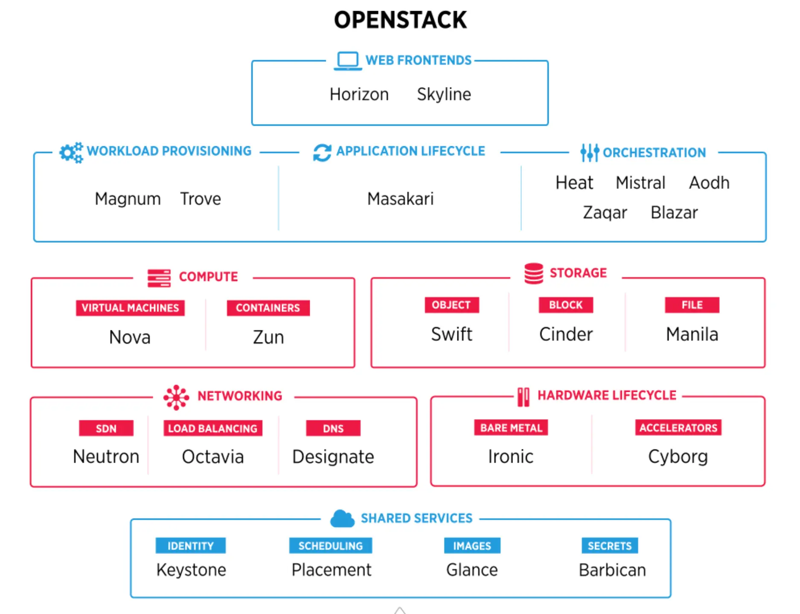
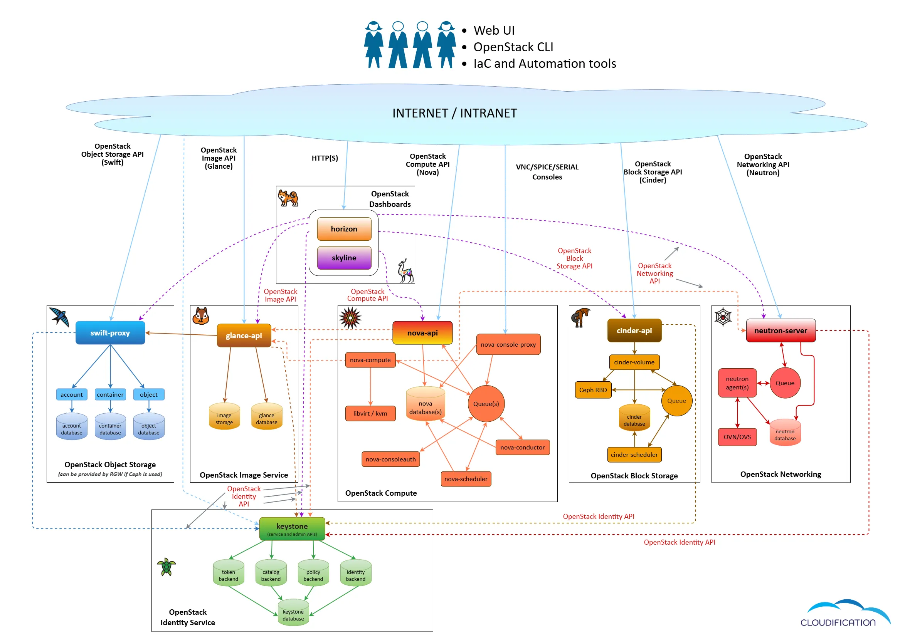

# Architecture microservices d'OpenStack

## Principe de l'architecture microservices

Une architecture monolithique regroupe les fonctions dans un seul déploiement. Une architecture microservices découpe le système en services indépendants, chacun avec une responsabilité délimitée et une API. Dans OpenStack, cela se traduit par un service par domaine (Nova, Neutron, Cinder, etc.), avec sa propre base de données et, le plus souvent, sa propre file de messages.

Chaque service peut être déployé, mis à jour et mis à l'échelle indépendamment. En contrepartie, l'architecture introduit des dépendances réseau, de la latence entre appels API, une complexité de déploiement et la nécessité d'une observabilité distribuée.

## Propriétés et compromis

- **Évolutivité** : mise à l'échelle horizontale par service, selon la charge réelle.
- **Déploiement indépendant** : un service peut être mis à jour sans redéployer la plateforme.
- **Isolation des pannes** : une défaillance reste circonscrite au service concerné.
- **Extensibilité** : intégration via API, sans couplage au code des autres services.
- **Compromis** : complexité opérationnelle, cohérence distribuée, versionnement d'API et besoin de traçage entre services.

## Services OpenStack essentiels (composants principaux)

### Nova (Calcul)

**Nova** est le service de calcul. Il gère le cycle de vie des instances : création, planification, redimensionnement, migration et suppression. Nova ne virtualise pas lui-même : il délègue l'exécution à un hyperviseur via des pilotes (KVM, Xen, ESXi, Hyper-V). Le placement des instances s'appuie sur le service Placement et sur le scheduler.

Composants principaux : `nova-api` (API REST), `nova-scheduler` (sélection d'hôte), `nova-conductor` (accès à la base de données), `nova-compute` (pilote d'hyperviseur). Nova gère les zones de disponibilité, les gabarits (flavors), la migration à chaud et l'évacuation.

**Responsabilités :**

- Interaction avec l'hyperviseur
- Planification des instances et cycle de vie des VM
- Mise à l'échelle des charges de calcul
- Migration des VM entre hyperviseurs

### Neutron (Réseau)

**Neutron** fournit le réseau en tant que service. Il gère les réseaux, sous-réseaux, routeurs, ports, groupes de sécurité et adresses IP flottantes. Le réseau défini par logiciel est implémenté par des plugins (ML2) et des agents déployés sur les nœuds.

Neutron assure l'isolation par tenant (VLAN, VXLAN, GRE), le routage distribué (DVR), le VRF, le routage statique et dynamique (BGP), la passerelle L2, l'IPAM, le pare-feu et les VPN. Les intégrations externes passent par des drivers.

**Fonctionnalités :**

- Réseau défini par logiciel (SDN)
- Isolation des réseaux par tenant
- Services de pare-feu
- Services VPN site à site
- IPAM

### Cinder (Stockage bloc)

**Cinder** fournit du stockage bloc persistant sous forme de volumes, snapshots et sauvegardes. Les volumes s'attachent et se détachent à chaud via le driver de l'hyperviseur (iSCSI, Fibre Channel, RBD, etc.).

Composants principaux : `cinder-api`, `cinder-scheduler`, `cinder-volume`, `cinder-backup`. Les backends sont abstraits par des drivers (Ceph, NetApp, Pure Storage, StorPool, etc.). Les types de volumes permettent de sélectionner un backend et des capacités (QoS, réplication).

**Fonctionnalités :**

- Gestion des volumes
- Snapshots et sauvegardes
- Intégration de backends via des pilotes (drivers)

### Keystone (Identité)

**Keystone** assure l'identité et le contrôle d'accès. Il gère l'authentification (mot de passe, LDAP, fédération OIDC/SAML, 2FA), les jetons (Fernet, JWT), les domaines, projets, utilisateurs, groupes et rôles. Il publie le catalogue de services utilisé par les clients pour résoudre les endpoints.

L'autorisation est appliquée par chaque service au moyen d'un moteur de politiques (RBAC, fichiers `policy.yaml`). Keystone délivre le jeton et les rôles ; les services vérifient ensuite les permissions sur leurs ressources.

**Fonctionnalités :**

- Authentification par jeton pour les appels API
- Gestion des utilisateurs, rôles et groupes
- Hiérarchie multi-tenant (domaines, projets)
- Catalogue de services
- Fédération avec des fournisseurs d'identité externes (Entra ID, LDAP, Keycloak)

### Glance (Service d'images)

**Glance** est le registre d'images. Il gère les métadonnées et le stockage des images de disques et de conteneurs. Les images sont conservées sur un backend (Swift, S3, Ceph RBD, système de fichiers) et exposées via une API REST.

Glance prend en charge les formats Raw, QCOW2, VHD, VMDK et AMI, avec conversion possible au téléchargement. Il fournit à Nova les métadonnées matérielles et d'hyperviseur, et gère la signature ainsi que la validation des images.

**Fonctionnalités :**

- Découverte et récupération d'images
- Intégration de backends de stockage
- Versionnement
- Métadonnées d'image utilisées par Nova (par exemple pour les VM Windows)

### Horizon (Tableau de bord)

**Horizon** est l'interface web d'administration et de self-service. C'est une application Django qui appelle les API des services et ne stocke pas d'état métier. Elle propose des vues utilisateur et administrateur, extensibles par des panneaux et des plugins. Skyline est une alternative plus récente.

**Fonctionnalités :**

- Interface web d'administration
- Vue administrateur distincte des projets
- Provisionnement en libre-service (VM, stockage bloc, réseaux, routeurs)

### Barbican (Gestion des clés)

**Barbican** gère les secrets : clés de chiffrement, certificats et identifiants. Il fournit un stockage centralisé avec contrôle d'accès, versionnement et prise en charge des modules de sécurité matériels (HSM). Nova l'utilise pour le chiffrement des disques ; Octavia l'utilise pour les certificats TLS des répartiteurs de charge.

**Fonctionnalités :**

- Stockage sécurisé des secrets (clés, certificats, identifiants)
- Prise en charge des HSM
- Intégration avec Nova (chiffrement des disques)
- Intégration avec Octavia (certificats SSL)

### Heat (Orchestration)

**Heat** orchestre l'infrastructure en tant que code. Il interprète des templates HOT (et CloudFormation) décrivant des ressources OpenStack et leurs dépendances, puis pilote les API pour créer, mettre à jour ou supprimer des stacks. Il gère les dépendances, le rollback et l'autoscaling via des groupes de ressources.

**Fonctionnalités :**

- Infrastructure en tant que code (IaC) par templates
- Provisionnement automatisé d'environnements complexes
- Gestion des dépendances entre ressources (VM, répartiteurs de charge)

### Swift (Stockage objet)

**Swift** est le stockage objet distribué. Il expose une API REST, avec un middleware de compatibilité S3, et organise les données en comptes, conteneurs et objets. L'architecture repose sur des serveurs proxy et des serveurs account/container/object, avec des anneaux (rings) pour la distribution et la réplication.

Swift assure la durabilité par réplication ou erasure coding, la tolérance aux pannes et la scalabilité horizontale. Ceph (S3/RBD) est souvent utilisé comme alternative pour le stockage objet natif.

**Fonctionnalités :**

- Stockage hautement évolutif
- Redondance et durabilité des données
- Accès via API RESTful

## Autres services représentés sur le schéma

### Interfaces web et orchestration

- **Skyline** : interface web alternative à Horizon, avec un frontend moderne et une API REST dédiée (`skyline-apiserver`), alors qu'Horizon est une application Django qui appelle directement les API des services.
- **Mistral** : workflows (Workflow-as-a-Service) pour des tâches asynchrones et des processus métier.
- **Aodh** : alertes basées sur les métriques de télémétrie ; déclenche des actions (auto-scaling, orchestration).
- **Blazar** : réservation de ressources (calcul, stockage) sur un créneau donné.
- **Zaqar** : messagerie multi-tenant (files et notifications) via API REST.

### Cycle de vie applicatif

- **Trove** : Database-as-a-Service ; provisionne et gère des instances de bases de données.
- **Magnum** : Container-as-a-Service ; déploie des clusters Kubernetes, Swarm ou Mesos sur OpenStack.
- **Masakari** : haute disponibilité ; détecte les pannes d'hôtes et récupère les instances par évacuation.

### Stockage et conteneurs

- **Manila** : stockage de fichiers partagés (NFS, CIFS) avec plusieurs backends.
- **Zun** : gestion de conteneurs sans orchestrateur externe, intégrée à Nova, Neutron et Cinder.

### Réseau

- **Octavia** : Load-Balancing-as-a-Service (LBaaS) basé sur des Amphora, piloté par API REST.
- **Designate** : DNS-as-a-Service ; gère les zones et enregistrements DNS, intégré à Neutron.

### Cycle de vie matériel

- **Ironic** : Bare Metal-as-a-Service ; provisionne des serveurs physiques via PXE, IPMI ou Redfish.
- **Cyborg** : gestion et allocation des accélérateurs matériels (GPU, FPGA, ASIC) aux instances.

### Services partagés

- **Placement** : suivi des inventaires et des allocations de ressources (vCPU, RAM, disque), utilisé par Nova pour l'ordonnancement.

## Interaction des services

Les services communiquent par API HTTP REST. Au sein d'un service, les composants échangent via une file AMQP (RabbitMQ). Chaque service possède sa propre base de données (MySQL/MariaDB ou autre) et ne partage pas son schéma. Ce couplage faible permet des déploiements et des montées en version indépendants.

*Architecture microservices d'OpenStack*

## Scénario : création d'une instance

1. L'utilisateur s'authentifie auprès de Keystone (interface web, CLI ou outil IaC) et obtient un jeton.
2. Chaque appel API est validé par Keystone : jeton, rôles et politiques.
3. Nova reçoit la requête, vérifie les quotas, interroge Placement pour les ressources disponibles, puis sélectionne un hôte via le scheduler.
4. Neutron crée un port et effectue son rattachement (port binding) au réseau demandé.
5. Glance fournit l'image de base.
6. Cinder crée et attache le volume si un stockage bloc est demandé.
7. `nova-compute` démarre l'instance sur l'hyperviseur ; son état passe à `ACTIVE`.

Le provisionnement prend généralement 30 à 60 secondes. En cas d'échec, Nova réessaie (3 fois par défaut) sur un autre hôte ; si les tentatives échouent, l'instance passe en état `ERROR` avec un message exploitable pour le diagnostic.

## Cas d'usage

- **Cloud privé** : IaaS interne, self-service et isolation par projet.
- **Cloud public** : mutualisation de ressources et facturation par usage.
- **Télécoms et NFV** : fonctions réseau virtualisées et orchestration.
- **Edge computing** : déploiements de petite taille en périphérie.
- **IA/ML/HPC** : accès aux GPU et accélérateurs via Cyborg.
- **Alternative à VMware** : migration d'infrastructures virtualisées.
